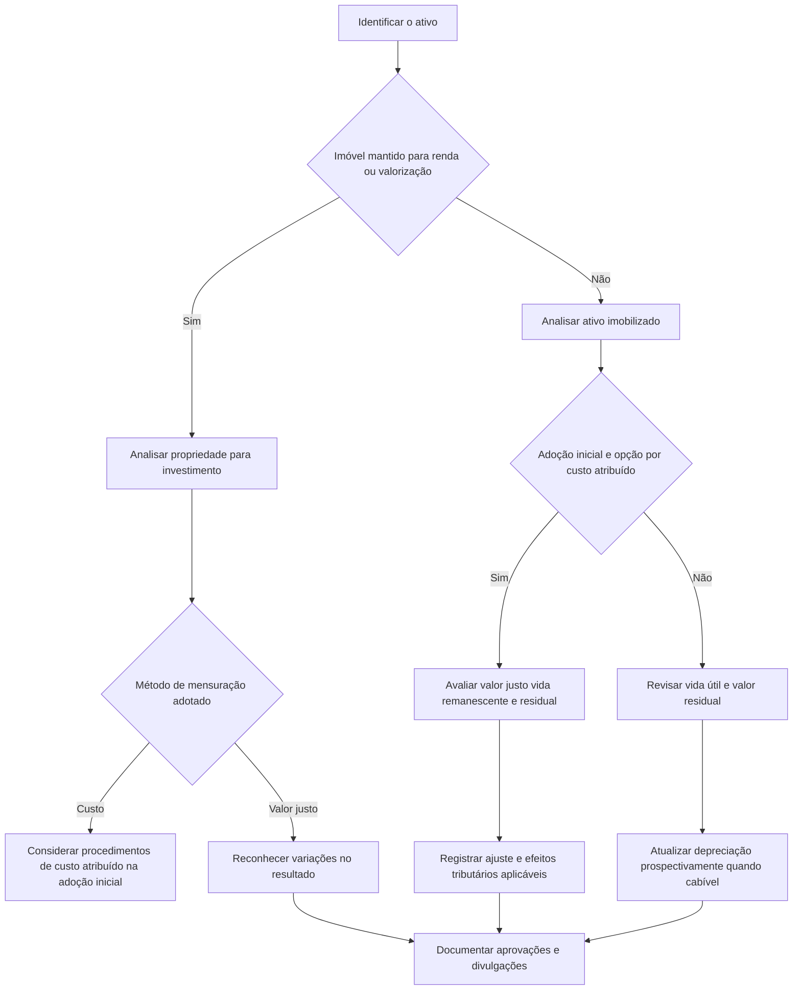

# ITG 10 — Interpretação sobre a Aplicação Inicial ao Ativo Imobilizado e à Propriedade para Investimento

> [!abstract] Resumo em 30 segundos
> A ITG 10 orienta a aplicação inicial das normas sobre ativo imobilizado e propriedade para investimento, com destaque para a revisão de vida útil e valor residual e para a opção de usar o **custo atribuído** na adoção inicial. Essa opção pode ajustar o valor de ativos selecionados, com contrapartida no patrimônio líquido e reconhecimento dos efeitos tributários aplicáveis. A interpretação também esclarece como distinguir imóveis mantidos para renda de ativos usados na atividade e define divulgações relacionadas às avaliações e aos ajustes.

## Ficha rápida

| Campo | Síntese |
|---|---|
| Norma | ITG 10 — Interpretação sobre a Aplicação Inicial ao Ativo Imobilizado e à Propriedade para Investimento |
| Tema central | Aplicação inicial da NBC TG 27 e da NBC TG 28 no contexto de adoção das normas convergidas |
| Assuntos principais | Custo atribuído, vida útil, valor residual, tributos diferidos, divulgação e classificação de propriedades |
| Referências técnicas citadas | NBC TG 27, NBC TG 28, NBC TG 37, NBC TG 43 e NBC TG 23 |
| Resolução identificável no PDF | Resolução CFC nº 1.263/09, que aprovou a interpretação |

> [!info] Contexto de adoção
> O texto técnico trata da aplicação inicial das normas no processo de convergência e descreve procedimentos ligados à transição daquele período. A resolução reproduzida no PDF informa entrada em vigor para exercícios iniciados a partir de 1º de janeiro de 2010. Essa referência é histórica e não substitui a consulta à regulamentação aplicável ao período analisado.

## Objetivo e alcance

A interpretação trata de questões da implementação inicial da NBC TG 27 — Ativo Imobilizado e da NBC TG 28 — Propriedade para Investimento, em conjunto com a adoção inicial prevista na NBC TG 37 e na NBC TG 43 (itens 1 e 2).

No imobilizado, o texto aborda a inadequação potencial de simplesmente manter taxas de depreciação historicamente usadas para fins fiscais, sem revisar a vida útil e sem estimar o valor residual. Na propriedade para investimento, esclarece a distinção entre imóveis mantidos para obter renda ou valorização e imóveis usados na produção, no fornecimento de serviços ou em atividades administrativas.

A ITG 10 não transforma o custo atribuído em uma política contínua de reavaliação. A opção descrita é restrita à adoção inicial.

## Conceitos-chave

- **Valor depreciável:** parcela do valor do ativo que deve ser apropriada sistematicamente durante sua vida útil. A determinação requer estimativa de valor residual e vida útil.
- **Vida útil:** período em que se espera que o ativo gere benefícios econômicos para a entidade que o controla. É diferente da vida econômica total do ativo, que considera os benefícios ao longo de toda a sua utilização, inclusive por outros usuários (item 19).
- **Custo atribuído — deemed cost:** valor justo que pode ser adotado, na transição, como novo valor do ativo selecionado. A opção não pode ser revista em períodos subsequentes e não representa adoção da prática de reavaliação (itens 21 a 27).
- **Propriedade para investimento:** terreno, edifício ou parte de edifício mantido para obter rendas, valorização do capital ou ambas, e não para uso operacional nem para venda no curso ordinário dos negócios (item 45).
- **Imobilizado alugado:** pode continuar classificado como imobilizado se o aluguel for acessório à atividade e o bem complementar outros ativos ou a operação da entidade (itens 44 e 46).
- **Mudança de estimativa:** a revisão da vida útil e do padrão de consumo dos benefícios costuma ser mudança de estimativa, contabilizada prospectivamente. A falta de práticas necessárias ou determinados registros inadequados podem, conforme o caso, indicar mudança de política ou erro (itens 13 a 17 e 30).

## Diagrama de decisão

## Aplicação passo a passo — checklist

1. **Identifique a natureza e o uso do bem.** Para imóveis, determine se o objetivo é gerar renda ou valorização como investimento, ou se o imóvel integra a operação da entidade. Considere a finalidade efetiva e os benefícios gerados.
2. **Revise a base da depreciação.** Não presuma que taxas fiscais sejam automaticamente adequadas para a contabilidade. Examine vida útil econômica, padrão de consumo dos benefícios e valor residual.
3. **Avalie a opção de custo atribuído na adoção inicial.** Identifique ativos ou conjuntos de ativos relevantes, em operação e com valor contábil significativamente diferente do valor justo. A opção é somente para a adoção inicial (itens 21 e 22).
4. **Obtenha suporte para a avaliação.** O trabalho deve considerar as condições de uso, manutenção, tecnologia, ambiente econômico, vida útil remanescente e, quando aplicável, valor residual. O avaliador pode ser interno ou externo, desde que tenha experiência, competência, objetividade e conhecimento técnico (itens 33 e 34).
5. **Documente e aprove.** Mantenha relatório fundamentado e aprovação do órgão competente. A aprovação deve observar também exigências estatutárias ou contratuais, se existentes (itens 29 e 35 a 37).
6. **Registre os efeitos.** Avalie o ajuste no ativo, a contrapartida em Ajustes de Avaliação Patrimonial e os tributos diferidos aplicáveis. Considere os efeitos na apresentação comparativa, conforme a orientação de transição descrita no texto.
7. **Mantenha revisões periódicas.** Documente, no mínimo a cada exercício, se as expectativas de vida útil e valor residual mudaram e se a estimativa continua adequada (itens 31 e 32).
8. **Prepare as divulgações.** Explique as premissas, bases de avaliação, efeitos no resultado e, se adotado custo atribuído, seus efeitos no balanço e no patrimônio líquido.

> [!tip] Fórmula de apoio
> **Valor depreciável = valor contábil ou custo atribuído − valor residual estimado.**
>
> A depreciação deve ser alocada sistematicamente ao longo da vida útil estimada. Se o valor residual esperado for superior ao valor contábil, o texto indica que não se reconhece depreciação (item 18).

## Reconhecimento e mensuração

### Ativo imobilizado e custo atribuído

A administração pode optar, na adoção inicial, por atribuir valor justo como custo atribuído a bens ou conjuntos de bens relevantes ainda em operação, especialmente quando o valor contábil estiver substancialmente abaixo ou acima do valor justo. O texto incentiva fortemente essa adoção nos casos descritos, mas não torna a opção obrigatória (itens 21 e 22).

A avaliação deve informar vida útil remanescente e valor residual para que se estabeleçam o valor depreciável e a nova taxa de depreciação (item 23). O ajuste inicial, positivo ou negativo, tem contrapartida em **Ajustes de Avaliação Patrimonial**, em subconta específica; os tributos diferidos devem ser considerados conforme o regime tributário da entidade (itens 16 e 25).

À medida que o ativo for depreciado, amortizado ou baixado contra o resultado, os valores correspondentes devem ser transferidos de Ajustes de Avaliação Patrimonial para Lucros ou Prejuízos Acumulados. Quando aplicável, os valores de tributos diferidos também são transferidos para a conta de tributos correntes (item 26). Eventual perda por recuperabilidade posterior é reconhecida no resultado, conforme a NBC TG 01; a ITG 10 veda usar, para essa perda, a baixa contra o patrimônio líquido mencionada para certas reduções de ativos reavaliados (item 27).

O custo atribuído substitui o valor contábil como novo valor do bem, sem alterar a base contábil de custo histórico. Uma reavaliação anterior, quando legalmente permitida e ainda representativa do valor justo, pode ser admitida como custo atribuído (item 22).

### Vida útil e valor residual

A primeira revisão para quem adotar custo atribuído coincide com a data de transição. Nos demais casos, a primeira análise periódica é tratada como mudança de estimativa, com efeitos prospectivos: valores de depreciação anteriores à revisão não são recalculados (item 30).

O valor residual é relevante porque representa a parcela que se espera recuperar pela alienação ao fim da vida útil. Sua estimativa deve considerar as características da indústria e a probabilidade de venda dos bens. A vida útil estimada para a entidade não deve ser confundida com a vida econômica total do ativo (itens 18 e 19).

### Tributos diferidos

A revisão da vida útil ou a atribuição de novo custo pode criar diferenças entre a base fiscal e o valor contábil. A entidade deve mensurar e contabilizar os efeitos de imposto de renda e contribuição social diferidos relativos às diferenças temporárias, considerando como espera recuperar ou liquidar os valores (item 38).

A orientação também alcança ativos não depreciáveis, incluindo terrenos classificados no imobilizado ou como propriedade para investimento. Para esses ativos, o texto considera a recuperação por venda, independentemente da base de mensuração contábil (item 39). Para reavaliações passadas de ativos não depreciáveis sem registro dos tributos correspondentes, o item 40 descreve lançamento envolvendo conta retificadora da reserva de reavaliação e provisão no Passivo Não Circulante.

### Propriedade para investimento

A propriedade para investimento deve ser classificada em **Investimentos**, no Ativo Não Circulante (item 49). Reclassificações de ou para essa categoria dependem de mudança de uso formalmente definida pela administração; não devem ser casuísticas e devem aprimorar a capacidade preditiva das demonstrações (item 50).

Se a entidade adotar o método de custo previsto na NBC TG 28, os procedimentos de custo atribuído descritos para o imobilizado também se aplicam à propriedade para investimento (item 51). No método do valor justo, as variações entre períodos são reconhecidas no resultado, independentemente de o imóvel ser mantido para renda ou valorização (item 52). A rubrica de resultado depende da essência econômica: o texto distingue propriedades ligadas à operação de administração de imóveis e investimentos de natureza especulativa; o critério utilizado e os valores devem ser demonstrados (item 53).

## Divulgação

As notas explicativas devem apresentar informações sobre a avaliação da vida útil e do valor residual, incluindo (item 41):

- premissas e fundamentos utilizados;
- bases da avaliação e identificação dos avaliadores;
- datas e histórico da avaliação;
- contas avaliadas e respectivos valores;
- efeito no resultado decorrente das mudanças na depreciação; e
- taxas de depreciação anterior e atual.

Na adoção inicial, a entidade deve declarar se adotou ou não o custo atribuído, preferencialmente na nota de práticas contábeis. Se adotado, deve informar a base e a razão da escolha, além dos efeitos no balanço de abertura, discriminados por conta ou grupo, inclusive parcelas alocadas a tributos diferidos e ao patrimônio líquido (item 42).

Enquanto houver efeitos relevantes no balanço ou no resultado, deve divulgar a adoção ou não da opção e os efeitos remanescentes no patrimônio líquido (item 43). Também deve divulgar a política de dividendos prevista durante a realização da diferença gerada pelo novo valor; o relatório de suporte e essa política dependem de aprovação do órgão deliberativo competente (itens 28 e 29).

## Exceções e erros comuns

> [!warning] Não confunda custo atribuído com reavaliação
> A opção é limitada à adoção inicial e não pode ser revista em períodos posteriores. Ela substitui o valor contábil como novo valor do ativo, mas não institui uma política recorrente de reavaliação.

- **Usar automaticamente a taxa fiscal:** a taxa aceita para fins tributários pode não refletir a vida útil econômica, o padrão de uso ou o valor residual.
- **Ignorar o valor residual:** o valor depreciável não corresponde necessariamente ao valor integral registrado do bem.
- **Recalcular depreciações passadas após revisão:** nos casos tratados como mudança de estimativa, o efeito é prospectivo.
- **Classificar todo imóvel alugado como propriedade para investimento:** se o aluguel for acessório à atividade e o imóvel complementar a operação, pode ser imobilizado. Se o imóvel for o ativo principal gerador de renda independente, a classificação pode ser propriedade para investimento (itens 46 e 47).
- **Reclassificar um imóvel sem mudança de uso definida:** a reclassificação exige mudança formal de uso e não deve ser casuística (item 50).
- **Tratar incentivo fiscal de depreciação acelerada como estimativa:** o texto indica que contabilizar esse incentivo independentemente do uso do bem constitui erro. Também pode haver erro quando uma perda por recuperabilidade que já deveria ter sido reconhecida não foi registrada (item 17).
- **Omitir tributos diferidos:** diferenças temporárias associadas a ativos depreciáveis ou não depreciáveis exigem análise dos efeitos fiscais (itens 38 e 39).

## Conexões com outras normas

- **NBC TG 27:** base para vida útil, valor residual e depreciação do imobilizado.
- **NBC TG 28:** classificação e métodos de mensuração da propriedade para investimento.
- **NBC TG 37 e NBC TG 43:** contexto de adoção inicial e custo atribuído mencionado pela interpretação.
- **NBC TG 23:** tratamento de mudanças de estimativa, mudanças de política contábil e erros.
- **NBC TG 32:** contabilização de tributos diferidos relacionados à recuperação dos ativos.
- **NBC TG 01:** perdas por redução ao valor recuperável; a ITG 10 remete a essa norma para perdas posteriores.

## Fonte

**ITG 10 — Interpretação sobre a Aplicação Inicial ao Ativo Imobilizado e à Propriedade para Investimento**, conforme o PDF fornecido: **ITG 10.pdf**. Os números de itens citados correspondem ao texto técnico reproduzido no documento.
