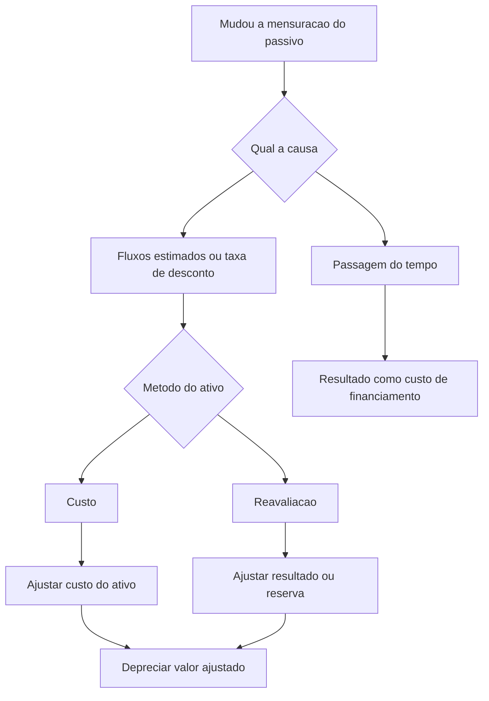

# ITG 12 — Mudanças em Passivos por Desativação, Restauração e Outros Passivos Similares

> [!abstract] Resumo em 30 segundos
> A ITG 12 explica como contabilizar mudanças na mensuração de passivos por desativação, restauração e obrigações similares. No modelo de custo, a mudança normalmente ajusta o custo do ativo relacionado; no modelo de reavaliação, afeta o resultado e/ou a reserva de reavaliação, conforme as regras da Interpretação. A reversão do desconto é reconhecida no resultado como custo de financiamento, sem capitalização.

## Ficha rápida

| Campo | Síntese |
|---|---|
| Norma | ITG 12 — Mudanças em Passivos por Desativação, Restauração e Outros Passivos Similares |
| Resolução de aprovação | Resolução CFC nº 1.265/09 |
| Tema central | Efeitos contábeis de mudanças na mensuração de obrigações de desativação e restauração |
| Aplicação | Passivos reconhecidos conforme a NBC TG 25 e associados ao custo de ativo imobilizado ou, conforme a alteração indicada no PDF, de ativo de direito de uso |
| Itens técnicos | Contexto e alcance: itens 1–2; questão: item 3; consenso: itens 4–8 |
| Vigência indicada na resolução | Exercícios iniciados a partir de 1º de janeiro de 2010 |

> [!info] Identificação do texto
> O PDF informa que a Resolução CFC nº 1.329/11 alterou a sigla de IT 12 para ITG 12 e atualizou referências a outras normas. O alcance também contém redação identificada como alterada pela Revisão NBC 01, incluindo ativos de direito de uso. Este resumo considera essa redação apresentada no PDF.

## Objetivo e alcance

A Interpretação orienta a contabilização dos efeitos de mudanças na mensuração de passivos por desativação, restauração e outros passivos similares. Entre os exemplos mencionados estão a desativação de uma fábrica, a reabilitação de danos ambientais em indústrias extrativas e a remoção de equipamentos (itens 1–2).

O alcance abrange mudanças em passivos que:

1. sejam reconhecidos como parte do custo de um item do imobilizado, ou, conforme a redação alterada indicada no PDF, como parte do custo de um ativo de direito de uso; e
2. sejam reconhecidos como passivo conforme a NBC TG 25 — Provisões, Passivos Contingentes e Ativos Contingentes.

A Interpretação trata de três causas de mudança (item 3):

- alteração nos fluxos de saída estimados necessários para liquidar a obrigação;
- alteração na taxa de desconto corrente baseada em mercado, incluindo mudanças no valor temporal do dinheiro e nos riscos específicos do passivo;
- aumento decorrente da passagem do tempo, também chamado de reversão do desconto.

## Conceitos-chave

| Conceito | Como entender |
|---|---|
| Passivo por desativação ou restauração | Obrigação de desmontar, retirar ou restaurar associada a um ativo. |
| Ajuste do ativo | No modelo de custo, a mudança no passivo pode aumentar ou reduzir o custo contábil do ativo relacionado. |
| Reversão do desconto | Aumento periódico do passivo decorrente da passagem do tempo. É reconhecido no resultado como custo de financiamento. |
| Reserva de reavaliação | No modelo de reavaliação, determinadas mudanças no passivo ajustam a reserva, observados os limites e tratamentos previstos no item 6. |

A estimativa inicial dos custos de desmontagem, retirada e restauração pode integrar o custo do imobilizado, conforme o contexto descrito com referência à NBC TG 27. A NBC TG 25 contém requisitos de mensuração do passivo; a ITG 12 orienta a contabilização das mudanças posteriores.

## Diagrama do tratamento

## Aplicação passo a passo / checklist

1. **Confirme que a obrigação está no alcance.** Verifique se o passivo está reconhecido conforme a NBC TG 25 e relacionado ao custo de imobilizado ou, na redação alterada reproduzida no PDF, de ativo de direito de uso.
2. **Identifique o motivo da mudança.** Separe alterações nos fluxos estimados e na taxa de desconto da reversão do desconto pelo decurso do tempo.
3. **Determine o método de mensuração do ativo relacionado.** Aplique o tratamento do modelo de custo ou, quando legalmente possível, o do modelo de reavaliação.
4. **Registre a mudança de mensuração.** Observe os limites de redução do ativo, o eventual efeito no resultado e, no modelo de reavaliação, a reserva existente e os valores que já foram reconhecidos no resultado.
5. **Revise a recuperabilidade quando houver aumento do custo do ativo.** Se o ajuste indicar que o valor contábil pode não ser recuperável, estime o valor recuperável e contabilize eventual perda conforme a NBC TG 01.
6. **Atualize a depreciação.** Deprecie o valor depreciável ajustado ao longo da vida útil restante.
7. **Registre separadamente a reversão do desconto.** Reconheça-a no resultado como custo de financiamento à medida que ocorrer.
8. **Avalie a necessidade de reavaliação e de divulgação.** No modelo de reavaliação, considere a exigência de consistência com o valor justo e a divulgação separada da mudança na reserva de reavaliação.

## Reconhecimento e mensuração

### Modelo de custo

Quando o ativo relacionado é mensurado pelo modelo de custo, as mudanças no passivo são adicionadas ao custo do ativo ou deduzidas dele no período corrente (item 5).

- **Redução do passivo:** deduza do custo do ativo, mas não além do valor contábil do ativo. Se a redução do passivo exceder esse valor contábil, reconheça o excedente imediatamente no resultado.
- **Aumento do passivo:** adicione ao custo do ativo. Avalie se esse aumento é uma indicação de que o valor contábil pode não ser recuperável; havendo indicação, teste o ativo conforme a NBC TG 01.
- **Depreciação:** deprecie o valor ajustado ao longo da vida útil remanescente.

**Fórmula operacional:**

`Valor contábil ajustado = valor contábil anterior ± ajuste do passivo`

A fórmula não substitui os limites e testes previstos no item 5.

### Modelo de reavaliação

Quando o ativo é mensurado pelo modelo de reavaliação, se legalmente permitido, a mudança no passivo afeta a reserva de reavaliação e/ou o resultado (item 6).

- **Redução do passivo:** em regra, reconheça em outros resultados abrangentes e aumente a reserva de reavaliação. Reconheça no resultado a parcela que reverta uma redução de reavaliação do ativo previamente reconhecida no resultado.
- **Aumento do passivo:** reconheça no resultado, exceto pela parcela que possa ser reconhecida em outros resultados abrangentes para reduzir a reserva de reavaliação, até o saldo credor existente para o ativo.
- **Limite da redução:** se a redução do passivo exceder o valor contábil que o ativo teria sob o modelo de custo, reconheça o excedente imediatamente no resultado.
- **Reavaliação do ativo:** uma mudança no passivo pode indicar a necessidade de reavaliar o ativo para que seu valor contábil não difira significativamente do valor justo no fim do período. Se necessária, a reavaliação abrange todos os ativos da mesma classe.
- **Base de avaliação:** quando a avaliação do ativo já deduz a obrigação de desativação, ajuste-a para evitar que o passivo seja contado duas vezes. O PDF também alerta que uma avaliação pelo custo de reposição depreciado pode não incluir o componente de desativação; nesse caso, pode ser necessário incluí-lo.

### Reversão do desconto e fim da vida útil

A reversão periódica do desconto é reconhecida no resultado como custo de financiamento à medida que ocorre. A capitalização prevista na NBC TG 20 não é permitida (item 8).

Depois que o ativo chega ao fim de sua vida útil, todas as mudanças subsequentes no passivo são reconhecidas no resultado à medida que ocorrerem, tanto no modelo de custo quanto no de reavaliação (item 7).

## Divulgação

A orientação explícita de divulgação da Interpretação refere-se ao modelo de reavaliação: a mudança na reserva de reavaliação decorrente da mudança no passivo deve ser identificada e divulgada separadamente na demonstração do resultado abrangente, em atendimento à NBC TG 26 (item 6).

O exemplo de transição também remete à NBC TG 23 para reapresentação de comparativos e divulgação de ajustes aos lucros acumulados de abertura, quando aplicável (itens EI13–EI18). O texto técnico não apresenta uma lista geral adicional de divulgações para todos os casos.

## Exceções e erros comuns

> [!warning] Pontos de atenção
> - **Não misture a reversão do desconto com uma mudança de estimativa.** A passagem do tempo é custo de financiamento no resultado; mudanças nos fluxos estimados ou na taxa de desconto seguem o método aplicável ao ativo.
> - **Não reduza o ativo abaixo do limite previsto.** No modelo de custo, a redução do passivo não pode reduzir o custo do ativo além do seu valor contábil; o excedente vai ao resultado.
> - **Não ignore a recuperabilidade após aumentar o custo.** O acréscimo pode sinalizar perda por redução ao valor recuperável.
> - **Não capitalize a reversão do desconto.** A Interpretação veda a capitalização mencionada na NBC TG 20.
> - **Não trate como ajuste do ativo mudanças posteriores ao fim de sua vida útil.** Nesse estágio, as mudanças do passivo vão ao resultado.
> - **Não conte duas vezes a obrigação na reavaliação.** Considere se a avaliação do ativo já deduziu os custos de desativação e ajuste a base, quando necessário.

## Conexões com outras normas

As relações abaixo são expressas no próprio PDF:

- **NBC TG 27 — Ativo Imobilizado:** inclusão da estimativa inicial dos custos de desmontagem, retirada e restauração no custo do ativo.
- **NBC TG 25 — Provisões, Passivos Contingentes e Ativos Contingentes:** requisitos sobre mensuração do passivo e referência à taxa de desconto.
- **NBC TG 01 — Redução ao Valor Recuperável de Ativos:** teste e contabilização de eventual perda quando o ajuste do custo indicar possível não recuperação.
- **NBC TG 26 — Apresentação das Demonstrações Contábeis:** divulgação separada da mudança na reserva de reavaliação em outros resultados abrangentes.
- **NBC TG 20 — Custos de Empréstimos:** a capitalização prevista nessa norma não se aplica à reversão periódica do desconto.
- **NBC TG 23 — Políticas Contábeis, Mudança de Estimativa e Retificação de Erro:** aplicação retrospectiva quando praticável e tratamento de comparativos na transição.
- **NBC TG 06:** citado no alcance alterado reproduzido no PDF em relação a ativos de direito de uso.

## Fonte

PDF fornecido: **ITG 12.pdf**. Resumo baseado no texto técnico da ITG 12 e na identificação da Resolução CFC nº 1.265/09 constante no documento. Os exemplos ilustrativos do PDF apoiam a compreensão, mas o próprio texto informa que eles não fazem parte da Interpretação.
