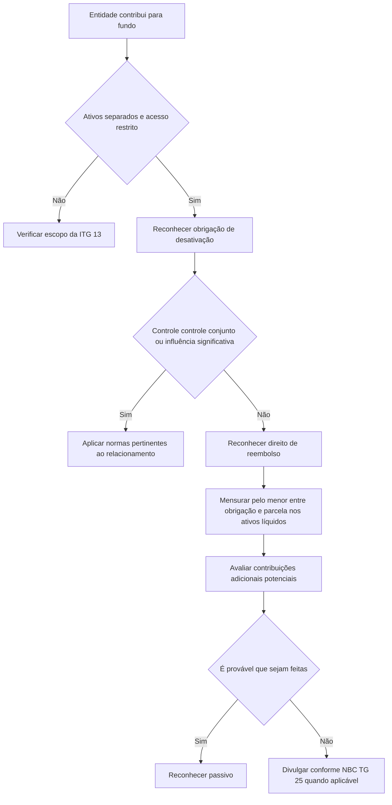

# ITG 13 (R2) — Direitos a Participações Decorrentes de Fundos de Desativação, Restauração e Reabilitação Ambiental

> [!abstract] Resumo em 30 segundos
> A entidade que contribui para um fundo de desativação pode ter, ao mesmo tempo, uma obrigação própria de pagar os custos de desativação e um direito de reembolso pelo fundo. Em regra, reconhece esses dois elementos separadamente. Se não tiver controle, controle conjunto ou influência significativa sobre o fundo, mensura o direito de reembolso pelo menor entre a obrigação reconhecida e sua parcela no valor justo dos ativos líquidos atribuíveis aos contribuintes. Eventuais contribuições adicionais seguem a NBC TG 25: a entidade reconhece um passivo somente se for provável que fará essas contribuições.

## Ficha rápida

| Campo | Síntese |
|---|---|
| Norma | ITG 13 (R2) |
| Tema | Direitos a participações em fundos de desativação, restauração e reabilitação ambiental |
| Aplicável a | Contribuintes de fundos com ativos administrados separadamente e acesso restrito |
| Questão central | Como contabilizar a participação no fundo e possíveis contribuições adicionais |
| Referência central para reembolso e contingências | NBC TG 25 |
| Alteração identificável no R2 | Atualização da referência a instrumentos financeiros para a NBC TG 48 e alteração do item 5 |
| Efeito informado para as alterações do R2 | A partir de 1º de janeiro de 2018 |

## Objetivo e alcance

A interpretação orienta a contabilização, nas demonstrações contábeis do contribuinte, dos direitos decorrentes de fundos criados para custear alguns ou todos os gastos de desativação. Esses gastos podem envolver, por exemplo, desativar fábricas ou equipamentos e reabilitar áreas ambientais.

O alcance exige **as duas condições abaixo**:

1. Os ativos do fundo são administrados separadamente — por estarem em uma entidade legal distinta ou segregados dentro de outra entidade.
2. O direito do contribuinte de acessar os ativos do fundo é restrito.

O texto descreve fundos financiados por contribuições voluntárias ou exigidas por lei ou regulamento. Eles podem ter um único contribuinte ou múltiplos contribuintes. Em fundos com vários contribuintes, podem existir direitos de reembolso vinculados às contribuições e aos ganhos, deduzidas as despesas administrativas; também pode haver obrigação de contribuições adicionais.

> [!warning] Limite de alcance
> Uma participação residual que ultrapasse o direito de reembolso — por exemplo, direito contratual a distribuições após a conclusão da desativação ou na liquidação do fundo — pode ser um instrumento patrimonial no alcance da NBC TG 48. Nesse caso, essa participação residual não está no alcance da ITG 13.

## Conceitos-chave

- **Fundo de desativação:** recursos segregados para financiar custos de desativação, restauração ou reabilitação ambiental.
- **Contribuinte:** entidade que realiza contribuições ao fundo e pode ter direito a reembolso de gastos elegíveis.
- **Obrigação de desativação:** obrigação do contribuinte de pagar os gastos correspondentes. A existência do fundo não a elimina automaticamente.
- **Direito de reembolso:** direito de receber recursos do fundo para cobrir gastos elegíveis, limitado nos termos da interpretação.
- **Contribuição adicional potencial:** valor que o contribuinte pode ter de aportar, por exemplo, em caso de falência de outro contribuinte ou de redução dos ativos do fundo a um nível insuficiente para cumprir os reembolsos.
- **Controle, controle conjunto ou influência significativa:** relações que devem ser avaliadas para decidir se a participação será contabilizada conforme as normas pertinentes sobre investimentos, negócios em conjunto e consolidação.

Os fundos são geralmente administrados por depositários independentes. Seus ativos podem incluir instrumentos de dívida e patrimoniais. O contribuinte continua responsável pelos gastos de desativação, mas pode obter reembolso até o menor valor entre os gastos incorridos e sua parcela nos ativos do fundo. O acesso a eventual excedente pode ser restrito ou inexistente.

## Diagrama de decisão

## Aplicação passo a passo — checklist

1. **Identifique o fundo e a participação da entidade.** Verifique se a entidade contribui para um fundo destinado a gastos de desativação, restauração ou reabilitação ambiental.
2. **Teste o alcance.** Confirme se os ativos são administrados separadamente e se o acesso do contribuinte é restrito. A interpretação requer ambas as características.
3. **Avalie a obrigação de desativação.** Determine se a entidade continua responsável por pagar os gastos, inclusive na hipótese de o fundo não pagar.
4. **Separe obrigação e participação.** Quando o contribuinte for responsável pelos gastos, reconheça a obrigação como passivo e contabilize separadamente sua participação no fundo.
5. **Avalie a relação com o fundo.** Determine se há controle, controle conjunto ou influência significativa, com referência às normas indicadas no item 8.
6. **Se não houver essa relação, mensure o reembolso.** Aplique o critério do menor valor descrito no item 9.
7. **Analise possíveis aportes adicionais.** Avalie se há obrigação potencial de contribuir além dos aportes já realizados e se é provável que esses valores sejam pagos.
8. **Prepare as divulgações.** Informe a natureza da participação, as restrições de acesso e, quando aplicável, as informações requeridas pela NBC TG 25.

## Reconhecimento e mensuração

### Obrigação de desativação e participação no fundo

O item 7 determina que o contribuinte reconheça a obrigação de pagar os gastos de desativação como passivo e reconheça separadamente sua participação no fundo. A exceção indicada é o caso em que o contribuinte não seja responsável por pagar esses gastos mesmo se o fundo deixar de pagá-los.

Se o contribuinte tiver **controle, controle conjunto ou influência significativa**, deve contabilizar a participação conforme as normas aplicáveis a esse relacionamento, nos termos do item 8.

Se não tiver essas relações, o item 9 determina que o direito de reembolso seja reconhecido conforme a NBC TG 25 e mensurado pelo menor entre:

\[
\text{Direito de reembolso} =
\min
\begin{cases}
\text{valor da obrigação por desativação reconhecida}\\
\text{parcela do contribuinte no valor justo dos ativos líquidos do fundo atribuíveis aos contribuintes}
\end{cases}
\]

As mudanças no valor contábil desse direito são reconhecidas no resultado do período em que ocorrem, exceto as contribuições ao fundo e os pagamentos feitos pelo fundo.

### Contribuições adicionais potenciais

Conforme o item 10, a obrigação potencial de fazer contribuições adicionais é tratada como passivo contingente no alcance da NBC TG 25. A entidade reconhece um passivo **somente se for provável que as contribuições adicionais serão feitas**.

## Divulgação

A entidade deve divulgar:

- a natureza de sua participação no fundo;
- quaisquer restrições de acesso aos ativos do fundo;
- quando houver contribuições adicionais potenciais não reconhecidas como passivo, as informações requeridas pelo item 86 da NBC TG 25;
- quando a participação for contabilizada segundo o item 9, as informações requeridas pelo item 85(c) da NBC TG 25.

A interpretação não reproduz o conteúdo desses requisitos da NBC TG 25. Para preparar as divulgações, consulte os itens indicados nessa norma.

## Exceções e erros comuns

> [!danger] Não compense automaticamente obrigação e direito
> A orientação é reconhecer separadamente a obrigação de pagar os gastos e a participação no fundo, quando o contribuinte continuar responsável pela desativação.

> [!warning] Não mensure o reembolso acima do limite estabelecido
> Para contribuintes sem controle, controle conjunto ou influência significativa, o direito de reembolso é limitado ao menor dos dois valores previstos no item 9.

> [!warning] Não reconheça automaticamente toda contribuição adicional possível
> O item 10 condiciona o reconhecimento do passivo à probabilidade de que as contribuições adicionais sejam feitas. Se não houver reconhecimento, avalie as divulgações requeridas pela NBC TG 25.

> [!info] Distinga reembolso de participação residual
> O direito de reembolso é tratado pela interpretação conforme o item 9. Uma participação residual além desse direito pode estar no alcance da NBC TG 48 e fora do alcance da ITG 13.

Outros erros a evitar:

- aplicar a interpretação sem verificar as duas condições de alcance;
- ignorar a possível relação de controle, controle conjunto ou influência significativa sobre o fundo;
- tratar a existência do fundo como se eliminasse, por si só, a obrigação do contribuinte;
- deixar de reconhecer no resultado as mudanças no valor contábil do direito de reembolso, ressalvadas as contribuições e os pagamentos do fundo.

## Conexões com outras normas

| Norma citada | Relação indicada pela ITG 13 |
|---|---|
| NBC TG 25 — Provisões, Passivos Contingentes e Ativos Contingentes | Base para contabilização do reembolso e para obrigações de contribuições adicionais; também orienta divulgações específicas. |
| NBC TG 18, NBC TG 19 e NBC TG 36 | Referências para avaliar controle, controle conjunto ou influência significativa e contabilizar a participação quando aplicável. |
| NBC TG 48 — Instrumentos Financeiros | Pode ser aplicável à participação residual que exceda o direito de reembolso; nesse caso, ela fica fora do alcance da ITG 13. |

A alteração R2 substituiu, no item 5 e nas referências, a menção anterior à NBC TG 38 pela NBC TG 48. O texto informa que as alterações entram em vigor na data de publicação e produzem efeitos a partir de 1º de janeiro de 2018.

## Fonte

- **PDF:** `ITG 13 (R2).pdf`
- **Conteúdo técnico:** páginas 1–4; itens 1–14.
- **Identificação da alteração R2:** página 6 do PDF.
- Síntese elaborada exclusivamente com base no texto fornecido.
