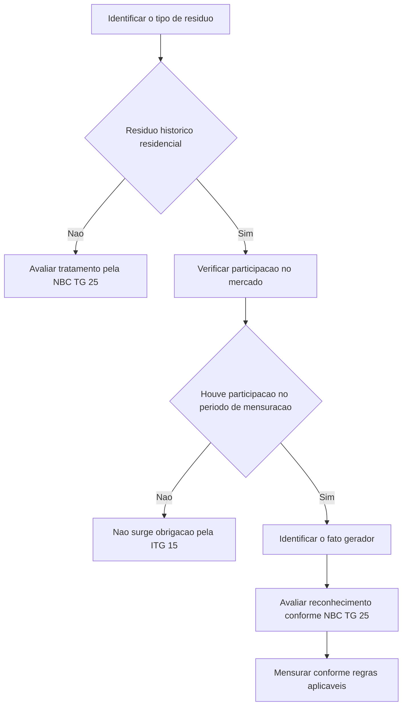

# ITG 15 — Passivos Decorrentes de Participação em Mercado Específico – Resíduos de Equipamentos Eletroeletrônicos

> [!abstract] Resumo em 30 segundos
> Para os custos de gerenciamento de resíduos de equipamentos residenciais históricos abrangidos pela Diretiva europeia, o fato gerador da obrigação é a **participação do fabricante no mercado durante o período de mensuração**. A obrigação não nasce simplesmente da fabricação ou venda dos equipamentos. Sem participação no mercado nesse período, não há obrigação segundo esta Interpretação. A ITG 15 trata do reconhecimento, não da mensuração do passivo.

## Ficha rápida

| Campo | Síntese |
|---|---|
| Norma | ITG 15 — Passivo Decorrente de Participação em Mercado Específico — Resíduos de Equipamentos Eletroeletrônicos |
| Tema | Identificação do fato gerador de obrigação por custos de gerenciamento de resíduos |
| Situação examinada | Equipamentos residenciais históricos no contexto da Diretiva da União Europeia |
| Questão central | Em que momento surge a obrigação a reconhecer? |
| Resposta | Quando há participação de mercado durante o período de mensuração |
| Referências identificadas no PDF | NBC TG 25 e NBC TG 23 |

> [!info] Contexto da identificação
> A resolução reproduzida no PDF aprova a interpretação e informa que ela tem por base a ICPC 15, correspondente à IFRIC 6 do IASB. O documento também registra que a Resolução CFC n.º 1.329/11 alterou a sigla de IT 15 para ITG 15 e atualizou referências normativas citadas. (p. 1)

## Objetivo e alcance

A Interpretação orienta o reconhecimento, nas demonstrações contábeis dos fabricantes, de passivos relacionados ao gerenciamento de resíduos previsto na Diretiva da União Europeia sobre Resíduos de Equipamentos Eletroeletrônicos, especificamente quanto às vendas de equipamentos residenciais históricos. (p. 3)

O contexto descrito no PDF é o de uma legislação que exige contribuição dos fabricantes para os custos de gerenciamento desses resíduos. A contribuição deve ser proporcional à participação de mercado, segundo o mecanismo definido por cada país-membro. A legislação local pode estabelecer períodos de mensuração e formas de calcular a participação e a obrigação diferentes. A ITG 15 esclarece o momento de reconhecimento, mas não estabelece como mensurar o passivo. (pp. 2–3)

### Fora do alcance direto

- Resíduos novos.
- Resíduos históricos provenientes de fontes que não sejam residências privadas.
- A mensuração do passivo, incluindo fórmulas e valores da obrigação.

Segundo o texto, os passivos relativos a resíduos novos e a resíduos históricos de fontes não residenciais são tratados pela NBC TG 25. Se a legislação local tratar resíduos novos de residências privadas de modo semelhante aos resíduos históricos residenciais, os princípios da Interpretação podem ser aplicados por referência à hierarquia da NBC TG 23. Essa hierarquia também é apontada como relevante para outros regulamentos com modelo semelhante de atribuição de custos. (p. 3)

## Conceitos-chave

| Conceito | Significado no contexto da ITG 15 |
|---|---|
| Evento que cria obrigação | Evento passado que cria obrigação presente e para o qual a entidade não tem alternativa realista senão liquidar a obrigação, conforme a referência à NBC TG 25. |
| Obrigação independente de ações futuras | A provisão se relaciona a obrigações originadas em eventos passados que existem independentemente de ações futuras da entidade. |
| Resíduo histórico residencial | Na situação descrita, equipamento residencial vendido antes da data de corte definida pela Diretiva — 13 de agosto de 2005. |
| Período de mensuração | Período estabelecido pela legislação aplicável para determinar a participação de mercado relevante. |
| Participação de mercado | Base de atribuição proporcional dos custos entre fabricantes, conforme o mecanismo previsto na legislação aplicável. |

O PDF observa que a duração do período de mensuração e os métodos de apuração da participação de mercado podem variar conforme a legislação de cada país. Essas variações afetam a mensuração, matéria que não integra o alcance da Interpretação. (p. 3)

## Diagrama de decisão

## Aplicação passo a passo e checklist

1. **Identifique a obrigação legal.** Confirme se o caso decorre de exigência de gerenciamento de resíduos e se o fabricante está sujeito ao mecanismo de contribuição descrito.
2. **Classifique os resíduos.** Verifique se são resíduos históricos de equipamentos residenciais. A Interpretação não abrange diretamente resíduos novos nem resíduos históricos de fontes não residenciais.
3. **Identifique o período de mensuração.** Consulte a legislação aplicável para determinar o período relevante. O PDF não fixa uma duração única.
4. **Verifique a participação de mercado.** Determine se a entidade participou do mercado durante esse período, conforme os critérios legais aplicáveis.
5. **Determine o fato gerador.** Se houve participação de mercado no período, esse é o evento que cria a obrigação para os custos de gerenciamento dos resíduos históricos residenciais. A fabricação ou a venda dos produtos, isoladamente, não é o fato gerador definido pela ITG 15.
6. **Avalie o reconhecimento.** Aplique os requisitos pertinentes da NBC TG 25. A ITG 15 define o fato gerador, mas não substitui os demais requisitos de reconhecimento.
7. **Determine a mensuração.** Utilize os parâmetros previstos na legislação aplicável. A Interpretação não define fórmulas, percentuais ou valores.
8. **Considere situações semelhantes fora do caso direto.** Se a legislação local tratar resíduos novos residenciais de forma semelhante aos históricos residenciais, considere a hierarquia da NBC TG 23 indicada no texto.

> [!tip] Pergunta operacional
> Para reconhecer uma obrigação nos termos da ITG 15, pergunte: **a entidade participou do mercado durante o período de mensuração relevante?** Não substitua essa análise pela simples verificação de quando os equipamentos foram fabricados ou vendidos.

## Reconhecimento e mensuração

### Reconhecimento

O consenso é que a participação no mercado durante o período de mensuração constitui o fato gerador da obrigação, conforme a referência ao critério da NBC TG 25. Portanto, para equipamentos residenciais históricos, a obrigação não surge no momento da fabricação ou da venda. Ela surge somente quando existe participação de mercado durante o período relevante. (p. 4)

A época do fato gerador pode ser diferente do período em que as atividades de gerenciamento dos resíduos são realizadas ou em que os custos relacionados são incorridos. Assim, não se deve presumir que a obrigação só nasce quando o serviço de gerenciamento ocorre ou quando o desembolso é feito. (p. 4)

### Mensuração

A ITG 15 **não trata da mensuração**. Períodos, critérios para apuração da participação de mercado e fórmulas de cálculo podem variar conforme a legislação aplicável. A entidade deve identificar esses parâmetros na regra pertinente, sem atribuir à Interpretação um método de cálculo que ela não fornece. (p. 3)

> [!warning] Limite da orientação
> A participação de mercado identifica o fato gerador, mas o texto da ITG 15 não informa, por si só, o valor a provisionar nem apresenta uma fórmula de mensuração.

## Divulgação

O texto da ITG 15 não especifica divulgações próprias nem apresenta uma lista de informações a divulgar. Ele remete ao tema do reconhecimento e delimita que a mensuração não está em seu alcance. Portanto, este resumo não atribui à Interpretação requisitos específicos de divulgação que não constam no PDF.

## Exceções e erros comuns

> [!danger] Erros a evitar
> - Reconhecer a obrigação apenas porque o equipamento foi fabricado ou vendido.
> - Adiar o reconhecimento até a realização das atividades de gerenciamento ou o pagamento dos custos.
> - Tratar todos os resíduos como se estivessem no alcance direto da ITG 15.
> - Supor que a Interpretação define período, fórmula ou valor de mensuração.

**Distinções essenciais:**

- **Histórico residencial:** é a situação central da Interpretação.
- **Novo ou não residencial:** não está no alcance direto descrito; o PDF remete à NBC TG 25.
- **Legislação local semelhante:** para novos resíduos residenciais tratados de forma semelhante aos históricos, o texto indica considerar os princípios da ITG 15 por referência à hierarquia da NBC TG 23.

## Conexões com outras normas

- **NBC TG 25 — Provisões, Passivos Contingentes e Ativos Contingentes:** fornece os conceitos de evento que cria obrigação e de obrigações originadas em eventos passados. A ITG 15 identifica, para o caso específico, qual evento gera a obrigação.
- **NBC TG 23 — Políticas Contábeis, Mudança de Estimativa e Retificação de Erro:** sua hierarquia é indicada para situações locais semelhantes às descritas e para outros regulamentos com modelo similar de atribuição de custos.

## Fonte

**PDF fornecido:** *ITG 15.pdf*, páginas 1–4. O texto técnico identifica referências à NBC TG 23 e à NBC TG 25. A resolução reproduzida na página 1 informa aprovação da interpretação e registra aplicação aos exercícios encerrados a partir de dezembro de 2010; já o item técnico sobre vigência determina que a Interpretação seja aplicada em conjunto com a adoção inicial da NBC TG 25. (p. 4)
