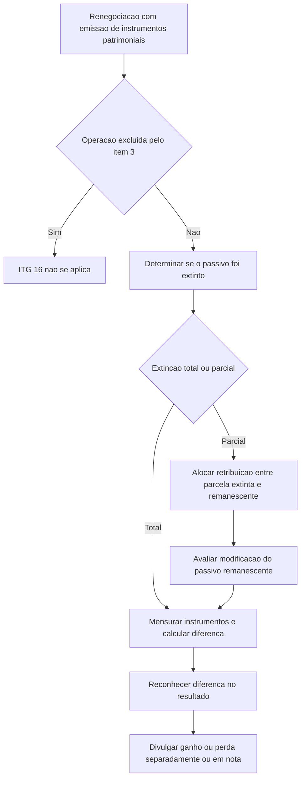

# ITG 16 (R2) — Extinção de Passivos Financeiros com Instrumentos Patrimoniais

> [!abstract] Resumo em 30 segundos
> Quando uma entidade renegocia um passivo financeiro e emite instrumentos patrimoniais próprios ao credor para extingui-lo total ou parcialmente, deve tratar esses instrumentos como retribuição paga. A entidade mensura os instrumentos inicialmente pelo valor justo; se esse valor não puder ser mensurado, usa o valor justo do passivo extinto. A diferença entre o valor contábil do passivo extinto e a retribuição paga vai para o resultado. Se a extinção for parcial, é necessário alocar a retribuição entre a parcela extinta e eventual modificação da parcela remanescente. O ganho ou a perda é divulgado separadamente no resultado ou em nota explicativa.

## Ficha rápida

| Campo | Síntese |
|---|---|
| Norma | ITG 16 (R2) |
| Tema | Extinção de passivos financeiros mediante emissão de instrumentos patrimoniais próprios |
| Entidade que aplica | A entidade devedora que emite os instrumentos patrimoniais |
| Não trata | Contabilização pelo credor |
| Referência central na consolidação R2 | NBC TG 48 — Instrumentos Financeiros |
| Data indicada no PDF | As alterações da R2 produzem efeitos a partir de 1º de janeiro de 2018 |

## Objetivo e alcance

A Interpretação orienta a contabilização pela entidade devedora quando as condições de um passivo financeiro são renegociadas e a entidade emite instrumentos patrimoniais próprios ao credor para extinguir a totalidade ou parte do passivo (itens 1–2, p. 1).

A orientação abrange três questões práticas: se os instrumentos patrimoniais emitidos constituem retribuição paga; como mensurá-los inicialmente; e como reconhecer a diferença entre o valor contábil do passivo extinto e a retribuição paga (item 4, pp. 2 e 5).

> [!warning] Operações fora do alcance
> A entidade não aplica a Interpretação quando:
> - o credor também é sócio ou acionista, direto ou indireto, e atua nessa qualidade;
> - as partes são controladas pela mesma parte ou partes, antes e depois da operação, e a essência da transação inclui distribuição de capital pela entidade ou contribuição para ela;
> - a extinção por emissão de instrumentos patrimoniais já está prevista nas condições originais do passivo (item 3, pp. 1–2).

## Conceitos-chave

- **Extinção total ou parcial:** baixa do passivo financeiro, ou de parte dele, quando e somente quando estiver extinto. A referência técnica da R2 é o item 3.3.1 da NBC TG 48 (item 5, p. 2).
- **Retribuição paga:** os instrumentos patrimoniais da entidade emitidos ao credor para extinguir o passivo, ou parte dele, são considerados retribuição paga, conforme o item 3.3.3 da NBC TG 48 (itens 4–5, pp. 2 e 5).
- **Valor justo dos instrumentos patrimoniais:** base de mensuração inicial, exceto quando não puder ser mensurado.
- **Passivo remanescente:** parcela que continua existindo após uma extinção parcial. A entidade avalia se seus termos foram modificados e se a alteração foi substancial.
- **Ganho ou perda:** diferença entre o valor contábil do passivo extinto e a retribuição paga; reconhecida no resultado do período (item 9, p. 3).

## Fluxo decisório

## Aplicação passo a passo — checklist

1. **Identifique a operação.** Confirme se houve renegociação de passivo financeiro e emissão de instrumentos patrimoniais próprios ao credor para extinguir todo ou parte do passivo.
2. **Verifique as exclusões.** Avalie as situações descritas no item 3. Se uma delas se aplicar, não use esta Interpretação para a operação.
3. **Determine se houve extinção.** Baixe o passivo, ou a parcela correspondente, somente quando estiver extinto, conforme a NBC TG 48.
4. **Mensure os instrumentos emitidos.** Use o valor justo dos instrumentos patrimoniais na mensuração inicial. Se não puder ser mensurado, use o valor justo do passivo financeiro extinto.
5. **Se a extinção for parcial, aloque a retribuição.** Considere se parte da retribuição se refere à modificação dos termos do passivo que permanece. Faça a alocação considerando todos os fatos e circunstâncias relevantes.
6. **Avalie o passivo remanescente.** Determine se seus termos foram substancialmente modificados. Se houve modificação substancial, contabilize a alteração como extinção da obrigação original e reconhecimento de novo passivo, conforme o item 3.3.2 da NBC TG 48.
7. **Reconheça o efeito no resultado.** Apure a diferença entre o valor contábil do passivo extinto e a retribuição paga.
8. **Divulgue o ganho ou a perda.** Apresente-o como item separado na demonstração do resultado ou em nota explicativa.

## Reconhecimento e mensuração

Os instrumentos patrimoniais próprios são reconhecidos inicialmente e mensurados na data em que o passivo financeiro, ou parte dele, é extinto (item 9, p. 3). A mensuração segue esta sequência:

| Situação | Mensuração inicial dos instrumentos patrimoniais |
|---|---|
| Valor justo dos instrumentos pode ser mensurado | Valor justo dos instrumentos emitidos |
| Valor justo dos instrumentos não pode ser mensurado | Valor justo do passivo financeiro extinto |

Para passivo extinto com característica de demanda, como depósito à vista, o PDF determina que, ao mensurar seu valor justo como alternativa à mensuração dos instrumentos, não se aplique o item 47 da NBC TG 46 (item 7, p. 2).

A diferença reconhecida no resultado pode ser representada, de forma esquemática, como:

**Diferença no resultado = valor contábil do passivo extinto − retribuição paga**

A fórmula resume a comparação exigida pela norma; a apuração deve respeitar a alocação aplicável quando apenas parte do passivo é extinta.

> [!info] Extinção parcial
> Se uma parcela da retribuição corresponder à modificação dos termos do passivo remanescente, não atribua automaticamente todo o valor à parcela extinta. Alocar a retribuição exige considerar os fatos e as circunstâncias relevantes da operação (itens 8 e 10, pp. 2–3).

## Divulgação

A entidade divulga o ganho ou a perda reconhecido conforme os itens 9 e 10 como:

- item separado na demonstração do resultado; ou
- informação em nota explicativa.

A Interpretação não especifica, no texto apresentado, um formato adicional de divulgação para essa operação (item 11, p. 3).

## Exceções e erros comuns

> [!danger] Evite estes erros
> - **Aplicar a Interpretação ao credor:** o alcance é a contabilização pela entidade devedora; a contabilização do credor não é tratada.
> - **Baixar o passivo apenas por ter havido emissão de ações ou outros instrumentos patrimoniais:** a baixa ocorre somente quando o passivo, ou sua parte, estiver extinto.
> - **Mensurar sempre pelo valor justo do passivo:** essa é a alternativa apenas quando o valor justo dos instrumentos patrimoniais não puder ser mensurado.
> - **Ignorar a parcela remanescente:** na extinção parcial, avalie a alocação da retribuição e se os termos do passivo remanescente foram substancialmente modificados.
> - **Omitir o efeito do resultado ou sua divulgação:** a diferença deve ser reconhecida no resultado e o ganho ou a perda divulgado separadamente no resultado ou em nota.
> - **Aplicar a regra quando a operação se enquadra nas exclusões do item 3:** verifique primeiro a condição do credor, o controle comum e se a extinção já estava prevista no passivo original.

## Conexões com outras normas

- **NBC TG 48 — Instrumentos Financeiros:** referência central da versão R2 para retribuição paga, baixa do passivo e tratamento de modificação substancial da parcela remanescente (itens 4, 5, 9 e 10).
- **NBC TG 46 — Mensuração do Valor Justo:** citada para a mensuração do passivo extinto quando o valor justo dos instrumentos patrimoniais não puder ser mensurado (item 7).
- **NBC TG 23 — Políticas Contábeis, Mudança de Estimativa e Retificação de Erro:** indicada no item 13 para aplicar uma alteração de prática contábil a partir do início do primeiro período comparativo apresentado.

## Fonte

**ITG 16 (R2) — Extinção de Passivos Financeiros com Instrumentos Patrimoniais**, PDF fornecido: *ITG 16 (R2).pdf*. Síntese baseada no texto técnico da Interpretação e nas alterações identificadas como R2. O PDF informa que as alterações da R2 produzem efeitos a partir de 1º de janeiro de 2018.
