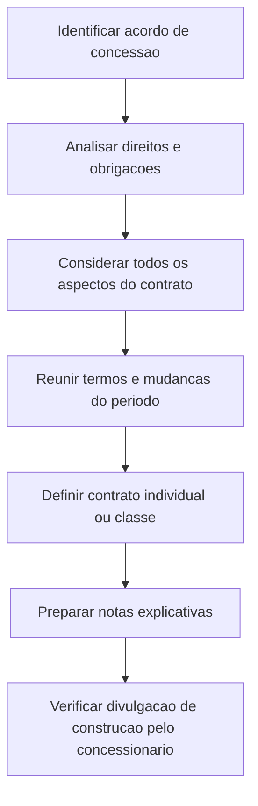

# ITG 17 — Contratos de Concessão: Evidenciação

> [!abstract] Resumo em 30 segundos
> A ITG 17 trata das informações que concessionário e concedente devem divulgar em notas explicativas sobre contratos de concessão de serviços públicos. Ao fim de cada período de reporte, devem apresentar informações sobre o acordo, seus termos relevantes, direitos e obrigações, mudanças ocorridas e classificação do contrato. O concessionário também divulga, em situação específica, a receita e o resultado dos serviços de construção.

## Ficha rápida

| Campo | Síntese |
|---|---|
| Norma | ITG 17 — Contratos de Concessão: Evidenciação |
| Foco | Divulgações em notas explicativas |
| Quem divulga | Concessionário e concedente |
| Momento | Ao final de cada período de reporte |
| Unidade de divulgação | Cada contrato individual ou classe de contratos similares |
| Referência de aprovação | Resolução CFC nº 1.375/11 |

A resolução que aprova a interpretação informa aplicação aos exercícios iniciados a partir de 1º de janeiro de 2011. Essa informação consta do texto da resolução, não dos requisitos técnicos da ITG 17. (PDF, p. 1)

## Objetivo e alcance

A interpretação define informações adicionais a serem apresentadas nas notas explicativas que acompanham as demonstrações contábeis do concessionário e do concedente. Seu foco é a evidenciação dos contratos de concessão de serviços públicos, considerando todos os aspectos do contrato para determinar quais divulgações são adequadas. (PDF, pp. 2–3, itens 4–6)

A norma descreve como concessão pública, por exemplo, acordos relativos a redes de água, rodovias, estacionamentos, túneis, pontes, aeroportos e telecomunicações. Em geral, o concedente outorga ao concessionário, durante o prazo contratual, o direito de prestar serviços ao público e, em alguns casos, o direito de usar ativos especificados. Em contrapartida, o concessionário assume obrigações de prestação de serviços e, quando aplicável, de reversão de direitos ao fim do prazo. (PDF, p. 2, itens 1–3)

Nem todo contrato de prestação de serviços a outra entidade é uma concessão pública. O texto diferencia, por exemplo, concessões públicas de terceirizações de serviços internos, como cafeteria para funcionários, manutenção predial, tecnologia da informação ou serviços contábeis. (PDF, p. 2, item 1)

## Conceitos-chave

- **Concedente:** entidade que celebra o acordo e outorga os direitos previstos na concessão. Pode ser do setor público ou do setor privado ligada a um ente governamental.
- **Concessionário:** entidade que recebe direitos no âmbito do acordo e assume o compromisso de prestar os serviços contratados.
- **Direito e obrigação concomitantes:** característica comum dos acordos de concessão descritos na interpretação: o concessionário recebe um direito e também assume uma obrigação de prestar serviços públicos.
- **Ativos especificados:** podem incluir ativos tangíveis, intangíveis ou financeiros relacionados ao contrato.
- **Classe de contratos:** agrupamento de contratos de concessão que envolvem serviços de natureza similar, como pedágio, telecomunicações ou tratamento de água. (PDF, pp. 2–3, itens 2–3 e 7)

## Aplicação passo a passo

1. **Identifique o acordo.** Verifique se o contrato envolve serviços que dão ao público acesso a facilidades econômicas ou sociais e se corresponde à descrição de concessão apresentada na interpretação.
2. **Determine as partes e os direitos e deveres.** Identifique concedente e concessionário, os serviços contratados, os direitos sobre ativos e as obrigações assumidas durante e ao término da concessão.
3. **Considere o contrato por inteiro.** Avalie todos os aspectos do acordo para decidir quais informações são necessárias nas notas explicativas.
4. **Levante termos e condições relevantes.** Registre, entre outros, o prazo, as regras de reajuste de preços e as bases para reajustes ou renegociações.
5. **Identifique direitos, obrigações e eventos contratuais.** Considere construção ou aquisição de infraestrutura, reversão de ativos, renovação, rescisão e grandes manutenções periódicas.
6. **Verifique as mudanças do período.** Identifique alterações contratuais ocorridas no período de reporte.
7. **Determine a forma de apresentação.** Divulgue por contrato individual ou por classe de contratos de natureza similar.
8. **Verifique a divulgação adicional do concessionário.** Se houve prestação de serviços de construção em troca de ativo financeiro ou intangível, apure a divulgação específica do item 6A.

## Reconhecimento e mensuração

A ITG 17 trata de **divulgações adicionais**; o trecho técnico fornecido não estabelece critérios próprios de reconhecimento ou mensuração para os ativos, passivos, receitas ou despesas do contrato. Portanto, não se deve extrair desta interpretação um modelo de contabilização que ela não apresenta.

O texto informa que aspectos de certos ativos relacionados a concessões podem estar tratados em outras normas do CFC: NBC TG 27 para aquisições de itens do ativo imobilizado, NBC TG 06 para ativos objeto de arrendamento e NBC TG 04 para aquisições de ativos intangíveis. A interpretação também observa que acordos podem envolver contratos a executar que não são disciplinados pelas normas mencionadas, exceto quando forem contratos onerosos; nesse caso, indica a NBC TG 25. (PDF, p. 3, item 5)

> [!info] Aplicação prática
> Use a ITG 17 para organizar a evidenciação do acordo. Para o tratamento contábil de itens específicos, considere as normas citadas no próprio texto, conforme aplicáveis. A interpretação não substitui essas normas.

## Divulgação

Ao final de cada período de reporte, **concedente e concessionário** devem divulgar, para cada contrato individual ou classe de contratos: (PDF, pp. 2–3, itens 6–7)

| Informação exigida | O que descrever |
|---|---|
| Acordo contratual | Descrição do contrato de concessão |
| Termos significativos | Condições que possam afetar o montante, o período de ocorrência ou a certeza dos fluxos de caixa futuros |
| Direitos e obrigações | Natureza e extensão dos direitos de uso e das obrigações ou direitos relativos aos serviços |
| Infraestrutura e ativos | Obrigações de adquirir ou construir infraestrutura e obrigações de entregar ou direitos de receber ativos no fim da concessão |
| Opções e outros termos | Opções de renovação ou rescisão e outros direitos e obrigações, incluindo grandes manutenções periódicas |
| Mudanças e classificação | Alterações ocorridas no período e classificação atribuída ao contrato |

A descrição dos termos significativos deve incluir, conforme pertinente, o período da concessão, as datas de reajustes de preços e as bases para reajuste ou renegociação. A “natureza e extensão” deve ser apresentada com o nível de detalhe aplicável ao item — por exemplo, quantidade, período de ocorrência ou montante. (PDF, p. 3, item 6)

**Divulgação adicional do concessionário:** quando prestar serviços de construção em troca de ativo financeiro ou ativo intangível, deve divulgar o total da receita e dos lucros ou prejuízos reconhecidos no período por esses serviços. Essa exigência é dirigida ao concessionário, não formulada como divulgação conjunta com o concedente. (PDF, p. 3, item 6A)

> [!tip] Checklist de fechamento
> - [ ] Descrição do contrato preparada.
> - [ ] Prazo, reajustes e bases de renegociação identificados.
> - [ ] Direitos de uso, serviços e infraestrutura considerados.
> - [ ] Obrigações e direitos relativos aos ativos no fim do prazo identificados.
> - [ ] Opções de renovação ou rescisão e manutenções periódicas avaliadas.
> - [ ] Mudanças do período e classificação do contrato documentadas.
> - [ ] Divulgação organizada por contrato individual ou classe similar.
> - [ ] Para o concessionário, receita e resultado dos serviços de construção verificados, quando aplicável.

## Exceções e erros comuns

> [!warning] Não confundir concessão com terceirização interna
> Um contrato para operar serviços internos da própria entidade, como cafeteria para funcionários ou manutenção predial, é apresentado como exemplo de acordo que não caracteriza serviço de concessão pública.

> [!danger] Não omitir o concedente
> Os requisitos gerais de divulgação do item 6 se dirigem tanto ao concessionário quanto ao concedente. A divulgação adicional do item 6A, por sua redação, é atribuída ao concessionário.

Erros a evitar:

- limitar a análise aos ativos e ignorar obrigações de prestar serviços;
- divulgar apenas o prazo do contrato, sem abordar termos capazes de afetar fluxos de caixa futuros;
- omitir mudanças ocorridas no período;
- agrupar contratos de naturezas diferentes como se fossem uma única classe;
- tratar contratos a executar como automaticamente abrangidos por norma específica: o texto ressalva os contratos onerosos e remete, nesse caso, à NBC TG 25;
- atribuir à ITG 17 critérios de reconhecimento ou mensuração que não aparecem no trecho técnico.

## Conexões com outras normas

As relações abaixo são as explicitamente citadas pela interpretação:

- **NBC TG 26 — Apresentação das Demonstrações Contábeis:** consta nas referências da ITG 17.
- **NBC TG 27 — Ativo Imobilizado:** citada para aspectos relacionados à aquisição de itens do imobilizado.
- **NBC TG 06 — Arrendamentos:** citada para ativos objeto de arrendamento.
- **NBC TG 04 — Ativo Intangível:** citada para aquisições de ativos intangíveis.
- **NBC TG 25 — Provisões, Passivos Contingentes e Ativos Contingentes:** indicada para contratos a executar que sejam onerosos.
- **ITG 01 — Contratos de Concessão:** consta nas referências da ITG 17. O texto fornecido não detalha a relação entre os requisitos das duas interpretações.

## Fonte

**ITG 17 — Contratos de Concessão: Evidenciação**, aprovada pela Resolução CFC nº 1.375/11. PDF fornecido: *ITG 17.pdf*, pp. 1–3. Em caso de diferença entre o texto da resolução e o texto técnico, este resumo prioriza os requisitos técnicos da interpretação.
