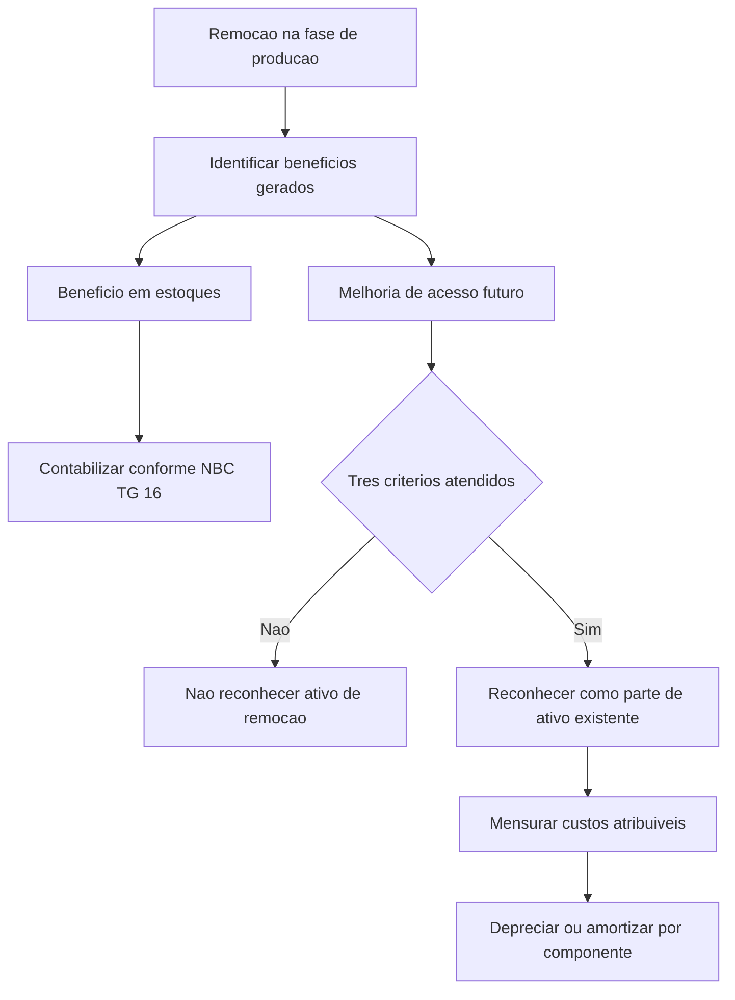

# ITG 18 — Custos de Remoção de Estéril de Mina de Superf Fase de Produção

> [!abstract] Resumo em 30 segundos
> Na fase de produção de uma mina de superfície, a remoção de estéril pode gerar dois benefícios: minério utilizável para estoques e melhor acesso a minério que será extraído no futuro. A parcela relacionada aos estoques é contabilizada conforme a NBC TG 16. A parcela que melhora o acesso pode ser reconhecida como ativo não circulante somente se houver benefício futuro provável, componente identificável da jazida e mensuração confiável dos custos. O ativo é inicialmente mensurado ao custo e depois depreciado ou amortizado ao longo da vida útil esperada do componente beneficiado.

## Ficha rápida

| Campo | Síntese |
|---|---|
| Norma | ITG 18 |
| Tema | Custos de remoção de estéril de mina de superfície durante a produção |
| Base indicada no PDF | Interpretação Técnica ICPC 18, baseada na IFRIC 20 do IASB |
| Abrangência | Custos de remoção incorridos na fase de produção de mina de superfície |
| Questões tratadas | Reconhecimento como ativo, mensuração inicial e mensuração subsequente |
| Vigência informada | Em vigor na publicação; aplicável a exercícios iniciados a partir de 1º de janeiro de 2013 |

## Objetivo e alcance

A ITG 18 orienta como contabilizar os custos de remoção de estéril incorridos **durante a fase de produção de uma mina de superfície**. A remoção pode continuar depois do início da produção e, nessa etapa, o material retirado pode conter tanto resíduos quanto minério.

A atividade pode gerar benefícios de naturezas distintas:

1. **Minério utilizável:** material que pode ser usado na produção de estoques.
2. **Melhoria de acesso:** acesso facilitado a um componente da jazida que permitirá extrair minério em períodos futuros.

A interpretação orienta a separação contábil desses benefícios e a mensuração do ativo associado à melhoria de acesso. Os custos de desenvolvimento anteriores ao início da produção são apresentados no PDF como contexto, mas não constituem o foco do alcance da ITG 18.

> [!info] Limite de aplicação
> O texto normativo delimita a interpretação aos custos de remoção em mina de superfície durante a produção. Uma nota explicativa do PDF, baseada no documento do IASB, informa que a interpretação não se aplica à mineração subterrânea nem à extração de óleo e gás natural.

## Conceitos-chave

- **Atividade de remoção de estéril:** retirada de resíduos minerários para obter acesso ao minério.
- **Componente da jazida:** volume específico da jazida cujo acesso melhora com a remoção. A identificação desse componente é importante para reconhecer os custos e para determinar a depreciação ou amortização posterior.
- **Ativo advindo da atividade de remoção:** parcela capitalizada dos custos de remoção que proporciona melhor acesso a minério a ser extraído no futuro. É contabilizada como parte ou melhoria de um ativo existente, não como ativo independente.
- **Operações incidentais:** atividades executadas simultaneamente à remoção, mas que não são necessárias à continuidade da atividade de remoção conforme planejada. Seus custos não integram o custo do ativo advindo da remoção.
- **Medida de produção:** critério relevante usado para repartir custos quando não é possível identificar separadamente os custos atribuíveis aos estoques e ao ativo de remoção.

## Diagrama de decisão

## Aplicação passo a passo — checklist

1. **Confirme o escopo.** Verifique se os custos se referem à remoção de estéril em mina de superfície durante a fase de produção.
2. **Identifique os benefícios.** Avalie se a remoção gerou minério utilizável para estoques, melhoria de acesso a minério futuro ou ambos.
3. **Separe a parcela de estoques.** Contabilize os custos na medida em que o benefício se realize em estoques, de acordo com os princípios da NBC TG 16.
4. **Teste os critérios para ativo.** Reconheça a parcela de melhoria de acesso somente se todos os critérios abaixo forem atendidos:
   - for provável que os benefícios econômicos futuros associados à melhoria de acesso fluam para a entidade;
   - for possível identificar o componente da jazida cujo acesso foi melhorado; e
   - os custos relacionados a esse componente puderem ser mensurados com confiabilidade.
5. **Determine os custos atribuíveis.** Inclua custos diretamente incorridos para melhorar o acesso ao componente identificado e custos indiretos de produção diretamente atribuíveis. Exclua custos de operações incidentais.
6. **Faça a alocação, se necessária.** Se os custos dos estoques e do ativo não puderem ser identificados separadamente, aplique um critério baseado em medidas relevantes de produção para repartir os custos.
7. **Classifique e acompanhe o ativo.** Registre-o como parte ou melhoria de ativo existente e siga a classificação tangível ou intangível desse ativo.
8. **Defina a apropriação subsequente.** Deprecie ou amortize sistematicamente o saldo durante a vida útil esperada do componente identificado, aplicando o método das unidades de produção salvo se outro método for mais apropriado.

## Reconhecimento e mensuração

### Reconhecimento

O tratamento depende da natureza do benefício:

| Benefício da remoção | Tratamento |
|---|---|
| Minério utilizável para produção de estoques | Custos contabilizados conforme a NBC TG 16 — Estoques |
| Melhoria de acesso a minério futuro | Reconhecer como ativo não circulante se os três critérios forem atendidos |

O ativo de remoção deve ser tratado como adição ou melhoria de um ativo existente. A natureza desse ativo existente determina se o ativo de remoção será classificado como tangível ou intangível.

### Mensuração inicial e alocação

A mensuração inicial é **ao custo**. Esse custo reúne:

- os custos diretamente incorridos na atividade de remoção que melhora o acesso ao componente identificado; e
- a parcela de custos indiretos de produção diretamente atribuível.

Custos de operações incidentais não são incluídos. O PDF exemplifica como operação incidental a construção de uma rodovia de acesso à área em que a remoção será realizada.

Quando não houver identificação separada entre os custos dos estoques e os custos do ativo de remoção, a alocação deve usar medidas relevantes de produção calculadas para o componente identificado. O texto apresenta como exemplos:

- custo dos estoques produzidos em comparação com o custo esperado;
- volume de estéril e outros resíduos removidos em comparação com o volume esperado para certo volume de produção de minério; e
- conteúdo mineral do minério extraído em comparação com o conteúdo esperado para determinada quantidade produzida.

A medida escolhida deve ajudar a identificar em que extensão as atividades adicionais estão criando benefícios futuros, em vez de apenas atendendo à produção corrente.

### Mensuração subsequente

Após o reconhecimento inicial, o ativo é mantido ao custo ou pelo montante reavaliado, quando não houver vedação legal no ordenamento jurídico brasileiro ao registro contábil da reavaliação. Em ambos os casos, são deduzidos:

- depreciação ou amortização; e
- provisão para perdas por desvalorização.

A depreciação ou amortização é sistemática e baseada na vida útil esperada do **componente beneficiado**. O método das unidades de produção deve ser usado, a menos que outro método seja mais apropriado.

A vida útil desse componente pode diferir da vida útil da mina e da vida útil de outros ativos relacionados à mina. O texto aponta uma situação limitada em que pode coincidir: quando a remoção melhora o acesso a toda a jazida remanescente, como pode ocorrer na etapa final da vida útil da mina.

> [!tip] Controle útil
> Mantenha rastreabilidade entre custos, componente da jazida beneficiado e medida de produção utilizada. Essa identificação dá suporte tanto ao reconhecimento confiável quanto à apropriação posterior do ativo.

## Divulgação

A ITG 18 trata de reconhecimento, mensuração inicial e mensuração subsequente. O texto fornecido **não estabelece exigências específicas de divulgação** para os custos de remoção ou para o ativo advindo da atividade de remoção.

## Exceções e erros comuns

> [!warning] Não capitalize automaticamente toda a remoção
> A remoção pode beneficiar estoques, melhorar acesso futuro ou produzir ambos os benefícios. A parcela de estoques segue a NBC TG 16; somente a parcela elegível de melhoria de acesso pode ser reconhecida como ativo, e apenas se todos os critérios forem atendidos.

> [!danger] Não reconheça ativo sem componente identificável
> Sem identificar o componente da jazida cujo acesso melhorou, não se atende a um dos requisitos expressos para reconhecer o ativo de remoção.

Erros a evitar:

- incluir no ativo os custos de operações incidentais;
- capitalizar custos sem conseguir mensurá-los com confiabilidade;
- alocar custos conjuntos sem um critério baseado em medidas relevantes de produção;
- depreciar ou amortizar o ativo com base automaticamente na vida útil total da mina, sem considerar a vida útil do componente identificado;
- tratar o ativo advindo da remoção como independente, ignorando que deve ser contabilizado como parte ou melhoria de ativo existente;
- presumir que o método das unidades de produção é obrigatório em todos os casos: outro método pode ser aplicado quando for mais apropriado.

### Disposições transitórias

No início do período mais antigo apresentado, ativos de remoção reconhecidos anteriormente devem ser reclassificados como parte do ativo existente relacionado, na medida em que exista componente remanescente identificável ao qual possam ser associados. Esses saldos são depreciados ou amortizados ao longo da vida útil remanescente esperada desse componente.

Se não existir componente identificável ao qual o ativo anterior possa ser relacionado, o saldo deve ser reconhecido nos lucros acumulados de abertura do início do período mais antigo apresentado.

## Conexões com outras normas

- **NBC TG 16 — Estoques:** aplica-se à parcela da remoção cujo benefício se realiza em estoques produzidos.
- **NBC TG 27 — Ativo Imobilizado e NBC TG 04 — Ativo Intangível:** constam entre as referências da ITG 18. A classificação do ativo de remoção acompanha a natureza tangível ou intangível do ativo existente do qual ele é parte.
- **NBC TG 26 — Apresentação das Demonstrações Contábeis:** consta entre as referências da interpretação; o texto fornecido não detalha um tratamento específico de apresentação.

## Fonte

Conselho Federal de Contabilidade, **ITG 18 — Custos de remoção de estéril de mina de superfície na fase de produção**, conforme o PDF *ITG 18.pdf*. O documento informa que a interpretação tem por base a ICPC 18, correspondente à IFRIC 20 do IASB.
