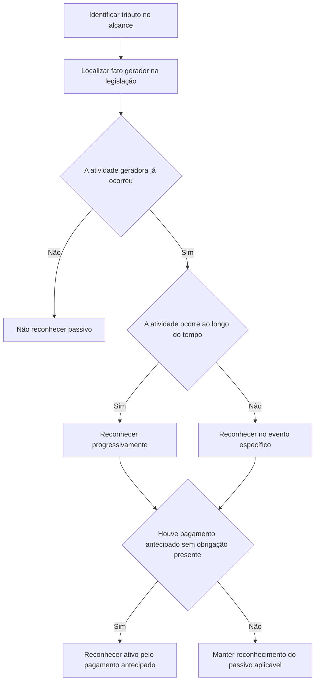

# ITG 19 — Tributos

> [!abstract] Em uma frase
> A obrigação de pagar tributo é reconhecida quando ocorre a atividade que a legislação identifica como fato gerador — não antes, apenas porque a entidade pretende ou precisa continuar operando.

## Resumo em 30 segundos

A ITG 19 esclarece **quando reconhecer o passivo por tributo**. O ponto decisivo é identificar, na legislação, a atividade que gera o pagamento. Se essa atividade ocorrer ao longo do tempo, o passivo é reconhecido progressivamente; se ocorrer em um momento específico, o passivo é reconhecido nesse momento. A expectativa de operar no futuro, a continuidade operacional e a compulsão econômica não criam, por si sós, uma obrigação presente.

A mesma lógica vale para demonstrações anuais e intermediárias. Se a entidade pagar o tributo antes de existir obrigação presente, reconhece um ativo. A ITG 19 trata do reconhecimento da obrigação; não define como contabilizar o custo correspondente nem estabelece regras específicas de divulgação.

## Ficha rápida

| Campo | Síntese |
|---|---|
| Norma | ITG 19 — Tributos |
| Aprovação | 21 de novembro de 2014 |
| Base indicada | IFRIC 21 do IASB |
| Tema central | Momento de reconhecimento da obrigação de pagar tributo |
| Norma relacionada à obrigação | NBC TG 25 — Provisões, Passivos Contingentes e Ativos Contingentes |
| Transição | Mudanças de política contábil decorrentes da aplicação inicial são contabilizadas retrospectivamente conforme a NBC TG 23 |
| Vigência informada no texto | Na data de publicação; aplicação aos exercícios iniciados a partir de 1º de janeiro de 2014 |

## Objetivo e alcance

A Interpretação responde a uma questão específica: **em que momento a entidade reconhece a obrigação de pagar um tributo?** Aplica-se à obrigação que esteja no alcance da NBC TG 25 e também à obrigação cujo momento e valor sejam certos (item 2, p. 1).

Para esta Interpretação, tributo é uma saída de recursos com benefícios econômicos imposta por governo à entidade de acordo com a legislação. “Governo” inclui governos, agências governamentais e órgãos similares, locais, nacionais ou internacionais (item 4, p. 2).

Não são tratados como tributo, para esse fim:

- fluxos de saída abrangidos por outra norma contábil, como tributos sobre o lucro no alcance da NBC TG 32;
- multas ou outras penalidades por violação da legislação;
- pagamentos pela aquisição de ativos ou pela prestação de serviços, quando decorrentes de contrato com o governo (itens 4 e 5, p. 2).

A entidade não é obrigada a aplicar a ITG 19 aos passivos decorrentes de sistemas de comércio de licenças de emissão de gases de efeito estufa (item 6, p. 2).

> [!warning] Limite do tema
> A ITG 19 determina o momento de reconhecimento do passivo. Não determina se o débito correspondente deve ser reconhecido como ativo ou despesa; essa decisão depende de outras normas contábeis (item 3, p. 2).

## Conceitos-chave

### Fato gerador identificado pela legislação

É a atividade que, conforme a legislação, gera o pagamento do tributo. A base usada para calcular o valor não necessariamente identifica o fato gerador.

Por exemplo, a legislação pode calcular o tributo do período atual com base na receita do período anterior. Nesse caso, a receita anterior pode ser necessária para calcular o valor, mas não é suficiente para criar a obrigação presente: o fato gerador pode ser a geração de receita no período atual (item 8, p. 2).

### Obrigação presente

O passivo nasce quando ocorre o fato gerador legalmente definido. A entidade não reconhece uma obrigação presente referente a atividade que ainda não ocorreu.

### Reconhecimento pontual ou progressivo

- **Progressivo:** quando a atividade que gera o tributo ocorre ao longo do tempo, a obrigação é reconhecida à medida que a atividade acontece.
- **Em um momento específico:** quando a obrigação é gerada por um evento pontual, o passivo é reconhecido quando esse evento ocorre.

### Limite mínimo

Se o tributo depender de atingir um limite mínimo, o reconhecimento deve seguir a natureza do fato gerador. O passivo correspondente ao limite é reconhecido quando ele é atingido; obrigações relativas à atividade posterior podem surgir progressivamente depois disso (item 12, p. 3; exemplos ilustrativos, pp. 5–6).

### Continuidade operacional e compulsão econômica

A presunção de continuidade operacional e a pressão econômica para continuar operando não antecipam o reconhecimento de um tributo que será gerado por atividade futura (itens 9 e 10, p. 3).

## Diagrama do raciocínio

## Aplicação passo a passo e checklist

1. **Verifique se a obrigação está no escopo.** Confirme se é tributo imposto por legislação e se não está excluído por outra norma, por ser penalidade, pagamento contratual ou passivo de sistema de licenças de emissão.
2. **Leia a legislação aplicável.** Identifique qual atividade gera o pagamento. Não conclua pelo período usado no cálculo sem examinar o fato gerador.
3. **Determine se a atividade já ocorreu.** Não reconheça passivo por operação futura apenas porque a entidade espera continuar operando ou está economicamente pressionada a fazê-lo.
4. **Defina o padrão de reconhecimento.** Se a atividade ocorre ao longo do tempo, reconheça progressivamente. Se a obrigação depende de evento em data ou momento específico, reconheça quando esse evento ocorrer.
5. **Avalie limites mínimos.** Identifique se o passivo nasce ao atingir o limite, pela atividade posterior, ou por componentes distintos da obrigação.
6. **Repita a análise na data de cada demonstração intermediária.** A obrigação só é reconhecida se existir ao final do período intermediário.
7. **Analise pagamentos antecipados.** Se houve pagamento antes de existir obrigação presente, reconheça um ativo.
8. **Avalie o débito correspondente.** Determine, com base em outras normas contábeis, se o reconhecimento da obrigação dá origem a ativo ou despesa.

> [!tip] Pergunta de controle
> “Qual atividade a legislação define como geradora do tributo, e essa atividade já ocorreu até a data de reporte?”

## Reconhecimento e mensuração

### Quando reconhecer

| Situação prevista na legislação | Tratamento do passivo |
|---|---|
| A atividade geradora ocorre continuamente, como geração de receita ao longo do período | Reconhecer à medida que a atividade ocorre |
| O fato gerador ocorre em momento determinado | Reconhecer quando esse momento ocorre |
| A obrigação depende de atingir um limite de atividade | Reconhecer quando o limite é atingido, conforme o fato gerador definido |
| A obrigação depende de atividade após o limite | Reconhecer progressivamente à medida que a atividade excedente ocorre |
| A atividade geradora pertence a período futuro | Não reconhecer obrigação presente antecipadamente |
| Tributo pago antes de existir obrigação presente | Reconhecer ativo pelo valor pago antecipadamente |

A norma não fornece fórmula geral de mensuração. Os exemplos ilustram que o valor do passivo acompanha a atividade que já ocorreu e, nos casos de limite, a base aplicável conforme o desenho legal do tributo. A base de cálculo pode ser relativa a período anterior sem que essa base, isoladamente, seja o fato gerador (item 8 e exemplos, pp. 2 e 4–6).

### Demonstrações intermediárias

Aplicam-se os mesmos princípios usados nas demonstrações anuais. Na data de encerramento do período intermediário:

- não se reconhece o passivo se não houver obrigação presente;
- reconhece-se o passivo se a obrigação presente já existir (item 13, p. 3).

Portanto, uma obrigação gerada em data específica não é reconhecida em períodos intermediários anteriores a essa data; uma obrigação gerada progressivamente é reconhecida conforme a atividade ocorre dentro do período.

## Divulgação

A ITG 19 fornecida não apresenta um conjunto próprio de divulgações específicas sobre tributos. Seu foco é o reconhecimento da obrigação. A lista de referências inclui a NBC TG 26 — Apresentação das Demonstrações Contábeis, mas a Interpretação não detalha, no texto apresentado, quais informações devem ser divulgadas ou como apresentá-las.

## Exceções e erros comuns

> [!danger] Não antecipe o passivo
> Não reconheça tributo sobre atividade futura somente porque a entidade pretende ou precisa continuar operando, ou porque as demonstrações são preparadas sob a presunção de continuidade operacional.

Erros a evitar:

- **Confundir base de cálculo com fato gerador:** receita de período anterior pode afetar o valor, sem criar, por si só, obrigação presente.
- **Reconhecer antes do evento legal:** se a obrigação surge apenas em uma data específica, não a distribua pelos períodos anteriores.
- **Tratar todo limite da mesma forma:** a legislação pode gerar obrigação ao atingir o limite e, separadamente, pela atividade posterior.
- **Usar critérios diferentes em demonstrações intermediárias:** os princípios de reconhecimento são os mesmos das demonstrações anuais.
- **Levar o pagamento antecipado diretamente a despesa ou passivo:** se não houver obrigação presente, a ITG 19 determina o reconhecimento de um ativo pelo pagamento antecipado.
- **Aplicar a interpretação a itens excluídos:** observe os tributos no alcance de outras normas, as penalidades, os pagamentos contratuais ao governo e a dispensa relativa a sistemas de licenças de emissão.

## Conexões com outras normas

- **NBC TG 25:** a ITG 19 trata da obrigação de pagar tributo quando ela está no alcance da norma de provisões e passivos.
- **NBC TG 23:** mudanças nas políticas contábeis decorrentes da aplicação inicial da ITG 19 são contabilizadas retrospectivamente conforme essa norma (Apêndice A2, p. 4).
- **NBC TG 21:** a ITG 19 determina que os mesmos princípios de reconhecimento sejam aplicados às demonstrações intermediárias e anuais.
- **NBC TG 32:** tributos sobre o lucro no alcance dessa norma estão excluídos da definição de tributo para a ITG 19.

## Fonte

**PDF:** `ITG 19.pdf`, páginas 1–6.  
A Interpretação identifica como base a IFRIC 21 do IASB. Os exemplos ilustrativos acompanham a ITG 19, mas o próprio documento esclarece que não fazem parte da Interpretação.
