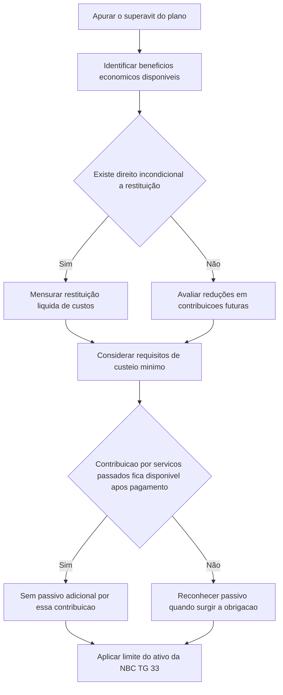

# ITG 20 — Limite de ativo de benefício definido, requisitos de custeio (funding) mínimo e sua interação

> [!abstract] Resumo em 30 segundos
> A ITG 20 orienta como avaliar se um superávit de plano de benefício definido pode gerar benefício econômico para a entidade — por restituição ou redução de contribuições futuras — e como os requisitos de custeio mínimo afetam essa avaliação. Se contribuições obrigatórias para cobrir serviços já prestados não puderem ser recuperadas nem reduzir contribuições futuras depois de pagas ao plano, a entidade reconhece um passivo quando surge a obrigação.

## Ficha rápida

| Campo | Síntese |
|---|---|
| Norma | ITG 20 — Limite de ativo de benefício definido, requisitos de custeio mínimo e sua interação |
| Objeto | Disponibilidade de restituições e reduções de contribuições futuras; efeitos do custeio mínimo |
| Aplicação | Benefícios definidos pós-emprego e outros benefícios definidos de longo prazo a empregados |
| Referência técnica de base | IFRIC 14 do IASB, conforme indicado no texto da resolução |
| Normas relacionadas citadas | NBC TG 33, NBC TG 26, NBC TG 23 e NBC TG 25 |
| Data indicada no texto | O texto declara vigência na data de publicação e aplicação aos exercícios iniciados a partir de 1º de janeiro de 2014 |

> [!info] Termos
> A ITG 20 esclarece que “custeio”, nesta Interpretação, tem o mesmo significado de “financiamento” na versão então atual da NBC TG 33 e de *funding* na versão então atual da IAS 19.

## Objetivo e alcance

A interpretação trata de três questões: quando restituições ou reduções de contribuições futuras são consideradas disponíveis para determinar o teto de ativo; como o custeio mínimo pode restringir essas reduções; e em que circunstâncias uma obrigação de custeio mínimo origina um passivo (item 6).

Aplica-se a todos os benefícios definidos pós-emprego e a outros benefícios definidos de longo prazo a empregados. Para essa finalidade, requisito de custeio mínimo é qualquer exigência de custeio de plano de benefício definido pós-emprego ou de outro plano de longo prazo (itens 4 e 5).

A NBC TG 33 limita o ativo de benefício definido líquido ao menor valor entre o superávit do plano e o teto de ativo. O teto corresponde ao valor presente dos benefícios econômicos disponíveis por restituições do plano ou por reduções nas contribuições futuras. A ITG 20 detalha como identificar esses benefícios econômicos, considerando os termos do plano e os requisitos aplicáveis na jurisdição do plano.

## Conceitos-chave

- **Superávit do plano:** valor justo dos ativos do plano menos o valor presente da obrigação de benefício definido.
- **Teto de ativo:** limite do ativo de benefício definido líquido, associado ao valor presente dos benefícios econômicos disponíveis por restituição ou redução de contribuições futuras.
- **Benefício econômico disponível:** benefício que a entidade pode realizar em algum momento durante a vigência do plano ou quando seus passivos forem liquidados. Não precisa ser realizável imediatamente no encerramento do período (item 8).
- **Direito incondicional à restituição:** direito que não depende de evento futuro incerto fora do controle total da entidade. Se a restituição depender desse tipo de evento, não há direito incondicional e o ativo não deve ser reconhecido (itens 11 e 12).
- **Defasagem de custeio mínimo por serviços passados:** insuficiência de custeio relacionada a serviços já recebidos; deve ser analisada separadamente das contribuições para serviços futuros (itens 18 e 19).
- **Pré-pagamento:** contribuição feita antes de ser exigida, que pode reduzir contribuições mínimas futuras para serviços futuros (item 20(a)).

## Diagrama de decisão

## Aplicação passo a passo — checklist

1. **Identifique o superávit ou déficit** conforme a NBC TG 33, usando os valores do plano no encerramento do período.
2. **Leia os termos do plano e os requisitos estatutários aplicáveis.** A disponibilidade deve ser determinada com base nesses termos e requisitos (item 7).
3. **Avalie as restituições possíveis.** Verifique se a entidade tem direito incondicional durante a vigência do plano, em liquidação gradual dos passivos ou em liquidação plena do plano. Considere custos associados à restituição.
4. **Avalie as reduções nas contribuições futuras.** Determine o benefício econômico máximo disponível por restituições, reduções ou combinação das duas. Não combine benefícios com base em premissas mutuamente excludentes (itens 9 e 16–17).
5. **Separe as contribuições mínimas por finalidade:** as destinadas a cobrir defasagens relativas a serviços passados e as destinadas a serviços futuros (item 18).
6. **Se houver custeio mínimo para serviços futuros,** considere o pré-pagamento e compare o custo de serviço futuro estimado com as contribuições mínimas estimadas (itens 20–22).
7. **Teste se as contribuições por serviços passados estarão disponíveis depois de pagas.** Se não estiverem, reconheça o passivo quando surgir a obrigação (itens 23 e 24).
8. **Aplique o teto de ativo** da NBC TG 33 e avalie as divulgações sobre incertezas relevantes.

## Reconhecimento e mensuração

### Restituições

Uma restituição só está disponível se a entidade tiver direito incondicional a ela em pelo menos uma das situações previstas: durante a vigência do plano; considerando a liquidação gradual dos passivos até que todos os participantes tenham deixado o plano; ou considerando a liquidação integral em um único evento, como o encerramento do plano (item 11).

A mensuração parte do superávit no encerramento do período que a entidade tem direito de receber, menos os custos associados. Se a restituição estiver sujeita a imposto que não seja imposto sobre a renda, por exemplo, a mensuração deve considerar o valor líquido desse imposto (item 13). Para restituição em encerramento do plano, devem ser incluídos os custos de liquidação dos passivos e da restituição, como honorários pagos pelo plano e prêmios de seguro necessários (item 14).

Quando a restituição é definida como valor total ou proporção do superávit, não se ajusta o valor pelo efeito do tempo, ainda que a realização ocorra apenas em data futura (item 15).

### Reduções nas contribuições futuras

Se não houver requisito de custeio mínimo para serviços futuros, o benefício econômico disponível corresponde ao custo de serviço futuro para a entidade em cada período, ao longo do menor entre a vida esperada do plano e a vida esperada da entidade. Não inclui valores assumidos pelos empregados (item 16).

A estimativa usa premissas consistentes com as da obrigação de benefício definido e com a situação existente no encerramento do período. Não se presume mudança futura nos benefícios antes de o plano ser alterado. Também se presume força de trabalho estável, salvo redução prevista no número de empregados cobertos pelo plano (item 17).

Se houver custeio mínimo para serviços futuros, o benefício econômico disponível é a soma de:

- valores que reduzam contribuições mínimas futuras por causa de pré-pagamentos; e
- custo de serviço futuro estimado menos contribuições mínimas estimadas para serviços futuros, calculadas como se não houvesse o pré-pagamento.

As estimativas devem considerar eventual superávit calculado na base de custeio mínimo. Devem seguir essa base e, para fatores que ela não especifique, usar premissas consistentes com as da obrigação de benefício definido. Mudanças na base só entram na estimativa se estiverem substantivamente promulgadas ou contratualmente pactuadas no encerramento do período. O componente calculado pela diferença entre custo de serviço e contribuições mínimas não pode ser inferior a zero (itens 20–22).

### Passivo por custeio mínimo

Para contribuições exigidas para cobrir defasagem relativa a serviços já recebidos, a entidade avalia se, depois de pagas ao plano, elas estarão disponíveis como restituição ou redução de contribuições futuras. Na medida em que não estejam disponíveis, reconhece um passivo quando surge a obrigação. Esse passivo reduz o ativo de benefício definido líquido ou aumenta o passivo líquido, de modo que o pagamento posterior das contribuições não gere ganho ou perda pela aplicação do limite de ativo da NBC TG 33 (itens 23 e 24).

> [!tip] Fórmula de orientação
> Para a redução de contribuições futuras com custeio mínimo para serviços futuros, considere: **pré-pagamentos que reduzam contribuições futuras + custo de serviço futuro estimado − contribuições mínimas estimadas sem pré-pagamento**. O resultado do segundo componente não pode ser negativo.

## Divulgação

A entidade deve divulgar, conforme a NBC TG 26, informações sobre fontes de incerteza de estimativa que possam causar ajuste relevante no valor contábil do ativo ou passivo líquido reconhecido. Isso pode incluir restrições à realização atual do superávit ou a base usada para determinar o benefício econômico disponível (item 10).

## Exceções e erros comuns

> [!warning] Pontos de atenção
> - **Não confunda contribuição obrigatória com passivo automático.** A obrigação de contribuir, por si só, não gera necessariamente passivo líquido adicional: é preciso avaliar se o valor pago ficará disponível à entidade.
> - **Não trate como incondicional um direito dependente de evento futuro incerto** que não esteja totalmente sob controle da entidade. Nesse caso, não se reconhece o ativo por restituição (item 12).
> - **Não presuma disponibilidade imediata.** O benefício pode estar disponível mesmo que só possa ser realizado futuramente (item 8).
> - **Não some restituição e redução de contribuições com premissas incompatíveis.** Deve-se determinar o benefício econômico máximo sem combinar cenários mutuamente exclusivos (item 9).
> - **Não misture serviços passados e futuros.** As contribuições para sanar defasagem por serviços já recebidos são analisadas separadamente das contribuições para serviços futuros.
> - **Não reduza abaixo de zero** o componente de redução futura calculado no item 20(b), mesmo que as contribuições mínimas estimadas excedam o custo de serviço futuro (item 22).
> - **Não incorpore mudanças ainda não formalizadas** na base de custeio mínimo: a estimativa não inclui alterações que não estejam substantivamente promulgadas ou contratualmente pactuadas ao fim do período (item 21).

Os exemplos ilustrativos do PDF demonstram aplicações numéricas, mas são identificados como acompanhantes da Interpretação e não como parte integrante dela. Seus valores não devem ser tratados como limites ou parâmetros gerais.

## Conexões com outras normas

- **NBC TG 33 — Benefícios a Empregados:** fornece o contexto do teto de ativo e as bases para mensuração da obrigação de benefício definido e do custo de serviço futuro.
- **NBC TG 26 — Apresentação das Demonstrações Contábeis:** relacionada à divulgação de incertezas de estimativa relevantes.
- **NBC TG 23 — Políticas Contábeis, Mudança de Estimativa e Retificação de Erro** e **NBC TG 25 — Provisões, Passivos Contingentes e Ativos Contingentes:** aparecem na seção de referências da Interpretação; o texto fornecido não detalha uma orientação específica de aplicação dessas normas.

## Fonte

**PDF fornecido:** *ITG 20.pdf*. Resumo elaborado com base no texto técnico da ITG 20 e nos exemplos ilustrativos nele incluídos.
