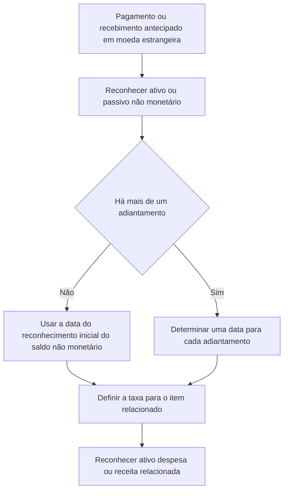

# ITG 21 — Transação em Moeda Estrangeira e Adiantamento

> [!abstract] Resumo em 30 segundos
> Quando uma entidade paga ou recebe antecipadamente uma contraprestação em moeda estrangeira e reconhece, por isso, um ativo ou passivo não monetário antes do item relacionado, a data da transação para definir a taxa de câmbio é a data do reconhecimento inicial desse ativo ou passivo não monetário. Havendo vários adiantamentos, cada um tem sua própria data da transação e taxa aplicável.

## Ficha rápida

| Campo | Síntese |
|---|---|
| Norma | ITG 21 — Transação em Moeda Estrangeira e Adiantamento |
| Finalidade | Definir a data da transação para determinar a taxa de câmbio aplicável a itens relacionados a pagamentos ou recebimentos antecipados em moeda estrangeira |
| Referência central | NBC TG 02 — Efeitos das Mudanças nas Taxas de Câmbio e Conversão de Demonstrações Contábeis |
| Vigência informada no PDF | 1º de janeiro de 2018 |
| Transição | Aplicação retrospectiva conforme NBC TG 23 ou aplicação prospectiva segundo as alternativas descritas no Apêndice A |

## Objetivo e alcance

A ITG 21 esclarece como determinar a “data da transação” prevista nos itens 21 e 22 da NBC TG 02 quando há contraprestação antecipada em moeda estrangeira. Essa data serve para designar a taxa de câmbio usada no reconhecimento inicial do ativo, da despesa ou da receita relacionados, inclusive quando apenas uma parte desses itens decorre do adiantamento. Também se relaciona ao desreconhecimento do ativo ou passivo não monetário originado pelo pagamento ou recebimento antecipado (itens 7 a 9, p. 2).

A interpretação se aplica quando, antes do reconhecimento do ativo, da despesa ou da receita relacionados, a entidade reconhece um ativo ou passivo não monetário decorrente do pagamento ou recebimento antecipado em moeda estrangeira (item 4, p. 2).

> [!info] Ideia essencial
> O adiantamento pode gerar primeiro um ativo não monetário — no caso de pagamento — ou um passivo não monetário — no caso de recebimento. A data em que esse saldo é reconhecido inicialmente é a referência cambial para o item relacionado, dentro do alcance da interpretação.

## Conceitos-chave

- **Data da transação:** para a situação tratada pela ITG 21, é a data em que a entidade reconhece inicialmente o ativo não monetário ou o passivo não monetário decorrente do pagamento ou recebimento antecipado.
- **Contraprestação antecipada:** pagamento ou recebimento em moeda estrangeira anterior ao reconhecimento do ativo, da despesa ou da receita relacionados.
- **Ativo ou passivo não monetário:** saldo reconhecido em razão do adiantamento, antes do reconhecimento do item relacionado. O texto cita, como exemplo de passivo contratual por recebimento, a situação descrita na NBC TG 47.
- **Vários adiantamentos:** cada pagamento ou recebimento antecipado deve ser tratado com sua própria data da transação.

A ITG 21 parte da regra geral da NBC TG 02: no reconhecimento inicial, a transação em moeda estrangeira é convertida para a moeda funcional pela taxa de câmbio à vista na data da transação. Para o caso específico de adiantamento, a interpretação define qual data deve ser considerada (itens 1 e 8, p. 1 e 2).

## Diagrama do tratamento

## Aplicação passo a passo — checklist

1. **Identifique a moeda da contraprestação.** Confirme se o pagamento ou recebimento antecipado está denominado em moeda estrangeira.
2. **Verifique a ordem dos reconhecimentos.** Determine se o adiantamento levou ao reconhecimento de um ativo ou passivo não monetário antes do ativo, da despesa ou da receita relacionados.
3. **Confirme o alcance.** Verifique se o item relacionado não está em uma situação excluída do tratamento indicado pela interpretação.
4. **Localize a data de reconhecimento inicial do saldo não monetário.** Essa data, e não automaticamente a data posterior do reconhecimento do item relacionado, é a data da transação para a finalidade da ITG 21.
5. **Determine a taxa aplicável.** Use a taxa de câmbio correspondente à data da transação definida para o adiantamento, conforme a regra da NBC TG 02.
6. **Trate cada adiantamento separadamente.** Se houver vários pagamentos ou recebimentos antecipados, determine a data da transação para cada um.
7. **Aplique a taxa ao item relacionado.** Considere a parcela do ativo, da despesa ou da receita vinculada ao adiantamento.
8. **Registre o desreconhecimento correspondente.** Ao reconhecer o item relacionado, considere o desreconhecimento do ativo ou passivo não monetário resultante da contraprestação antecipada.

> [!tip] Controle prático
> Mantenha a trilha de cada parcela antecipada: valor em moeda estrangeira, data do reconhecimento do ativo ou passivo não monetário, taxa utilizada e parcela do item relacionado. Isso ajuda a aplicar corretamente a regra quando há mais de um adiantamento.

## Reconhecimento e mensuração

A taxa de câmbio é determinada com base na data em que o ativo não monetário ou o passivo não monetário decorrente do adiantamento é reconhecido inicialmente. Essa taxa é utilizada no reconhecimento inicial do ativo, da despesa ou da receita relacionados, ou da parte correspondente (item 8, p. 2).

Quando houver mais de um pagamento ou recebimento antecipado, não se deve tratar todos como se tivessem necessariamente uma única data: a entidade determina uma data da transação para cada adiantamento (item 9, p. 2).

### Exemplo conceitual

Uma entidade recebe antecipadamente moeda estrangeira e reconhece um passivo não monetário. Em momento posterior, reconhece a receita relacionada. Para a parcela vinculada ao recebimento antecipado, a data da transação é a data do reconhecimento inicial daquele passivo não monetário. Se houver outro recebimento antecipado, sua data deve ser apurada separadamente.

O exemplo apenas ilustra a regra; não substitui a análise da norma específica aplicável ao reconhecimento da receita.

## Divulgação

A ITG 21 não apresenta, no texto fornecido, exigências específicas de divulgação. A interpretação trata da determinação da data da transação e da taxa de câmbio aplicável. Assim, não se deve atribuir a ela uma obrigação de divulgação que não esteja descrita no PDF.

## Exceções e erros comuns

### Situações fora da aplicação indicada

A interpretação não se aplica quando o ativo, a despesa ou a receita relacionados forem mensurados inicialmente:

- pelo valor justo; ou
- pelo valor justo da contraprestação paga ou recebida em data diferente da data em que o ativo ou passivo não monetário do adiantamento foi reconhecido inicialmente.

O PDF apresenta a mensuração de ágio por expectativa de rentabilidade futura em combinação de negócios, conforme a NBC TG 15, como exemplo dessa segunda situação (item 5, p. 2).

A entidade **não é obrigada** a aplicar a interpretação a tributos sobre o lucro nem a contratos de seguro que emite — incluindo contratos de resseguro — ou a contratos de resseguro que retém (item 6, p. 2). O texto expressa uma dispensa de aplicação, não uma regra geral de mensuração para esses itens.

> [!warning] Erros a evitar
> - Usar automaticamente a data de reconhecimento da receita ou do ativo relacionado, ignorando a data anterior do reconhecimento do saldo não monetário do adiantamento.
> - Atribuir uma única data a vários adiantamentos sem avaliá-los individualmente.
> - Aplicar a interpretação sem verificar as situações de mensuração excluídas.
> - Tratar os itens para os quais a aplicação não é obrigatória como se a ITG 21 impusesse sua aplicação.

## Transição e vigência

O PDF informa que a interpretação entra em vigor em **1º de janeiro de 2018**. O Apêndice A também informa que, para pleno atendimento às normas internacionais de contabilidade, a aplicação é para períodos anuais iniciados em ou após essa data (p. 2–3).

Na adoção inicial, a entidade deve escolher uma das alternativas descritas no Apêndice A:

1. aplicar retrospectivamente, conforme a NBC TG 23; ou
2. aplicar prospectivamente a todos os ativos, despesas e receitas no alcance da interpretação inicialmente reconhecidos a partir do início:
   - do período em que a entidade aplicar a interpretação pela primeira vez; ou
   - do período comparativo anterior apresentado nas demonstrações do período da primeira aplicação.

Na aplicação prospectiva, a entidade também aplica a interpretação aos ativos, às despesas e às receitas reconhecidos a partir da data escolhida quando o ativo ou passivo não monetário decorrente do adiantamento tiver sido reconhecido antes dessa data (Apêndice A, itens A2 e A3, p. 3).

## Conexões com outras normas

- **NBC TG 02:** fornece a regra de conversão inicial pela taxa de câmbio à vista e a referência à data da transação, que a ITG 21 esclarece para contraprestações antecipadas.
- **NBC TG 23:** é mencionada como base para a alternativa de aplicação retrospectiva na adoção inicial.
- **NBC TG 47:** é citada no contexto de recebimentos antecipados e apresentação de passivo contratual.
- **NBC TG 15:** aparece como exemplo de situação de mensuração que pode ficar fora da aplicação da interpretação.

## Fonte

**ITG 21 — Transação em Moeda Estrangeira e Adiantamento**, conforme texto do PDF fornecido, páginas 1 a 3. O PDF identifica a aprovação da interpretação pelo Conselho Federal de Contabilidade e informa que ela foi elaborada de acordo com a IFRIC 22 do IASB.
