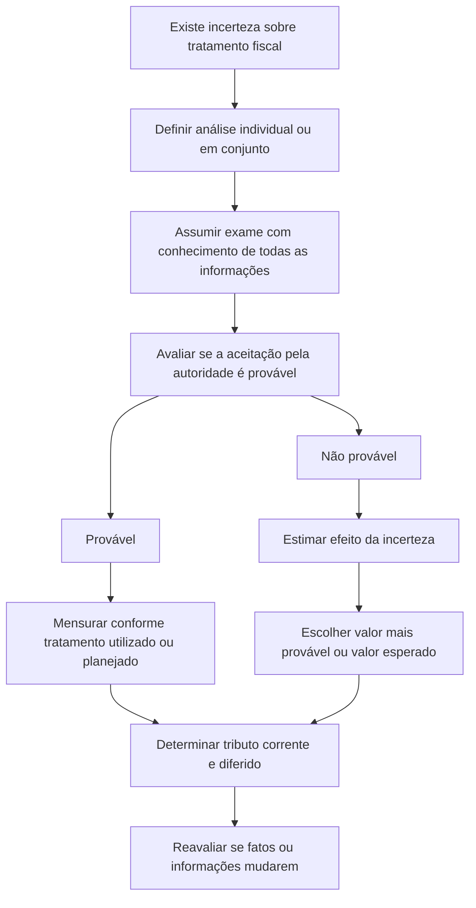

# ITG 22 — Incerteza sobre Tratamento de Tributos sobre o Lucro

> [!abstract] Resumo em 30 segundos
> A ITG 22 explica como contabilizar tributos sobre o lucro quando há dúvida se a autoridade fiscal aceitará o tratamento tributário adotado ou planejado pela entidade. A entidade define se analisa tratamentos incertos individualmente ou em conjunto; presume que a autoridade fiscal examinará os valores a que tem direito e conhecerá todas as informações pertinentes; avalia se é provável que aceite o tratamento; e, se não for provável, estima o efeito da incerteza pelo método que melhor preveja sua resolução. Mudanças em fatos ou informações exigem reavaliação.

## Ficha rápida

| Campo | Síntese |
|---|---|
| Norma | ITG 22 — Incerteza sobre Tratamento de Tributos sobre o Lucro |
| Grupo | 03 - ITG |
| Tema | Reconhecimento e mensuração de tributos correntes e diferidos em situações de incerteza fiscal |
| Norma relacionada central | NBC TG 32 — Tributos sobre o Lucro |
| Vigência indicada no texto técnico | Aplicação a períodos anuais iniciados em ou após 1º de janeiro de 2019 |
| Transição | Aplicação retrospectiva conforme uma das duas abordagens previstas no Apêndice B |

## Objetivo e alcance

A Interpretação esclarece como aplicar os requisitos de reconhecimento e mensuração da NBC TG 32 quando houver incerteza sobre tratamentos de tributos sobre o lucro. A entidade determina os valores de lucro tributável ou prejuízo fiscal, bases fiscais, prejuízos fiscais não utilizados, créditos fiscais não utilizados e alíquotas fiscais segundo a ITG 22. Com esses valores, reconhece e mensura os ativos e passivos de tributos correntes ou diferidos pertinentes. (p. 2, itens 4–5)

A incerteza pode decorrer de dúvida sobre a aplicação da legislação tributária a uma transação ou circunstância. A aceitabilidade do tratamento pode só ser esclarecida futuramente pela autoridade fiscal ou por um tribunal. (p. 1–2, itens 1–3)

### Conceitos-chave

- **Tratamento fiscal:** tratamento que a entidade utiliza ou planeja utilizar na apuração dos tributos sobre o lucro.
- **Autoridade fiscal:** órgão ou órgãos que decidem se o tratamento é aceitável conforme a legislação tributária; pode incluir tribunais.
- **Tratamento fiscal incerto:** tratamento cuja aceitação pela autoridade fiscal, segundo a legislação tributária, é incerta.
- **Exemplo de tratamento incerto:** não apresentar apuração de tributos sobre o lucro em uma jurisdição ou deixar determinada receita fora do lucro tributável, quando a aceitabilidade dessas posições não estiver clara. (p. 2, item 3)

## Diagrama de decisão

## Aplicação passo a passo — checklist

1. **Identifique o tratamento incerto.** Verifique se existe incerteza sobre a aceitação de um tratamento adotado ou planejado na apuração dos tributos sobre o lucro.
2. **Escolha a unidade de análise.** Decida se cada tratamento será considerado separadamente ou em conjunto com outros. A escolha deve corresponder à abordagem que melhor estime como a incerteza será resolvida. Considere, por exemplo, como a entidade prepara e sustenta suas apurações e como espera que a autoridade fiscal examine e resolva as questões. (p. 2, itens 6–7)
3. **Adote a premissa sobre o exame fiscal.** Considere que a autoridade examinará os valores que tem direito de examinar e que terá pleno conhecimento de todas as informações relacionadas. (p. 2, item 8)
4. **Avalie a probabilidade de aceitação.** Julgue se é provável que a autoridade fiscal aceite o tratamento incerto. (p. 3, item 9)
5. **Determine os valores fiscais.** Se a aceitação for provável, use o tratamento fiscal utilizado ou planejado. Se não for provável, reflita a incerteza nos valores fiscais aplicáveis.
6. **Selecione o método de mensuração, se necessário.** Use o valor mais provável ou o valor esperado, conforme qual deles melhor preveja a resolução da incerteza.
7. **Mantenha consistência entre tributos correntes e diferidos.** Se o tratamento afetar ambos, aplique julgamentos e estimativas consistentes. (p. 3, item 12)
8. **Reavalie quando houver mudanças relevantes.** Considere mudanças em fatos, circunstâncias ou novas informações que afetem o julgamento ou a estimativa.
9. **Avalie divulgações e eventos subsequentes.** Verifique os requisitos aplicáveis da NBC TG 26, da NBC TG 32 e da NBC TG 24, conforme o caso.

## Reconhecimento e mensuração

A ITG 22 não estabelece uma apuração fiscal alternativa: orienta como determinar as premissas e os valores usados na aplicação da NBC TG 32 diante da incerteza.

| Conclusão sobre a aceitação | Tratamento contábil indicado |
|---|---|
| É provável que a autoridade aceite o tratamento | Determinar os valores fiscais de forma consistente com o tratamento utilizado ou planejado na declaração de tributos sobre o lucro. |
| Não é provável que a autoridade aceite o tratamento | Refletir o efeito da incerteza nos valores fiscais pertinentes, usando o método que melhor preveja sua resolução. |

Os dois métodos previstos para refletir o efeito da incerteza são:

- **Valor mais provável:** o único valor mais provável entre os resultados possíveis. Pode ser a melhor previsão quando os resultados forem binários ou estiverem concentrados em um valor.
- **Valor esperado:** soma dos resultados possíveis ponderados por suas probabilidades. Pode ser a melhor previsão quando houver diversos resultados que não sejam binários nem concentrados em um único valor. (p. 3, item 11)

A norma não determina que se use sempre um dos métodos. A escolha depende de qual deles fornece a melhor previsão da resolução da incerteza. Se o tratamento afetar tanto o tributo corrente quanto o diferido — por exemplo, o lucro tributável e as bases fiscais —, julgamentos e estimativas devem ser consistentes para ambos. (p. 3, itens 11–12)

> [!tip] Escolha do método
> Documente por que o valor mais provável ou o valor esperado representa melhor os resultados possíveis do caso. A ITG 22 associa a escolha à natureza e à distribuição dos resultados, não a uma preferência automática por um método.

## Mudanças em fatos e circunstâncias

A entidade deve reavaliar o julgamento ou a estimativa quando os fatos e circunstâncias que os sustentam mudarem ou quando surgirem novas informações que os afetem. A mudança pode alterar a conclusão sobre a aceitação do tratamento, a estimativa do efeito da incerteza, ou ambas. Seu efeito é tratado como mudança de estimativa contábil, aplicando-se a NBC TG 23. Para mudanças ocorridas após o encerramento do período, a entidade aplica a NBC TG 24 para determinar se são eventos que requerem ajuste. (p. 3, itens 13–14)

Exemplos que podem levar à reavaliação, dependendo das circunstâncias:

- resultados de exames ou ações da autoridade fiscal, inclusive concordância ou discordância sobre tratamentos semelhantes;
- informações sobre valores pagos ou recebidos para liquidar tratamentos fiscais semelhantes;
- alterações nas regras estabelecidas pela autoridade fiscal;
- extinção ou prescrição do direito de examinar ou reexaminar o tratamento. (p. 4, Apêndice A, itens A1–A2)

A relevância das informações deve ser avaliada no contexto das leis fiscais aplicáveis. Uma alteração pode exigir reavaliação para um tratamento e não para outro, por estarem sujeitos a leis diferentes. (p. 4, item A1)

## Divulgação

Quando houver incerteza sobre tratamentos de tributos sobre o lucro, a entidade avalia se deve divulgar:

- julgamentos feitos ao determinar lucro tributável ou prejuízo fiscal, bases fiscais, prejuízos fiscais não utilizados, créditos fiscais não utilizados e alíquotas fiscais, conforme o item 122 da NBC TG 26;
- informações sobre premissas e dados usados nessas determinações, conforme os itens 125 a 129 da NBC TG 26. (p. 4, item A4)

Se a entidade concluir que é provável que a autoridade aceite o tratamento incerto, também deve avaliar se divulga o efeito potencial da incerteza como contingência relacionada a tributos, conforme o item 88 da NBC TG 32. (p. 4, item A5)

> [!info] Avaliar não é divulgar automaticamente
> O Apêndice A orienta a entidade a determinar se deve divulgar as informações indicadas, com referência aos requisitos das normas citadas. Não transforma toda incerteza, por si só, em divulgação obrigatória sem essa avaliação.

## Exceções e erros comuns

> [!warning] Pontos de atenção
> - **Não escolha a unidade de análise por conveniência:** considerar tratamentos separadamente ou em conjunto deve refletir a abordagem que melhor estime a resolução da incerteza.
> - **Não pressuponha um exame limitado:** a premissa é que a autoridade examinará os valores que pode examinar e conhecerá todas as informações relacionadas.
> - **Não aplique sempre o mesmo método de mensuração:** valor mais provável e valor esperado são alternativas; selecione o que melhor prevê a resolução para o caso.
> - **Não trate silêncio da autoridade, isoladamente, como nova evidência:** a ausência de concordância ou discordância, por si só, provavelmente não constitui mudança de fatos ou novas informações que afetem julgamentos e estimativas. (p. 4, item A3)
> - **Não ignore a ligação entre tributo corrente e diferido:** quando ambos forem afetados, julgamentos e estimativas devem ser consistentes.
> - **Não confunda reavaliação com correção de erro:** a Interpretação direciona o efeito de mudanças em fatos ou novas informações para a contabilização de mudança de estimativa, nos termos da NBC TG 23. (p. 3, item 14)

## Vigência e transição

O Apêndice B informa que os órgãos reguladores definem a vigência para as entidades sob sua regulação. Para atendimento às normas internacionais de contabilidade, a ITG 22 deve ser aplicada a períodos anuais iniciados em ou após **1º de janeiro de 2019**. (p. 5, item B1)

Na aplicação inicial, a entidade escolhe uma das abordagens retrospectivas:

1. aplicar retrospectivamente a NBC TG 23, se isso for possível sem uso de fatos e conhecimentos posteriores; ou
2. reconhecer o efeito cumulativo da aplicação inicial na data de aplicação inicial, sem refazer informações comparativas. Nesse caso, o efeito é ajustado ao saldo de abertura de lucros acumulados ou a outro componente apropriado do patrimônio líquido. (p. 5, item B2)

A resolução de aprovação identifica a norma como elaborada de acordo com sua equivalente internacional, a IFRIC 23, e declara sua entrada em vigor na data de publicação, além de indicar a aplicação aos exercícios iniciados em ou após 1º de janeiro de 2019. (p. 1, resolução; p. 3, Vigência)

## Conexões com outras normas

- **NBC TG 32 — Tributos sobre o Lucro:** norma cujos requisitos de reconhecimento e mensuração são aplicados com as orientações da ITG 22.
- **NBC TG 23 — Políticas Contábeis, Mudança de Estimativa e Retificação de Erro:** aplicada ao efeito de mudanças em fatos, circunstâncias ou novas informações e indicada na transição.
- **NBC TG 24 — Evento Subsequente:** usada para avaliar se uma mudança posterior ao encerramento exige ajuste.
- **NBC TG 26 — Apresentação das Demonstrações Contábeis:** referência para avaliar divulgações de julgamentos, premissas e informações relevantes.

## Fonte

**PDF fornecido:** *ITG 22.pdf* — Norma Brasileira de Contabilidade ITG 22, *Incerteza sobre Tratamento de Tributos sobre o Lucro*. Referências de página e item indicadas no resumo correspondem ao texto do PDF.
