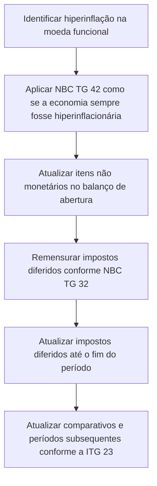

# ITG 23 — Aplicação da Abordagem de Atualização Monetária Prevista na NBCTG 42

> [!abstract] Resumo em 30 segundos
> A ITG 23 orienta a aplicação da NBC TG 42 quando a entidade identifica hiperinflação na economia de sua moeda funcional, embora ela não fosse hiperinflacionária no período anterior. A entidade deve tratar a economia como se sempre tivesse sido hiperinflacionária para aplicar os requisitos da NBC TG 42. A Interpretação também determina como calcular os impostos diferidos de abertura e atualizar valores comparativos e subsequentes.

## Ficha rápida

| Campo | Informação |
|---|---|
| Norma | ITG 23 — Aplicação da Abordagem de Atualização Monetária Prevista na NBC TG 42 |
| Emissão | 19 de dezembro de 2018 |
| Tema | Transição para a aplicação da NBC TG 42 ao identificar hiperinflação |
| Normas citadas | NBC TG 42 — Contabilidade em Economia Hiperinflacionária; NBC TG 32 — Tributos sobre o Lucro |
| Vigência indicada no PDF | Na data de publicação, aplicável aos exercícios iniciados em ou após 1º de janeiro de 2018 |

## Objetivo e alcance

A Interpretação esclarece a aplicação da NBC TG 42 no período em que a entidade identifica que a economia de sua moeda funcional se tornou hiperinflacionária, quando não era assim no período anterior. O texto informa que a identificação se baseia no julgamento da entidade, considerando os critérios do item 3 da NBC TG 42.

A ITG 23 trata de duas questões principais:

1. Como entender a exigência de apresentar as demonstrações em unidade de mensuração corrente no fim do período, prevista na NBC TG 42.
2. Como contabilizar os impostos diferidos de abertura nas demonstrações contábeis atualizadas monetariamente.

> [!info] Premissa central
> No período em que a hiperinflação é identificada, a entidade aplica a NBC TG 42 como se a economia tivesse sido hiperinflacionária durante todo o tempo relevante para as demonstrações.

## Conceitos-chave

- **Unidade de mensuração corrente:** unidade de medida aplicável ao fim do período de relatório, cuja mudança é considerada na atualização monetária.
- **Itens não monetários ao custo histórico:** para o balanço patrimonial de abertura do período mais antigo apresentado, a atualização reflete a inflação desde a aquisição do ativo ou desde o reconhecimento ou assunção do passivo até o fim do período.
- **Itens não monetários reconhecidos por valores correntes:** se o valor foi determinado em data diferente da aquisição do ativo ou do reconhecimento ou assunção do passivo, a atualização começa na data em que o valor contábil foi determinado.
- **Impostos diferidos de abertura:** são remensurados com base nos valores contábeis dos itens não monetários após sua atualização monetária na data do balanço de abertura e, depois, atualizados até o fim do período.

## Diagrama do processo

## Aplicação passo a passo e checklist

1. **Avalie a existência de hiperinflação.**  
   A identificação cabe ao julgamento da entidade, com base nos critérios da NBC TG 42. Não trate a conclusão como automática nem a determine apenas com base nesta Interpretação.

2. **Defina o balanço de abertura relevante.**  
   Para os itens não monetários ao custo histórico, considere o balanço patrimonial de abertura do início do período mais antigo apresentado nas demonstrações contábeis.

3. **Determine a data inicial da atualização de cada item não monetário.**
   - Para itens ao custo histórico: data de aquisição do ativo ou de reconhecimento ou assunção do passivo.
   - Para itens reconhecidos por valor corrente em data posterior: data em que o valor contábil foi determinado.

4. **Atualize os valores até o fim do período de relatório.**  
   A atualização deve refletir o efeito da inflação entre a data inicial aplicável e o final do período.

5. **Calcule os impostos diferidos de abertura em duas etapas.**
   - Primeiro, atualize os valores contábeis nominais dos itens não monetários até a unidade de mensuração vigente na data do balanço de abertura e, então, remensure os impostos diferidos segundo a NBC TG 32.
   - Depois, atualize monetariamente os impostos diferidos remensurados desde a data do balanço de abertura até o final do período.

6. **Repita a abordagem nos comparativos apresentados.**  
   A ITG 23 determina que o procedimento para os impostos diferidos de abertura também seja aplicado aos balanços de abertura dos períodos comparativos apresentados.

7. **Para períodos subsequentes, use as demonstrações do período anterior já atualizadas.**  
   Atualize os valores correspondentes, inclusive os impostos diferidos, aplicando a mudança na unidade de mensuração do período subsequente somente às demonstrações contábeis do período anterior que já tenham sido atualizadas.

> [!tip] Controle prático
> Mantenha documentadas, por item não monetário, a base de mensuração, a data de referência para iniciar a atualização e o valor atualizado utilizado na remensuração dos impostos diferidos.

## Reconhecimento e mensuração

### Itens não monetários

A regra transitória é tratar a economia como hiperinflacionária ao aplicar a NBC TG 42 no período de identificação. Para itens não monetários mensurados ao custo histórico, a atualização do balanço de abertura considera a inflação desde a data de aquisição do ativo ou de reconhecimento ou assunção do passivo.

Quando o item não monetário já constar do balanço de abertura por um valor corrente determinado em data posterior à aquisição ou ao reconhecimento do passivo, o período de atualização começa nessa data de determinação do valor.

### Impostos diferidos

No fim do período, os impostos diferidos devem ser reconhecidos e mensurados de acordo com a NBC TG 32. Para determinar os saldos de abertura, a sequência exigida é:

**Atualizar os valores contábeis dos itens não monetários na data de abertura → remensurar os impostos diferidos conforme a NBC TG 32 → atualizar esses impostos diferidos até o fim do período.**

A ITG 23 também determina que essa abordagem seja aplicada aos saldos de abertura dos períodos comparativos apresentados nas demonstrações atualizadas.

### Períodos subsequentes

Após a atualização monetária inicial, os valores correspondentes das demonstrações do período subsequente — inclusive impostos diferidos — devem ser atualizados considerando a mudança na unidade de mensuração somente sobre as demonstrações do período anterior já atualizadas monetariamente.

## Divulgação

O texto da ITG 23 fornecido não estabelece requisitos específicos de divulgação. A Interpretação apresenta orientações de aplicação e mensuração relacionadas à NBC TG 42 e à NBC TG 32. A entidade deve avaliar os requisitos de divulgação dessas normas relacionadas; não se deve deduzir desta ITG 23, isoladamente, uma obrigação de divulgação adicional.

## Exceções e erros comuns

A Interpretação não apresenta uma lista de exceções. Para evitar aplicação incorreta:

- **Não** comece a atualização de todo item não monetário na mesma data: a data depende da base e do momento em que o valor contábil foi determinado.
- **Não** remensure os impostos diferidos de abertura antes de atualizar os valores contábeis dos itens não monetários.
- **Não** confunda a remensuração conforme a NBC TG 32 com a atualização monetária posterior dos impostos diferidos: são etapas distintas.
- **Não** omita os balanços de abertura dos períodos comparativos apresentados.
- **Não** aplique a mudança da unidade de mensuração do período subsequente diretamente a valores comparativos ainda não atualizados; a ITG 23 determina que a base sejam as demonstrações anteriores já atualizadas.
- **Não** interprete a data de início do custo histórico como a data do balanço de abertura: a atualização considera a data de aquisição ou de reconhecimento ou assunção, conforme aplicável.

> [!warning] Limite do resumo
> A ITG 23 orienta pontos específicos da aplicação da NBC TG 42. Ela não substitui a leitura das normas referenciadas para os demais critérios de hiperinflação, reconhecimento, mensuração e divulgação.

## Conexões com outras normas

- **NBC TG 42:** norma cuja abordagem de atualização monetária é esclarecida pela ITG 23.
- **NBC TG 32:** norma a ser aplicada ao reconhecimento e à mensuração dos impostos diferidos no fim do período e à remensuração dos saldos de abertura.

## Fonte

Conselho Federal de Contabilidade, **ITG 23 — Aplicação da Abordagem de Atualização Monetária Prevista na NBC TG 42**, PDF *ITG 23.pdf*, páginas 1–2. As orientações centrais estão nos itens 1 a 5; a vigência consta do item 6.
