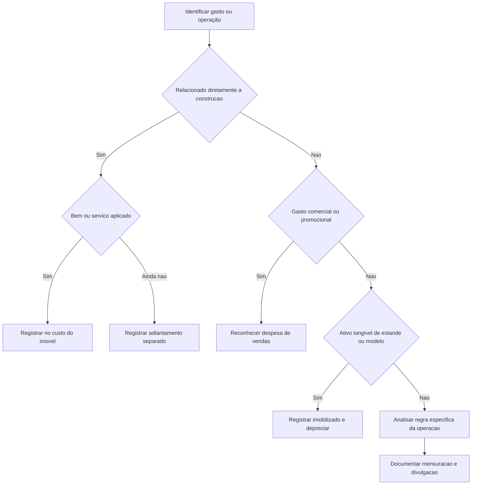

# CTG 01 — Entidades de Incorporação Imobiliária

## Resumo em 30 segundos

O CTG 01 esclarece práticas contábeis para entidades de incorporação imobiliária. Orienta quais gastos compõem o custo dos imóveis, quando reconhecer despesas de venda, como tratar permutas e garantias, e como avaliar cessões de recebíveis e ajuste a valor presente. Em geral, custos diretamente atribuíveis à construção podem integrar os estoques; propaganda é despesa do período; e a contabilização deve refletir a substância econômica das operações. O texto também exige divulgações específicas, como a política para encargos financeiros e os fundamentos usados para decidir sobre a baixa de recebíveis cedidos.

> [!abstract] Ideia central
> Classifique cada valor conforme sua natureza e substância: custo do imóvel, ativo separado, despesa, recebível mantido ou obrigação. Não inclua automaticamente no custo de construção gastos comerciais ou valores que ainda não foram efetivamente aplicados na obra.

## Ficha rápida

| Campo | Informação |
|---|---|
| Norma | CTG 01 — Entidades de Incorporação Imobiliária |
| Referência do documento | Resolução CFC nº 1.154/09 aprova o CTG 01 |
| Grupo | 04 - CTG |
| Assuntos principais | Custos, despesas de venda, permutas, garantias, cessão de recebíveis e ajuste a valor presente |
| Fonte analisada | `CTG 01.pdf` |

## Objetivo e alcance

O Comunicado esclarece assuntos que geravam dúvidas sobre práticas contábeis de entidades de incorporação imobiliária: formação do custo dos imóveis; comissões e outras despesas de venda; estandes e apartamentos-modelo; permutas físicas; provisão para garantias; cessão de recebíveis; ajuste a valor presente; e classificação de atualização monetária e juros sobre contas a receber de unidades concluídas e entregues (item 1).

As orientações abrangem reconhecimento, mensuração, classificação e divulgação. Para aplicá-las, é necessário identificar a natureza do gasto ou da operação e, em seguida, verificar se há condições para reconhecê-los como ativo, custo ou despesa.

## Conceitos-chave

- **Custo do imóvel:** gastos para obter o imóvel e prepará-lo, incluindo terreno, projetos e custos diretamente relacionados à construção. Os valores devem corresponder ao que foi efetivamente aplicado na obra (itens 2 e 3).
- **Encargos financeiros capitalizáveis:** encargos diretamente associados ao financiamento do empreendimento, observadas as condições e os limites definidos no Comunicado (itens 6 a 8).
- **Comissão de venda:** inicialmente registrada como pagamento antecipado e apropriada como despesa de vendas conforme os mesmos critérios de apropriação da receita de incorporação (item 10).
- **Permuta com substância comercial:** troca de unidades de naturezas ou valores diferentes, capaz de gerar ganho ou perda; a receita é mensurada pelo valor justo conforme os critérios descritos no texto (item 21).
- **Ajuste a valor presente (AVP):** mensuração que considera prazo e diferença entre taxas de juros, quando aplicável às contas a receber e a outros elementos descritos no Comunicado (itens 33 e 34).
- **Cessão de recebíveis:** operação cuja contabilização depende de quem mantém o controle, os direitos, os riscos e as responsabilidades associados aos créditos (itens 27 a 32).

## Diagrama de decisão

## Aplicação passo a passo — checklist

1. **Identifique a natureza do item.** Determine se o valor se refere à aquisição ou construção do imóvel, a uma atividade de venda, a um ativo tangível, a uma permuta, a uma garantia ou à cessão de créditos.
2. **Verifique se o custo foi incorrido e aplicado.** Adiantamentos a fornecedores permanecem em rubrica específica até que os bens ou serviços correspondentes sejam obtidos e efetivamente aplicados na construção (item 3).
3. **Separe custos recuperáveis de perdas.** Gastos contratuais sem probabilidade de recuperação são reconhecidos imediatamente no resultado como custo incorrido do empreendimento (item 5).
4. **Teste os requisitos de capitalização dos encargos.** Confirme a associação direta com o financiamento, o início das atividades necessárias e os limites de montante e período (itens 6 a 8).
5. **Distinga despesas de venda de custos de construção.** Comissões, propaganda, marketing e promoção não devem ser tratados como custo de construção; aplique a regra específica para cada um (itens 10 a 13).
6. **Avalie ativos de estande e apartamento-modelo.** Registre no imobilizado quando aplicável, estime a vida útil, deprecie e avalie indícios de desvalorização (itens 14 a 19).
7. **Examine permutas e garantias.** Verifique se a permuta envolve unidades de mesma natureza e valor e estime a obrigação de garantia com suporte em dados técnicos e históricos (itens 20 a 26).
8. **Na cessão de recebíveis, avalie a transferência efetiva.** Considere controle, direitos, riscos, responsabilidades e garantias; documente os fundamentos da decisão (itens 27 a 32).
9. **Analise a necessidade de AVP e a classificação dos efeitos.** Considere a natureza da venda, o prazo, as taxas e a substância do financiamento ao cliente (itens 33 a 35).
10. **Prepare as divulgações requeridas.** Inclua a política de encargos financeiros e os fundamentos relevantes para o tratamento dos recebíveis cedidos (itens 9 e 29).

## Reconhecimento e mensuração

### Custos dos imóveis e encargos financeiros

O custo do imóvel inclui preço do terreno e gastos necessários à aquisição e regularização; projetos; custos diretamente relacionados à construção, como preparação do terreno, canteiro e benfeitorias em áreas comuns; tributos não recuperáveis incorridos durante a construção; e encargos financeiros diretamente associados ao financiamento do empreendimento (item 2).

O custo corresponde ao que foi efetivamente aplicado. Adiantamentos a fornecedores são controlados separadamente e só passam a compor o custo conforme os bens ou serviços sejam obtidos e aplicados. O custo do imóvel vendido também considera o valor estimado das garantias posteriores à conclusão e entrega (itens 3 e 4).

Perdas contratuais sem probabilidade de recuperação são reconhecidas imediatamente como custo. Esse reconhecimento não depende do estágio da obra, não deve ser compensado com lucros estimados de outros empreendimentos e não afeta o cálculo da evolução da obra para fins de reconhecimento da receita (item 5).

A capitalização de encargos financeiros exige, entre outros aspectos, custos do terreno ou da construção, custos de empréstimos e atividades de preparação do imóvel em andamento. A capitalização vai até a conclusão física da construção e não altera o percentual de evolução da obra. O montante capitalizado não pode superar os encargos incorridos no período. O Comunicado também determina que os encargos elegíveis mantidos nos estoques sejam calculados proporcionalmente às unidades não comercializadas; a parcela atribuível às unidades comercializadas é apropriada ao resultado como custo dessas unidades (itens 7 e 8).

### Despesas de venda e ativos comerciais

As comissões de venda são registradas inicialmente como pagamentos antecipados e apropriadas ao resultado em despesas de vendas, acompanhando os critérios de apropriação da receita. Em cada balanço, inclusive intermediário, a entidade analisa os valores ainda não apropriados e os reconhece imediatamente como despesa se houver cancelamento da venda ou for provável que os valores contratados não serão pagos (itens 10 e 11).

Propaganda, marketing, promoções e atividades correlatas não integram o custo de construção, ainda que vinculadas a um empreendimento específico. São reconhecidas como despesas de vendas quando incorridas, conforme o período de veiculação; não podem ser diferidas até a entrega das unidades (itens 12 e 13).

Gastos diretamente relacionados à construção de estandes e apartamentos-modelo, bem como à aquisição de mobília e decoração, são registrados no imobilizado e depreciados durante a vida útil estimada. Se a vida útil estimada for inferior a 12 meses, os gastos são reconhecidos diretamente como despesas de vendas. A depreciação também é despesa de vendas e não afeta o lucro bruto nem o cálculo da evolução financeira da obra. Valores recuperados pela venda de mobílias ou partes do estande reduzem o custo desses itens. A entidade avalia indícios de desvalorização, como a venda de parte substancial das unidades ou o fim do uso do estande (itens 14 a 19).

### Permutas, garantias e recebíveis cedidos

A troca de unidades de mesma natureza e valor não gera ganho ou perda. Se as unidades tiverem natureza ou valor diferentes, a operação tem substância comercial e pode gerar ganho ou perda. A receita é mensurada pelo valor justo dos imóveis ou terrenos recebidos; se esse valor não puder ser mensurado com segurança, utiliza-se o valor de venda das unidades entregues. Na permuta de terreno por apartamentos a construir, o terreno é reconhecido como estoque, em contrapartida a adiantamento de clientes no passivo, na assinatura do instrumento ou contrato (itens 20 a 23).

A provisão para garantias considera os gastos estimados do período posterior à entrega das chaves, com base em dados técnicos do imóvel e no histórico de gastos. É registrada no passivo circulante ou não circulante, considerando unidades vendidas e percentual de evolução dos empreendimentos. A reversão ocorre apenas quando a obrigação se extingue por completo. O efeito da provisão não altera a evolução da obra. Se houver seguro ou terceiros responsáveis, a provisão deve considerar uma avaliação da probabilidade de saída de recursos (itens 24 a 26).

Para recebíveis cedidos, a existência de controle financeiro, retenção substancial de direitos ou riscos, obrigação de recompra ou garantias pode indicar que os créditos devem continuar reconhecidos como ativos, com o valor recebido registrado como passivo. A análise deve refletir a realidade econômica; após a entrega das unidades, a entidade reavalia a operação conforme os critérios indicados no item 27 (itens 27 a 32).

### Ajuste a valor presente

Nas vendas a prazo de unidades concluídas, avalia-se se a taxa prevista para os recebimentos futuros é compatível com a taxa usual de mercado em operações similares. Se houver diferença, as contas a receber são descontadas para que estejam mensuradas pelo valor justo na data da venda (item 34(a)).

Nas vendas a prazo de unidades não concluídas, as contas a receber calculadas conforme o percentual de evolução financeira da obra são mensuradas a valor presente considerando prazo e diferença entre a taxa de mercado e a taxa implícita nos contratos. O ajuste corresponde à diferença entre os preços à vista e a prazo para a mesma unidade. Os efeitos do ajuste são apropriados ao longo do tempo, conforme o prazo de fluência dos juros (item 34(b) e (c)).

A reversão do AVP pode ser classificada como receita financeira ou, quando o financiamento ao cliente fizer parte das atividades operacionais e isso estiver devidamente fundamentado, como receita operacional. A classificação deve ser consistente com o objeto social e divulgada em notas explicativas. O texto esclarece que os adiantamentos de clientes são passivos não monetários e não estão sujeitos ao AVP (item 34(c) e (d)).

Para unidades em construção, a receita é reconhecida conforme a proporção entre custos incorridos e custo total previsto, aplicada ao preço de venda contratual. Quando aplicável, o custo orçado a incorrer deve considerar preços à vista, descontados a valor presente (item 34(e)). A atualização monetária e os juros de contas a receber de unidades concluídas e entregues devem ser classificados de forma consistente com a orientação sobre reversão do AVP (item 35).

## Divulgação

- Divulgue a política contábil adotada para encargos financeiros de empréstimos (item 9).
- Nas operações de cessão de recebíveis, explique em nota explicativa as evidências usadas pela administração para fundamentar a decisão de manter ou não os créditos registrados (item 29).
- Divulgue claramente a classificação da reversão do AVP, quando aplicável, e sua fundamentação, em consistência com o objeto social da entidade (item 34(c)).
- A resolução que aprova o CTG 01 menciona aplicação aos exercícios sociais iniciados em 2008. O item 36 do texto técnico prevê adoção retrospectiva dos critérios, conforme a NBC TG 13.

## Exceções e erros comuns

> [!warning] Evite estes tratamentos
> - Capitalizar adiantamentos antes de obter e aplicar os bens ou serviços na construção.
> - Incluir propaganda, marketing e promoções no custo do imóvel ou diferir essas despesas até a entrega.
> - Deixar de reconhecer imediatamente gastos contratuais sem probabilidade de recuperação.
> - Incluir encargos financeiros no percentual de evolução da obra ou mantê-los integralmente no estoque sem considerar as unidades comercializadas.
> - Tratar toda permuta como operação sem ganho ou perda, sem avaliar natureza e valor das unidades.
> - Baixar recebíveis cedidos apenas pela forma contratual, sem examinar controle, riscos e responsabilidades mantidos.
> - Aplicar AVP aos adiantamentos de clientes, embora o texto os caracterize como passivos não monetários.
> - Reverter provisões para garantias antes da extinção completa da obrigação.

## Conexões com outras normas

O próprio CTG 01 remete à **NBC TG 12 — Ajuste a Valor Presente** para os procedimentos gerais e para a classificação das reversões do ajuste (itens 33 e 34). Também menciona a **NBC TG Estrutura Conceitual** ao tratar das transações que dão origem a ativos, passivos, receitas ou despesas (item 34(a)) e a **NBC TG 13 — Adoção Inicial da Lei nº 11.638/07 e da Medida Provisória nº 449/08** para a adoção retrospectiva dos critérios (item 36).

## Fonte

Conselho Federal de Contabilidade. **CTG 01 — Entidades de Incorporação Imobiliária**, no arquivo `CTG 01.pdf`. Referências a itens e páginas seguem a numeração impressa no documento; os itens técnicos citados estão nas páginas 2 a 9 do PDF.
