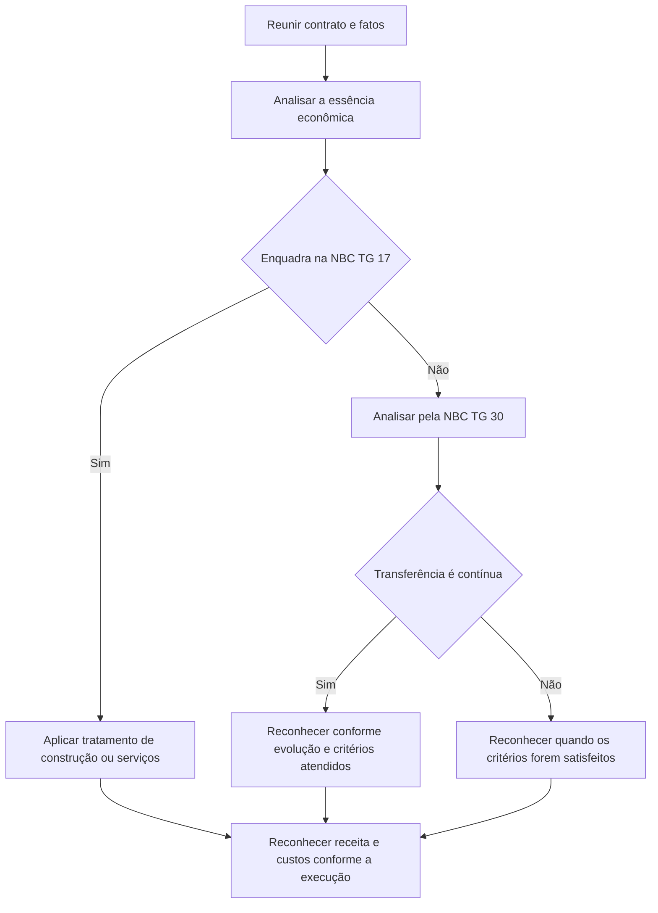

# CTG 04 — Aplicação da Interpretação Técnica ITG 02 – Contrato de Construção do Setor Imobiliário

> [!abstract] Resumo em 30 segundos
> O CTG 04 orienta a análise dos contratos imobiliários para determinar se estão no alcance da NBC TG 17 — Contratos de Construção ou da NBC TG 30 — Receitas e, principalmente, quando reconhecer receitas, custos e despesas. A classificação depende dos termos contratuais e das circunstâncias econômicas, não apenas do nome ou da forma jurídica do contrato. No contexto brasileiro descrito pelo Comunicado, a transferência de riscos e benefícios costuma ocorrer continuamente durante a obra, o que geralmente leva ao reconhecimento ao longo da construção. A conclusão, porém, deve ser feita contrato a contrato.

## Ficha rápida

| Campo | Síntese |
|---|---|
| Norma | CTG 04 |
| Assunto | Aplicação da ITG 02 aos contratos de construção do setor imobiliário |
| Foco | Enquadramento do contrato e momento de reconhecimento da receita |
| Referências centrais | NBC TG 17, NBC TG 30 e ITG 02 |
| Abordagem | Análise individual, com prevalência da essência econômica sobre a forma |

A Resolução CFC n.º 1.317/10 aprovou o Comunicado. O texto técnico do PDF apresenta a orientação do CTG 04; a referência à Resolução é apenas de identificação.

## Objetivo e alcance

O CTG 04 auxilia os preparadores a decidir se contratos de construção ou incorporação imobiliária estão no alcance da NBC TG 17 ou da NBC TG 30 e, consequentemente, a definir o momento de reconhecimento da receita (item 6).

A análise deve considerar os termos do contrato e todos os fatos e circunstâncias relacionados. O Comunicado enfatiza que cada contrato exige julgamento e que a substância econômica prevalece sobre a forma jurídica (itens 1 e 7).

O texto se concentra nas condições descritas para o ambiente econômico e jurídico brasileiro. Para atividades fora do Brasil ou situações sujeitas a condições legais ou contratuais diferentes, a análise deve considerar a legislação, os contratos e, quando aplicável, a jurisprudência específicos (item 5).

## Conceitos-chave

- **Contrato de construção:** para o enquadramento na NBC TG 17, o contrato deve atender à definição de contrato especificamente negociado para construir um ativo ou uma combinação de ativos (item 8).
- **Contrato de serviços:** pode ocorrer quando a entidade presta serviços de construção ou gerenciamento, sem assumir a compra e o fornecimento dos materiais de construção. O Comunicado também trata da prestação de serviços segundo a NBC TG 30, sujeita aos critérios ali indicados (itens 8 e 35).
- **Venda de bens:** se a entidade presta serviços junto com o fornecimento de materiais e mantém controle, riscos e benefícios até a conclusão, o contrato é tratado como venda de bens, com reconhecimento conforme os critérios da NBC TG 30 (item 36).
- **Transferência contínua:** o comprador recebe controle, riscos e benefícios significativos à medida que a construção avança. Se os critérios de reconhecimento aplicáveis forem atendidos continuamente, a receita é reconhecida conforme essa evolução (itens 21 e 24).
- **Transferência em um único momento:** o controle, os riscos e os benefícios significativos são transferidos de uma vez, como na entrega do imóvel pronto. Nesse caso, a receita só é reconhecida quando os critérios aplicáveis à venda de bens forem satisfeitos (item 31).

> [!info] Ponto de partida
> Uma “promessa de compra e venda” não deve ser tratada automaticamente como mera opção de compra futura. O Comunicado descreve que, no contexto brasileiro, ela costuma representar uma operação de compra e venda de unidade futura, com obrigações assumidas pelas partes. É necessário avaliar os direitos e obrigações efetivos do contrato (itens 13–17).

## Diagrama de análise

## Aplicação passo a passo — checklist

1. **Reúna a documentação relevante.** Examine contratos formais e verbais, aditivos, práticas atuais e passadas e o modelo de negócio da entidade (item 37).
2. **Analise a substância da operação.** Identifique os direitos e obrigações efetivos das partes, sem decidir apenas pelo título do instrumento (itens 1, 7 e 16).
3. **Avalie o envolvimento e o controle da entidade.** O enquadramento pressupõe que a entidade não mantenha envolvimento gerencial contínuo ou controle efetivo em grau que impeça o reconhecimento da receita (item 9, com referência à ITG 02).
4. **Teste o alcance da NBC TG 17.** Verifique se há contrato especificamente negociado para a construção de ativo ou combinação de ativos e considere se a entidade atua como prestadora de serviços de construção (item 8).
5. **Se o contrato não se enquadrar na NBC TG 17, aplique a análise da NBC TG 30.** Determine se a entidade vende bens, presta serviços ou combina fornecimento de materiais e serviços (itens 19, 34–36).
6. **Avalie quando há transferência de controle, riscos e benefícios significativos.** Considere direitos do comprador durante a obra, possibilidade de dispor do bem ou dos direitos aquisitivos e o que ocorreria se a construção fosse interrompida (itens 21–30).
7. **Defina o padrão de reconhecimento.** Conclua se a transferência ocorre continuamente ou em um único momento e verifique os critérios da norma aplicável.
8. **Identifique obrigações remanescentes.** Avalie garantias e outros serviços ou bens ainda devidos após a entrega (item 32).
9. **Documente o julgamento e a política contábil.** A conclusão deve refletir a análise do contrato e do modelo de negócio, e não uma regra única para todos os contratos da entidade (item 37).

> [!tip] Evidências de transferência durante a obra
> O Comunicado cita, entre outros exemplos, direitos do adquirente de dispor do imóvel ou dos direitos aquisitivos, participação do comprador na valorização ou desvalorização, possibilidade de os compradores substituírem a incorporadora em certas circunstâncias e direito de retenção do trabalho em andamento em caso de interrupção (itens 22 e 27–29). Esses elementos são evidências para julgamento, não uma lista automática de requisitos.

## Reconhecimento e mensuração

### Reconhecimento ao longo da construção

No cenário brasileiro descrito pelo CTG 04, a transferência de riscos e benefícios significativos ocorre usualmente de forma contínua. Por isso, em geral, a receita e as despesas correspondentes são reconhecidas à medida que a construção avança (item 33).

Quando a entidade transfere continuamente controle, riscos e benefícios sobre o imóvel em construção e os critérios da NBC TG 30 são atendidos à medida que a obra progride, a receita deve acompanhar o percentual de evolução da obra (item 21). Para contratos de prestação de serviços, se atendidos os critérios da NBC TG 30 indicados no item 35, a receita é reconhecida com base na proporção dos serviços prestados.

O CTG 04 não estabelece uma fórmula própria para medir o avanço. A entidade deve aplicar os critérios da norma pertinente e manter coerência entre o reconhecimento da receita e dos custos e despesas correspondentes.

### Reconhecimento em um único momento

Se a transferência de controle, riscos e benefícios significativos ocorrer apenas quando o imóvel estiver pronto, a entidade reconhece a receita quando todos os critérios aplicáveis da NBC TG 30 forem satisfeitos (itens 31 e 36). O texto ressalta que esse tratamento depende dos contratos e das circunstâncias: não se deve presumir que a entrega das chaves seja sempre o momento adequado.

### Garantias e obrigações remanescentes

Se, após a entrega, a entidade ainda tiver de prestar serviços — inclusive gastos estimados para cobrir garantias contratuais ou legais — deve reconhecer passivo e despesa segundo a orientação citada no item 32. O passivo deve ser mensurado conforme a NBC TG 25.

Se houver bens ou serviços remanescentes que sejam identificáveis separadamente do imóvel entregue, devem ser tratados como componente separado da venda, conforme a ITG 02 (item 32).

## Divulgação

O CTG 04 concentra-se no enquadramento e no reconhecimento; não apresenta um conjunto próprio e detalhado de divulgações para contratos imobiliários. A entidade deve observar as exigências de divulgação das normas citadas aplicáveis à sua situação.

O texto também reproduz a orientação da NBC TG 26 para circunstâncias extremamente raras em que a administração conclua que cumprir um requisito produziria demonstrações tão enganosas que entrariam em conflito com seu objetivo, mas a estrutura regulatória proíba deixar de aplicá-lo. Nesse caso, na maior extensão possível, devem ser divulgados o requisito e as razões da conclusão, além dos ajustes considerados necessários em cada período apresentado (item 1, transcrição dos itens 23 e 24 da NBC TG 26). Essa orientação não é uma dispensa geral dos requisitos.

## Exceções e erros comuns

> [!warning] Evite estas simplificações
> - **Decidir pelo nome do contrato:** “promessa de compra e venda” não determina, por si só, o tratamento contábil.
> - **Aplicar a mesma conclusão a todos os contratos:** contratos da mesma entidade podem ser de serviços, de venda com transferência contínua ou de venda com transferência na entrega (item 37).
> - **Usar apenas a possibilidade de alterar o projeto como critério:** no contexto descrito, após o registro dos documentos e o início da comercialização, alterações estruturais podem não estar ao alcance individual do comprador nem do incorporador; o Comunicado considera essa questão potencialmente inócua para o julgamento (itens 10–11 e 18).
> - **Reconhecer sempre na entrega das chaves:** a transferência pode ser contínua ou ocorrer em um único momento, conforme a análise concreta (itens 24 e 31).
> - **Ignorar diferenças contratuais ou jurídicas:** condições específicas, sobretudo fora do contexto brasileiro considerado, exigem análise própria (item 5).

## Conexões com outras normas

| Norma citada no CTG 04 | Relação apresentada no texto |
|---|---|
| ITG 02 | Base interpretativa para determinar o alcance e o tratamento dos contratos imobiliários. |
| NBC TG 17 | Referência para contratos de construção e para o reconhecimento associado à prestação de serviços de construção. |
| NBC TG 30 | Referência para reconhecimento de receita em contratos de venda de bens ou prestação de serviços. |
| NBC TG 25 | Mensuração do passivo relacionado às obrigações de garantia citadas no item 32. |
| NBC TG Estrutura Conceitual e NBC TG 26 | Fundamentam a análise pela essência econômica e a apresentação das demonstrações contábeis. |

> [!danger] Julgamento documentado
> O resultado prático depende dos direitos e obrigações reais, da transferência de controle, riscos e benefícios e do modelo de negócio. Não conclua pelo setor, pelo formato jurídico ou por uma presunção genérica sobre todas as vendas imobiliárias.

## Fonte

**CTG 04 — Aplicação da Interpretação Técnica ITG 02 — Contrato de Construção do Setor Imobiliário.** PDF fornecido: *CTG 04.pdf*. Referências a itens e páginas correspondem ao texto do PDF.
