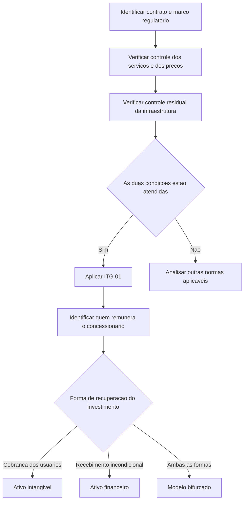

# CTG 05 — Contratos de Concessão

> [!abstract] Resumo em 30 segundos
> O CTG 05 esclarece como aplicar a ITG 01 a contratos de concessão e orienta a análise de temas como outorga, infraestrutura, remuneração do concessionário, construção, manutenção e indenização. A contabilização depende das cláusulas e da realidade econômica de cada contrato: o concessionário pode reconhecer ativo intangível, ativo financeiro ou ambos. A primeira etapa é determinar se o contrato está no alcance da ITG 01.

## Ficha rápida

| Campo | Síntese |
|---|---|
| Norma | CTG 05 — Contratos de Concessão |
| Finalidade | Esclarecer dúvidas sobre a adoção da ITG 01 por empresas reguladas brasileiras |
| Atividades destacadas | Rodovias, ferrovias e energia elétrica |
| Aplicação por analogia | Outras atividades reguladas, quando cabível e consideradas as características do contrato |
| Ato aprovador | Resolução CFC n.º 1.318/10 |

## Objetivo e alcance

O Comunicado orienta a aplicação da ITG 01 — Contratos de Concessão, especialmente por entidades reguladas que atuam como concessionárias ou operadoras. Seu foco é contábil; o texto não trata dos efeitos tributários da adoção.

A análise deve ser feita contrato a contrato. É necessário compreender o marco regulatório do setor, os direitos e obrigações das partes, a formação e revisão de tarifas e os fluxos de remuneração previstos. O CTG destaca que mudanças contábeis podem alterar o lucro líquido e, consequentemente, afetar o fluxo de caixa dos dividendos, ainda que não alterem o fluxo de caixa do negócio.

A ITG 01 alcança contratos que atendam, em conjunto, a duas condições:

1. O concedente controla ou regulamenta os serviços prestados com a infraestrutura, os usuários ou destinatários desses serviços e seus preços.
2. O concedente controla participação residual significativa na infraestrutura ao final do prazo da concessão.

O CTG direciona orientações específicas a rodovias, ferrovias e energia elétrica e admite o uso por similaridade ou analogia em outras atividades reguladas, conforme as características de cada contrato.

## Conceitos-chave

| Conceito | Aplicação prática |
|---|---|
| Infraestrutura da concessão | Em geral, não representa um bem cujo direito de uso é controlado pelo concessionário como em um arrendamento. O concessionário tem acesso para prestar o serviço nos termos do contrato. |
| Ativo intangível | Representa, entre outras situações, o direito de cobrar dos usuários pelo serviço. |
| Ativo financeiro | Reconhecido quando há direito contratual incondicional de receber caixa ou outro ativo financeiro, por exemplo, do poder concedente. |
| Modelo bifurcado | Combina ativo intangível e ativo financeiro quando a remuneração do investimento tem componentes distintos. |
| Direito de outorga | Direito de explorar a concessão obtido mediante entrega ou promessa de entrega de recursos econômicos. A contabilização depende da substância do contrato e do momento em que surgem direitos e obrigações. |
| Bens vinculados | Bens construídos ou adquiridos pelo concessionário e efetivamente utilizados na prestação do serviço público. |

A remuneração por usuários, mediante direito de cobrança, aponta para ativo intangível. A remuneração incondicional pelo poder concedente aponta para ativo financeiro. Quando parte da recuperação depende dos usuários e parte do concedente, pode haver modelo híbrido. A expectativa de indenização futura, por si só, não basta: o ativo financeiro é reconhecido quando as condições contratuais para o reembolso são atingidas.

## Diagrama de análise

## Aplicação passo a passo — checklist

- [ ] **Reunir e entender o contrato:** identificar partes, prazo, obrigações, direitos, tarifas, revisões e condições de extinção.
- [ ] **Conhecer o marco regulatório:** verificar como o setor regula os serviços, os usuários atendidos, a infraestrutura e os preços.
- [ ] **Testar o alcance da ITG 01:** avaliar separadamente as duas condições de controle indicadas no CTG.
- [ ] **Identificar a forma de remuneração:** distinguir cobranças dos usuários, recebimentos do poder concedente e eventuais combinações.
- [ ] **Avaliar a outorga:** determinar se o contrato é executório ou se o direito e a obrigação surgem na assinatura, considerando fatos e circunstâncias do caso.
- [ ] **Separar construção, operação e manutenção:** avaliar a natureza de cada serviço e se a construção gera potencial de receita adicional.
- [ ] **Mensurar os ativos e passivos:** considerar valor presente quando indicado e documentar estimativas, premissas e julgamentos.
- [ ] **Reavaliar ao longo do contrato:** atualizar estimativas de obrigações e acompanhar adições, substituições, amortização e eventuais indenizações.
- [ ] **Preparar as divulgações:** explicar características contratuais, critérios de outorga e investimentos futuros relevantes.

## Reconhecimento e mensuração

### Ativo intangível, ativo financeiro ou modelo bifurcado

O modelo contábil depende de quem é responsável por remunerar o concessionário pelos serviços de construção e melhorias. Se a remuneração depender da cobrança dos usuários, o direito correspondente é reconhecido como ativo intangível. Se houver direito contratual incondicional de receber caixa ou outro ativo financeiro, reconhece-se ativo financeiro. Quando coexistirem formas de recuperação, a contabilização pode ser dividida entre os dois ativos.

Na fase de construção, pode ser impraticável separar desde o início a parcela financeira da parcela intangível. O CTG considera aceitável reconhecer integralmente a receita de construção como ativo intangível em construção até que a alocação possa ser feita, divulgando essa circunstância.

### Direito de outorga

O tratamento depende de quando surgem os direitos e obrigações:

- **Contrato considerado executório:** os fatos e circunstâncias podem indicar que a infraestrutura é disponibilizada gradualmente, à medida que as condições contratuais são cumpridas. Nessa hipótese, a ausência de obrigações executáveis na data do balanço pode afastar o reconhecimento integral na assinatura.
- **Direito e obrigação existentes na assinatura:** se a substância econômica indicar aquisição do direito de exploração desde o início, o ativo intangível e a obrigação correspondente são reconhecidos conforme o contrato.

Para outorga fixa enquadrada nessa segunda situação, o ativo intangível é mensurado pelo custo, incluindo valores já pagos e valores futuros a valor presente. Na outorga variável, vinculada, por exemplo, à receita do período, a despesa é reconhecida no período em que a receita que a originou é reconhecida. O CTG requer que a escolha contábil reflita a essência econômica do contrato.

Quando serviços de construção não geram receita adicional, o tratamento das obrigações também depende da avaliação do contrato. O CTG descreve provisões ao longo do prazo em determinadas situações e, em outras, o reconhecimento inicial de passivo a valor presente, com contrapartida no ativo intangível.

### Construção, custos e amortização

Quando presta serviços de construção, a concessionária reconhece a receita pelo valor justo e reconhece os custos correspondentes como despesas. Assim, pode haver margem de construção, inclusive quando a obra é terceirizada, pois a concessionária pode continuar responsável pela prestação.

Os custos de empréstimos podem ser capitalizados durante a construção se atendidos os requisitos da NBC TG 20. A capitalização também pode ser aplicável antes do início da cobrança dos usuários, desde que o ativo ainda não esteja pronto para o uso pretendido.

O ativo intangível é amortizado durante o prazo da concessão, conforme o padrão de consumo dos benefícios econômicos. Se não for possível estimar esse padrão com confiabilidade razoável, o CTG aponta o método linear como alternativa recomendada.

### Provisões e bens

Gastos correntes de operação e manutenção rotineira são reconhecidos no resultado quando ocorrem. Para manutenção, reparos e substituições destinados a recompor a infraestrutura a um nível especificado de operacionalidade, deve-se estimar a obrigação presente e reconhecer provisão e despesa, observando a NBC TG 25. Despesas relativas a períodos passados podem afetar lucros ou prejuízos acumulados, conforme indicado no texto.

Bens móveis recebidos do poder concedente podem ser classificados como imobilizado quando possam ser retidos ou negociados pelo concessionário sem interferência significativa do concedente. O CTG também alerta que bens negociáveis podem ser essenciais à prestação do serviço, exigindo julgamento sobre sua classificação. Bens não vinculados à concessão permanecem sujeitos aos critérios da NBC TG 27.

## Divulgação

As notas explicativas devem informar, entre outros aspectos:

- características principais dos contratos de concessão e dos contratos de arrendamento assinados com o poder concedente;
- se a outorga é fixa ou variável, seus critérios de reajuste, indexadores e prazos;
- investimentos futuros contratados, com tipo, montante estimado na data do balanço e datas previstas;
- aumento de receita, se houver, relacionado à realização de obras;
- situações relevantes de interpretação legal ou regulatória sobre bens sujeitos à reversão;
- reconhecimento temporário da receita de construção como ativo intangível em construção, quando ainda não for viável alocar a parcela financeira.

## Exceções e erros comuns

> [!warning] Evite conclusões automáticas
> O setor de atividade, a existência de tarifa regulada ou uma previsão de indenização não substituem a análise das cláusulas e da operação efetiva. A avaliação deve considerar cada contrato.

- **Tratar todo contrato como sujeito à ITG 01:** a aplicação depende do atendimento simultâneo das condições de controle.
- **Reconhecer ativo financeiro apenas por haver expectativa de indenização:** é necessário direito contratual incondicional e, quando aplicável, que as condições de reembolso tenham sido atingidas.
- **Classificar toda a infraestrutura como imobilizado do concessionário:** os direitos do operador podem corresponder a ativo intangível, ativo financeiro ou ambos.
- **Ignorar diferenças entre contratos do mesmo setor:** o CTG destaca a análise individual, especialmente para contratos de geração de energia.
- **Presumir que toda concessão ferroviária está no alcance da ITG 01:** o texto indica que, nas condições descritas, pode não haver controle suficiente sobre os destinatários ou os preços; a conclusão depende das características contratuais e da operação.
- **Capitalizar custos sem avaliar sua natureza:** custos correntes de manutenção, custos retardatários e melhorias com potencial de receita têm tratamentos distintos.
- **Usar estimativas sem suporte:** vida útil, indenização, custos futuros e alocação entre ativos exigem premissas documentadas e divulgação quando pertinente.

## Conexões com outras normas

As relações abaixo são expressamente indicadas no CTG 05:

- **ITG 01 — Contratos de Concessão:** interpretação cuja adoção o Comunicado esclarece.
- **NBC TG 04 — Ativo Intangível:** classificação e amortização do direito de exploração e análise de infraestrutura fora do alcance da ITG 01.
- **NBC TG 12 — Ajuste a Valor Presente:** mensuração a valor presente de determinados ativos e obrigações.
- **NBC TG 20 — Custos de Empréstimos:** capitalização de custos durante a construção, quando atendidos os requisitos.
- **NBC TG 25 — Provisões, Passivos Contingentes e Ativos Contingentes:** provisões para manutenção, reparos e substituições.
- **NBC TG 27 — Ativo Imobilizado:** bens fora do alcance da ITG 01 e orientações específicas para infraestrutura de geração.
- **NBC TG 30 — Receitas:** reconhecimento de receitas de contratos de venda de energia tratados no Comunicado.
- **NBC TG 38 e NBC TG 39:** classificação e tratamento de ativos financeiros.
- **ITG 10:** referência a custo atribuído na adoção inicial da NBC TG 27, nos casos descritos para geração.

## Fonte

**CFC. CTG 05 — Contratos de Concessão.** Arquivo fornecido: *CTG 05.pdf*. As orientações deste resumo foram sintetizadas exclusivamente a partir do texto disponibilizado do documento.
