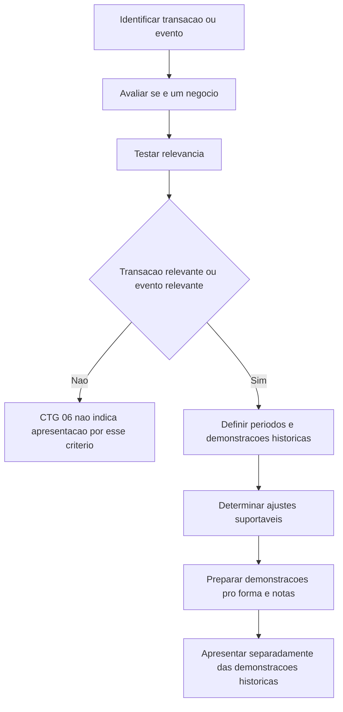

# CTG 06 — Apresentação de Informações Financeiras Pro Forma

> [!abstract] Resumo em 30 segundos
> A CTG 06 orienta como compilar, elaborar, apresentar e divulgar informações financeiras pro forma sobre os efeitos de uma transação ou evento relevante. Essas informações ilustram, com base em dados históricos e ajustes objetivamente suportáveis, como poderiam ter sido afetados a posição financeira e os resultados da entidade se a transação tivesse ocorrido antes. Não são projeções, não substituem demonstrações históricas e devem ser identificadas e apresentadas separadamente.

## Ficha rápida

| Campo | Síntese |
|---|---|
| Norma | NBC CTG 06 — Apresentação de informações financeiras pro forma |
| Finalidade | Definir critérios de compilação, elaboração e apresentação |
| Aplicação | Voluntária, salvo exigência legal ou regulatória |
| Quando considerar | Transações relevantes, baixas de negócios e outros eventos cuja divulgação seja relevante para os usuários |
| Componentes | Balanço patrimonial pro forma, quando aplicável; demonstração do resultado pro forma; notas explicativas próprias |
| Base normativa mencionada | NBC TG 15, para avaliar o conceito de negócio; NBC TG 26, indicada no exemplo do Apêndice I |

## Objetivo e alcance

A norma busca mostrar aos investidores, credores e demais usuários o impacto de uma transação específica sobre informações financeiras históricas. O propósito é auxiliar a análise das perspectivas da entidade, sem afirmar que os resultados ou a posição financeira efetivos teriam sido exatamente aqueles.

A apresentação é voluntária, a menos que seja requerida por lei ou por órgão regulador. Se a entidade optar por apresentá-la, deve cumprir integralmente os requisitos da CTG 06. As informações pro forma:

- devem ser intituladas e claramente diferenciadas das demonstrações históricas;
- devem ser apresentadas separadamente das demonstrações contábeis da entidade;
- não substituem as demonstrações contábeis nem as informações financeiras históricas exigidas;
- não correspondem a demonstrações contábeis combinadas, cujas circunstâncias e procedimentos são distintos.

A norma limita os ajustes aos efeitos de uma transação específica que possam ser mensurados objetivamente a partir de valores históricos. Estimativas sobre como decisões ou práticas operacionais da administração poderiam ter afetado períodos anteriores são projeções e não integram esse alcance. As notas devem esclarecer essa limitação.

## Conceitos-chave

**Informações financeiras pro forma** — Informações que ilustram como as demonstrações históricas poderiam ter sido afetadas caso uma transação específica tivesse sido concluída em data anterior, considerando seu impacto em bases recorrentes.

**Transação provável** — Para a CTG 06, considera-se provável quando há termos contratuais irrevogáveis acordados sobre os principais aspectos, ainda que sujeitos a condições suspensivas ou resolutivas. Essas condições podem incluir aprovações de órgãos reguladores.

**Negócio** — Deve ser avaliado conforme a NBC TG 15, considerando os fatos e as circunstâncias e se há continuidade suficiente das operações antes e depois da transação para que as informações anteriores sejam relevantes para entender as operações futuras. Uma entidade independente, controlada ou divisão é presumida como negócio. Um componente menor também pode ser negócio; entre os aspectos a considerar estão a continuidade das atividades geradoras de receita e a permanência de atributos como empregados, instalações, clientes, distribuição, direitos de funcionamento, técnicas de produção ou nomes comerciais.

**Relevância da transação** — É determinada pelo possível efeito sobre as decisões dos usuários. A norma presume relevância quando os testes quantitativos aplicáveis são excedidos; também trata de alienações e da análise conjunta de operações individualmente não significativas.

## Quando avaliar a elaboração

A CTG 06 prevê a apresentação, entre outras circunstâncias, quando:

- ocorreu uma transação relevante durante o exercício mais recente ou período intermediário subsequente para o qual o balanço é requerido;
- uma transação relevante ocorreu, ou é provável que ocorra, após a data do balanço mais recente divulgado ou arquivado;
- títulos de dívida ou ações serão usados para pagar a transação, ou os recursos obtidos serão aplicados nela;
- um negócio relevante foi, ou provavelmente será, baixado por venda, descontinuação ou distribuição aos acionistas e a baixa não está totalmente refletida nas demonstrações históricas;
- em incorporação envolvendo negócio relevante, cotistas ou acionistas recebem participação na nova sociedade;
- a apresentação é necessária para refletir como entidade autônoma as operações e a posição financeira de uma entidade que antes integrava outra;
- ocorreu, ou provavelmente ocorrerá, outro evento cuja informação pro forma seja relevante para o entendimento dos usuários.

### Testes quantitativos de relevância

Para aquisições, a comparação utiliza as demonstrações anuais mais recentes do negócio e da adquirente. Considera-se relevante quando qualquer um dos indicadores excede **20%**; para transações prováveis, o percentual é substituído por **50%**:

1. ativos totais consolidados do negócio, multiplicados pela participação adquirida ou a adquirir, em relação aos ativos totais consolidados da adquirente;
2. investimento total — custo pago ou a pagar — acrescido de empréstimos ou outros valores a receber do negócio, em relação aos ativos totais consolidados da adquirente;
3. lucro líquido consolidado das operações continuadas antes dos impostos do negócio, multiplicado pela participação adquirida ou a adquirir, em relação ao lucro líquido correspondente da adquirente.

Para o terceiro indicador, se o lucro da adquirente no último exercício estiver pelo menos 10% abaixo da média dos cinco exercícios anteriores, o denominador passa a ser essa média. Anos com prejuízo da adquirente são considerados como resultado zero, mas o denominador continua sendo cinco. Para o negócio adquirido, usa-se o resultado do último exercício, seja lucro ou prejuízo.

Um negócio a alienar é avaliado pelos indicadores aplicáveis. Aquisições ou alienações individualmente abaixo de 20% podem ser relevantes em conjunto se algum indicador superar 50%. A norma também encoraja informações pro forma quando a entidade opta por apresentar demonstrações históricas de negócios individualmente não relevantes.

## Diagrama de decisão

## Aplicação passo a passo — checklist

1. **Identifique a transação ou o evento** e confirme se ocorreu ou se é provável nos termos da norma.
2. **Avalie se envolve um negócio**, considerando a continuidade das operações e os atributos que permanecem após a operação.
3. **Teste a relevância.** Aplique os indicadores e percentuais pertinentes; considere operações individualmente não significativas em conjunto.
4. **Defina o propósito e os períodos.** Estabeleça quais demonstrações históricas serão usadas e em que datas a transação será considerada concluída para cada informação pro forma.
5. **Reúna as informações históricas** das entidades envolvidas. Quando houver negócio adquirido ou a adquirir, apresente também suas demonstrações históricas para os mesmos períodos da informação pro forma.
6. **Determine os ajustes permitidos.** Vincule cada ajuste à transação, use premissas explicáveis e exclua projeções baseadas em decisões operacionais da administração.
7. **Prepare as colunas de apresentação:** informações históricas das entidades, ajustes e total pro forma. Se houver mais de uma transação, avalie apresentação agregada ou desagregada.
8. **Redija notas próprias** com a descrição da transação, as fontes dos dados históricos, as premissas, incertezas, períodos e finalidade.
9. **Confira a apresentação final:** identificação clara, práticas contábeis consistentes com as demonstrações históricas e declaração de que os dados pro forma não indicam necessariamente resultados efetivos.

## Reconhecimento e mensuração

A CTG 06 não transforma as informações pro forma em demonstrações históricas. Os ajustes devem ser construídos para ilustrar a transação conforme os critérios abaixo.

| Informação | Data ou base de referência | Ajustes permitidos |
|---|---|---|
| Demonstração do resultado | Como se a transação tivesse ocorrido no início do último exercício social encerrado | Eventos diretamente atribuíveis, com impacto esperado recorrente e suporte em fatos |
| Balanço patrimonial | Como se a transação tivesse ocorrido na data-base mais recente para a qual o balanço é exigido | Eventos diretamente atribuíveis e realisticamente suportáveis, recorrentes ou não |

As informações devem seguir práticas contábeis consistentes com as demonstrações históricas da adquirente. Quando aplicável, a forma de refletir a aquisição deve observar a prática contábil usada nas demonstrações a serem apresentadas.

Em aquisições, os ajustes ao resultado podem incluir depreciação decorrente da alocação do custo de aquisição aos ativos líquidos adquiridos e encargos financeiros da dívida contratada para financiar a operação. Se ajustes de aquisição, como descontos significativos dos ativos para valor justo, afetarem significativamente os resultados logo após a aquisição e forem sendo eliminados em período relativamente curto, deve-se divulgar em nota o efeito nos resultados de cada um dos cinco exercícios seguintes.

Em venda ou baixa, o ponto de partida são as demonstrações históricas da entidade existente. Devem ser evidenciadas a eliminação dos negócios a vender ou baixar e os ajustes necessários para mostrar as operações recorrentes remanescentes. Para entidades antes integrantes de outra, podem ser necessários ajustes de despesas gerais corporativas, juros e imposto de renda alocados em bases que a administração não considere razoáveis.

Os efeitos tributários dos ajustes são normalmente calculados pelas alíquotas vigentes nos períodos apresentados e mostrados em linha específica.

> [!warning] Ajustes que não cabem
> Não inclua efeitos baseados em julgamentos sobre decisões posteriores da administração, como desligamento de funcionários, fechamento de fábricas ou outros gastos de reestruturação. A norma também cita como inadequada a receita financeira originada dos recursos de uma oferta ou venda de ativos.

Se os resultados possíveis da transação puderem ser significativamente diferentes, apresente o cenário mais provável na forma tabular e inclua em nota análises pro forma adicionais para os possíveis resultados.

## Períodos e apresentação

O balanço patrimonial pro forma é apresentado na data do balanço consolidado mais recente exigido, exceto quando a transação já estiver refletida nele. A demonstração do resultado pro forma é apresentada para o exercício social anterior e para o período intermediário do exercício atual. A comparação com o período intermediário do exercício anterior é facultativa. Não se apresentam períodos anteriores ao exercício social anterior indicado pela norma. Também não se apresenta resultado pro forma quando a demonstração histórica já reflete a transação durante todo o período.

As demonstrações do resultado pro forma usam o encerramento do exercício social da entidade. Se o encerramento mais recente de outra entidade envolvida divergir em mais de 60 dias, a demonstração dessa entidade deve ser atualizada para, no máximo, 60 dias após o encerramento mais recente da entidade. A atualização pode incorporar resultados intermediários subsequentes e deduzir os resultados intermediários comparáveis do exercício anterior.

Eventos não usuais que afetem significativamente os resultados do exercício mais recente devem ser divulgados. A entidade pode considerar um período de 12 meses encerrado na data do balanço mais recente quando ele representar melhor as operações normais.

## Divulgação

As notas explicativas próprias devem descrever:

- a transação ou o evento e as entidades envolvidas;
- a origem das informações históricas utilizadas e a condição de auditoria ou revisão, quando aplicável;
- os períodos apresentados e as principais premissas dos ajustes;
- incertezas relacionadas às premissas;
- o propósito da apresentação e a necessidade de leitura conjunta com as demonstrações históricas;
- por que os resultados pro forma podem não corresponder exatamente ao que teria ocorrido se a transação tivesse sido concluída antes.

Quando negócios adquiridos ou a adquirir forem apresentados em informações pro forma, suas demonstrações históricas devem ser apresentadas para os mesmos períodos. As demonstrações anuais e intermediárias devem ser comparativas com os períodos anteriores correspondentes. Devem ser auditadas ou revisadas, respectivamente, quando isso for requerido pela administração, por lei ou por órgão regulador; se não forem, essa condição deve ser explicitada.

A apresentação é normalmente feita em colunas: dados históricos de cada entidade, ajustes e total pro forma. Se houver várias transações, a apresentação pode ser agregada, mas deve mostrar individualmente os efeitos das transações e explicar as variáveis relevantes. Se a finalidade for obter aprovação de acionistas para uma transação, os efeitos dela devem ser apresentados separadamente, sem agregação com outras.

## Exceções e erros comuns

> [!danger] Não trate pro forma como projeção
> Não antecipe efeitos de planos ou decisões futuras da administração. A finalidade é ilustrar efeitos da transação mensuráveis e suportáveis, não prever o desempenho.

- **Não substituir as demonstrações históricas** nem apresentar a informação pro forma como se fosse resultado efetivamente realizado.
- **Não misturar práticas contábeis** com aquelas usadas nas demonstrações históricas da entidade.
- **Não omitir notas** sobre premissas, fontes, incertezas e finalidade.
- **Não apresentar balanço pro forma** se o balanço histórico mais recente já refletir a transação.
- **Não deixar de explicar apresentações agregadas** nem agregar os efeitos de uma transação que precise ser identificada isoladamente para aprovação dos acionistas.
- **Não confundir negócio com qualquer ativo isolado**: avalie a continuidade das operações e os fatos e circunstâncias pertinentes.

## Conexões com outras normas

- **NBC TG 15 — Combinação de Negócios:** indicada pela CTG 06 como referência para avaliar o conceito de negócio.
- **NBC TG 26 — Apresentação das Demonstrações Contábeis:** o Apêndice I informa que o formato ilustrativo de balanço e demonstração do resultado deve estar em conformidade com essa norma.

## Fonte

**CTG 06.pdf** — NBC CTG 06, “Apresentação de informações financeiras pro forma”, incluindo os Apêndices I e II. O texto identifica a aprovação da norma em 19 de abril de 2013 e declara que ela entra em vigor na data de sua publicação.
