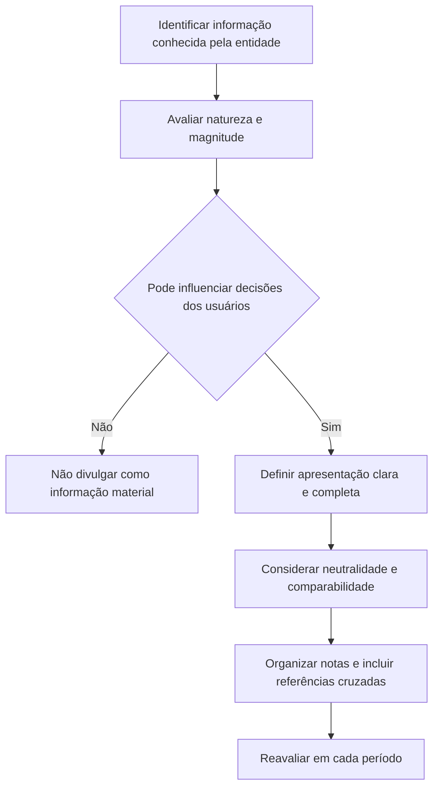

# CTG 07 (R1) — Evidenciação na divulgação dos relatórios contábil-financeiros de propósito geral

## Resumo em 30 segundos

A CTG 07 (R1) orienta **o que divulgar e como apresentar** nos relatórios contábil-financeiros de propósito geral, especialmente nas notas explicativas. O critério central é a relevância para as decisões dos usuários: divulgue informações materiais, completas, neutras, compreensíveis e específicas da entidade; evite informações irrelevantes, repetitivas ou padronizadas que ocultem o que importa. A avaliação depende da natureza e da magnitude dos fatos e deve ser feita caso a caso. O Comunicado trata de divulgação, não de reconhecimento ou mensuração.

> [!abstract] Ideia central
> A divulgação não é um exercício de cumprir uma lista. Deve apresentar toda informação relevante que possa influenciar os usuários — ainda que nenhuma norma a mencione expressamente — e não sobrecarregar as demonstrações com informação imaterial.

## Ficha rápida

| Campo | Síntese |
|---|---|
| Norma | CTG 07 (R1) — Evidenciação na divulgação dos relatórios contábil-financeiros de propósito geral |
| Objetivo | Orientar requisitos básicos de elaboração e evidenciação |
| Alcance | Informações próprias das demonstrações anuais e intermediárias, com destaque para notas explicativas |
| Foco | Relevância, materialidade, clareza e organização das divulgações |
| Fora do escopo | Questões de reconhecimento e mensuração |
| Vigência indicada no PDF | 1º de novembro de 2023; nessa data, substitui e revoga a CTG 07 anterior |

O PDF identifica a aprovação da NBC pelo CFC em 17 de agosto de 2023 e a elaboração com base na OCPC 07 (R1), emitida pelo CPC. A vigência e a substituição da versão anterior constam das disposições finais (itens 47–48, p. 12).

## Objetivo e alcance

O Comunicado trata dos requisitos básicos de elaboração e evidenciação na divulgação de relatórios contábil-financeiros de propósito geral. Sua aplicação se concentra na divulgação de informações próprias das demonstrações contábeis anuais e intermediárias, especialmente nas notas explicativas (itens 1–2, p. 1).

A CTG 07 (R1) consolida exigências existentes em normas, interpretações, outros comunicados do CFC, disposições do IASB não divulgadas pelo CFC e na lei, **sem alterar tais exigências** (item 4, p. 1). Seu objeto é a divulgação: reconhecimento e mensuração não são tratados (item 3, p. 1).

## Conceitos-chave

- **Relevância:** a informação é relevante se puder fazer diferença nas decisões dos usuários. No contexto descrito, os usuários principais são investidores e credores, existentes e potenciais (itens 5–8, pp. 1–2).
- **Materialidade:** aspecto específico da relevância para a entidade que reporta. Considera a natureza da informação, sua magnitude ou ambas. Não há limite quantitativo uniforme nem regra que determine previamente o que será material em toda situação (itens 15–17, p. 3).
- **Representação fidedigna:** a informação deve ser, tanto quanto possível, completa, neutra e isenta de erros. Comentários, qualificações e adjetivações também devem ser neutros (itens 11–12, p. 2).
- **Características de melhoria:** comparabilidade, verificabilidade, tempestividade e compreensibilidade aumentam a utilidade da informação (itens 13–14, p. 2).
- **Especificidade:** políticas contábeis e explicações devem refletir o que é aplicável à entidade e às suas circunstâncias, em vez de reproduzir conteúdo normativo genérico (itens 28 e 32–34, pp. 5 e 7).

> [!info] Materialidade não é só valor
> Um valor pequeno em termos absolutos ou percentuais pode ser material por sua natureza, por implicações de governabilidade, por possível impacto futuro ou por sua importância social. Avalie a perspectiva dos usuários, não apenas um corte numérico (itens 15–17, p. 3).

## Diagrama de decisão

## Aplicação passo a passo — checklist

1. **Identifique a informação disponível** sobre a posição financeira, o desempenho, os fluxos de caixa, as políticas contábeis, os riscos e outros assuntos relevantes para a entidade.
2. **Avalie a materialidade** sob perspectivas quantitativa e qualitativa. Considere a natureza e a magnitude; não aplique automaticamente um limite uniforme.
3. **Considere o efeito combinado:** uma informação pode ser material em conjunto com outras informações das demonstrações, mesmo que isoladamente pareça pouco expressiva.
4. **Avalie divulgações exigidas por normas.** A exigência não torna automaticamente material cada informação indicada. Se a informação não for material, a divulgação específica pode ser dispensada conforme a orientação do Comunicado, ressalvada a exigência expressa de órgão regulador (itens 20–22, pp. 3–4).
5. **Não omita informação material** só porque nenhuma lei ou documento do CFC a exige expressamente (síntese das diretrizes, p. 6).
6. **Apresente itens separadamente quando necessário.** Agrupe itens imateriais ou semelhantes; não oculte informação material em divulgações irrelevantes nem agregue itens materiais de naturezas ou funções diferentes (itens 20–22A, pp. 3–4).
7. **Redija para os usuários:** prefira linguagem compreensível e evite terminologia técnica específica da entidade ou do setor, salvo quando inevitável. Nessa situação, considere um glossário conciso (item 14, p. 2).
8. **Organize as notas de modo sistemático**, usando referências cruzadas com os itens das demonstrações contábeis e, quando pertinente, com outras notas (itens 23–25, pp. 4–5; item 36, p. 7).
9. **Revise políticas contábeis divulgadas:** mantenha as que são materiais e aplicáveis; elimine textos genéricos, duplicados ou referentes a políticas sem alternativas que não sejam específicas à entidade (itens 26–28, pp. 5–6).
10. **Faça a avaliação separadamente** para demonstrações individuais e consolidadas, pois uma informação pode ser material para uma e não para a outra (item 39, p. 7).
11. **Reavalie a materialidade a cada período** e confirme que as demonstrações contêm as informações relevantes e apenas as que atendem ao objetivo do relatório financeiro.

## Reconhecimento e mensuração

A CTG 07 (R1) **não estabelece critérios de reconhecimento ou mensuração**. Ela não substitui os requisitos técnicos aplicáveis a ativos, passivos, receitas, despesas ou outros elementos; trata da decisão sobre divulgar e da forma de fazê-lo (item 3, p. 1).

Os exemplos do texto ilustram julgamentos de materialidade sobre políticas contábeis e divulgações. Eles não devem ser lidos como alteração dos critérios de reconhecimento ou mensuração das normas citadas (item 41, p. 8).

## Divulgação

### Notas explicativas e apresentação

- Divulgue separadamente classes materiais de itens semelhantes e itens de natureza ou função distinta, salvo quando imateriais. Itens individualmente imateriais podem ser agregados; alguns, contudo, podem ser relevantes o suficiente para apresentação individualizada em nota, embora não o sejam na face das demonstrações (itens 20–21, pp. 3–4).
- Não reduza a compreensibilidade ao misturar informação material com conteúdo irrelevante ou ao agregar itens materiais de naturezas ou funções diferentes (itens 20 e 22A, pp. 3–4).
- A ordem das notas pode destacar as atividades mais relevantes, agrupar informações mensuradas de forma semelhante ou acompanhar a ordem das demonstrações. Pode ser necessário alterar a ordem de alguns assuntos, mantendo uma estrutura tão sistemática quanto praticável (itens 23–25, pp. 4–5).
- Evite repetição de fatos, políticas e informações. Referencie os itens das demonstrações e as notas relacionadas (itens 23 e 36–37, pp. 4 e 7).
- A seção de base de elaboração e políticas contábeis pode ser separada ou incorporada às notas dos itens correspondentes; o texto apresenta isso como opção (item 27, p. 5).

### Políticas contábeis

Divulgue informações de políticas contábeis quando forem materiais, consideradas em conjunto com as demais informações das demonstrações. Informações relativas a transações, eventos ou condições imateriais geralmente não precisam ser divulgadas; a natureza do assunto também pode tornar uma política material, mesmo quando os valores envolvidos são imateriais. Nem toda política relacionada a valores materiais é, por isso, material (itens 26–26C, pp. 5–6).

Priorize explicações específicas sobre como a política foi aplicada às circunstâncias da entidade. Não transcreva normas: resuma somente os aspectos principais relevantes e aplicáveis, em linguagem acessível. Se houver escolha entre políticas permitidas ou mudança de política, explique os motivos e as consequências para as demonstrações, observando a NBC TG 23 (itens 32–35, p. 7).

### Declaração de conformidade e riscos

A administração deve afirmar, na nota de declaração de conformidade, que todas as informações relevantes próprias das demonstrações — e somente elas — estão sendo evidenciadas e que correspondem às informações utilizadas na gestão (item 38, p. 7). A relevância deve incluir atenção aos temas que possam representar riscos para a entidade (item 31, p. 7).

## Exceções e erros comuns

> [!warning] Evite o “checklist automático”
> Incluir todas as divulgações de forma mecânica pode obscurecer as informações importantes. A avaliação de materialidade deve orientar a aplicação dos requisitos, sem dispensar uma informação material que seja necessária aos usuários.

- **Definir um limite quantitativo universal:** o Comunicado não prevê um corte uniforme; a avaliação é caso a caso.
- **Divulgar políticas contábeis genéricas ou inaplicáveis:** não reproduza políticas de operações inexistentes nem descreva alternativas que não se aplicam à entidade.
- **Copiar o texto de normas:** mencione o documento quando útil e resuma os aspectos aplicáveis; não transcreva trechos normativos (itens 28 e 32–33, pp. 5 e 7).
- **Confundir materialidade do valor com materialidade da política:** analise separadamente a utilidade de explicar a política e a relevância dos valores relacionados.
- **Omitir informação material não expressamente exigida:** a ausência de requisito explícito não justifica a omissão se a informação puder influenciar decisões.
- **Ignorar exigência expressa do regulador:** o texto ressalva informações requeridas expressamente por órgão regulador (item 22, p. 4).
- **Avaliar demonstrações individuais e consolidadas como se fossem iguais:** a materialidade pode divergir entre elas.
- **Usar linguagem excessivamente técnica, repetir conteúdo ou agregar itens materialmente diferentes:** isso pode prejudicar a compreensão e desviar a atenção dos usuários.

## Conexões com outras normas

A CTG 07 (R1) relaciona suas diretrizes, de forma explícita, à **NBC TG Estrutura Conceitual para Relatório Financeiro** (relevância e representação fidedigna), à **NBC TG 26 — Apresentação das Demonstrações Contábeis** (materialidade, apresentação e notas), à **NBC TG 23 — Políticas Contábeis, Mudança de Estimativa e Retificação de Erro** (escolha e mudança de política) e à **Lei nº 6.404/76**, art. 176, § 5º (base de preparação, práticas específicas e critérios de avaliação). O texto também usa exemplos relacionados à NBC TG 27, NBC TG 05 e NBC TG 01, sem que isso altere o escopo de divulgação do Comunicado.

## Fonte

Conselho Federal de Contabilidade, **NBC CTG 07 (R1), de 17 de agosto de 2023 — Evidenciação na divulgação dos relatórios contábil-financeiros de propósito geral**, PDF *CTG 07 (R1).pdf*, páginas 1–12. Remissões a itens e páginas foram incluídas quando identificáveis no texto fornecido.
