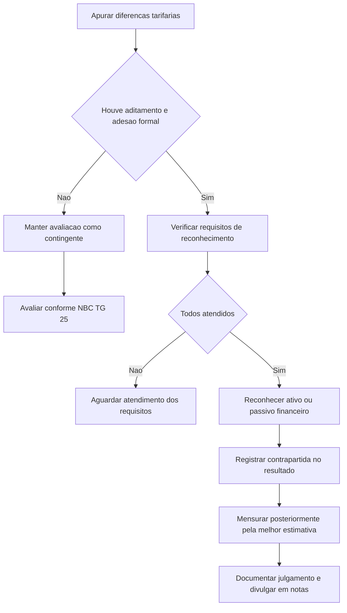

# CTG 08 — Reconhecimento de determinados ativos e passivos nos relatórios contábil-financeiros de propósito geral das distribuidoras de energia elétrica emitidos de acordo com as normas brasileiras e internacionais de contabilidade

## Resumo em 30 segundos

A CTG 08 trata do reconhecimento, nos relatórios contábil-financeiros de propósito geral, de ativos e passivos relacionados a diferenças entre custos tarifários previstos e efetivamente incorridos por distribuidoras de energia elétrica. Para concessionárias e permissionárias que aderirem ao aditamento contratual descrito no Comunicado, essas diferenças deixam de ser tratadas como contingentes e podem ser reconhecidas como valores financeiros a receber ou a pagar. O reconhecimento começa quando o aditamento e a concordância formal forem efetivados e todos os requisitos estiverem atendidos; a aplicação é prospectiva.

> [!abstract] Essência
> O aditamento contratual identifica o Poder Concedente como contraparte e reduz a incerteza sobre a realização ou liquidação dos saldos. A entidade reconhece o ativo ou passivo financeiro correspondente e registra os efeitos no resultado, conforme as orientações da norma.

## Ficha rápida

| Campo | Síntese |
|---|---|
| Norma | Comunicado Técnico CTG 08 |
| Tema | Ativos e passivos ligados a diferenças tarifárias de distribuidoras de energia elétrica |
| Aplicação | Exclusivamente a concessionárias e permissionárias públicas de distribuição de energia elétrica |
| Condição central | Aditamento dos contratos de concessão ou permissão e concordância formal da entidade |
| Tratamento inicial | Reconhecimento prospectivo do saldo elegível, com contrapartida no resultado |
| Mensuração posterior | Melhor estimativa do montante financeiro a realizar ou liquidar, com contrapartida em receita |
| Fonte | CTG 08.pdf; texto técnico nas páginas 1 a 8 |

## Objetivo e alcance

O objetivo é orientar o reconhecimento, a mensuração e a evidenciação de determinados ativos e passivos nos relatórios contábil-financeiros de propósito geral das concessões e permissões públicas brasileiras de distribuição de energia elétrica (p. 5, item 1).

O Comunicado aplica-se **exclusivamente** a concessionárias e permissionárias públicas desse segmento (p. 5, item 2). Para o tratamento dos saldos abordados, orienta a aplicação das NBC TG 23, NBC TG 25, NBC TG 30, NBC TG 38, NBC TG 39 e NBC TG 40 (p. 5, item 3). A introdução também relaciona a análise às características da informação previstas na NBC TG Estrutura Conceitual (p. 4).

A norma diferencia a situação anterior ao aditamento daquela aplicável às entidades que aderirem à alteração contratual aprovada pela ANEEL. Portanto, não se deve estender automaticamente o tratamento a entidades sem a adesão formal descrita no Comunicado.

## Conceitos-chave

- **Parcela A:** custos não gerenciáveis, como aquisição de energia, conexão, transmissão e encargos setoriais. Em regra, são repassados aos consumidores ou suportados pelo Poder Concedente.
- **Parcela B:** custos gerenciáveis, incluindo investimentos em infraestrutura, operação, manutenção e remuneração dos provedores de capital. A norma também menciona outros componentes financeiros relacionados à Parcela B.
- **Diferença temporal:** diferença entre valores orçados e incluídos na tarifa e valores efetivamente incorridos. Pode resultar em direito de recebimento ou obrigação de devolução.
- **Aditamento contratual:** alteração que, para a entidade aderente, identifica o Poder Concedente como contraparte responsável pela liquidação ou realização financeira dos saldos abrangidos e prevê tratamento dos saldos remanescentes na extinção da concessão ou permissão.
- **Ativo ou passivo financeiro:** após o evento contratual descrito, o saldo elegível pode ser reconhecido como valor efetivamente a receber ou a pagar, e não apenas como ativo ou passivo regulatório contingente.

> [!info] Contexto regulatório
> A tarifa considera custos e componentes definidos ou homologados no processo regulatório. Como os custos efetivos podem divergir dos valores previstos e incluídos na tarifa, podem surgir saldos a recuperar ou devolver em ciclos tarifários posteriores.

## Diagrama do tratamento

## Aplicação passo a passo / checklist

1. **Confirme o alcance:** a entidade é concessionária ou permissionária pública de distribuição de energia elétrica?
2. **Identifique os saldos:** apure diferenças da Parcela A e outros componentes financeiros abrangidos, considerando valores ainda não recuperados ou liquidados.
3. **Verifique o evento contratual:** confirme se o contrato foi aditado nos termos tratados pelo Comunicado e se houve concordância formal da concessionária ou permissionária, mediante assinatura.
4. **Avalie a data de reconhecimento:** use a data em que todos os requisitos necessários estiverem atendidos; não antecipe o reconhecimento apenas porque há expectativa de recuperação tarifária.
5. **Reconheça o saldo elegível:** registre o ativo ou passivo financeiro correspondente aos saldos remanescentes ainda não recuperados ou liquidados.
6. **Registre a contrapartida inicial:** reconheça o efeito no resultado do exercício em que ocorrer a modificação contratual, em receita de venda de bens e serviços.
7. **Atualize a mensuração nos períodos seguintes:** utilize a melhor estimativa do montante financeiro a realizar ou liquidar em decorrência da obrigação de performance completada no período.
8. **Documente o julgamento:** mantenha evidência dos fatos, circunstâncias e estimativas que sustentam a política contábil aplicada.
9. **Prepare a divulgação:** use a documentação como base para as notas explicativas dos relatórios contábil-financeiros de propósito geral.

## Reconhecimento e mensuração

### Antes do aditamento

A norma explica que, antes do aditamento, a dependência de evento futuro não plenamente controlável pela entidade caracterizava os saldos como ativos ou passivos contingentes. Ativos e passivos contingentes não são reconhecidos nas demonstrações contábeis; devem, contudo, ser avaliados periodicamente conforme a probabilidade de entrada ou saída de recursos. Se houver mudança nas circunstâncias, aplicam-se os tratamentos previstos na NBC TG 25, conforme descrito nos itens 5 e 6 (p. 5–6).

### Após o aditamento e a adesão formal

Para as entidades que aderirem à alteração, o aditamento reduz a incerteza relevante e permite tratar os saldos elegíveis como instrumentos financeiros a receber ou a pagar. O reconhecimento alcança os saldos de diferenças da Parcela A e outros componentes financeiros ainda não recuperados ou liquidados (p. 6, itens 7 e 8).

A data inicial é aquela em que todos os requisitos necessários ao reconhecimento estiverem atendidos. O Comunicado considera o aditamento um evento novo que altera as condições contratuais anteriores; por isso, o efeito **não é mudança de política contábil**, mas uma nova situação, aplicada prospectivamente (p. 7, itens 11 e 12).

No reconhecimento inicial, o ajuste é registrado em ativo ou passivo financeiro, conforme o caso, com contrapartida no resultado do exercício em que ocorrer a modificação contratual, na rubrica de receita de venda de bens e serviços (p. 7, item 13).

Na mensuração subsequente, as diferenças apuradas em cada período têm como contrapartida a adequada rubrica de receita de venda de bens e serviços no resultado do período. A mensuração deve considerar a melhor estimativa do montante financeiro a realizar em decorrência do cumprimento integral da obrigação de performance completada, levando em conta os fatos e as circunstâncias existentes que deem suporte à transação (p. 7, itens 14 e 15).

> [!tip] Controle prático
> Mantenha memória de cálculo por período, reconciliação dos saldos ainda não recuperados ou liquidados e documentação dos pressupostos usados na melhor estimativa.

## Divulgação

O julgamento relativo à estimativa deve ser documentado como evidência objetiva da política contábil adotada. Essa documentação também serve de base para as divulgações nas notas explicativas integrantes dos relatórios contábil-financeiros de propósito geral (p. 7–8, item 15).

O Comunicado não detalha, no texto fornecido, um modelo de nota explicativa ou uma lista fechada de informações a divulgar. A evidenciação deve, portanto, refletir os saldos reconhecidos e o julgamento que sustenta a mensuração, sem atribuir à norma exigências adicionais não expressas no documento.

## Exceções e erros comuns

> [!warning] Não confundir demonstrações regulatórias e relatórios de propósito geral
> A introdução informa que, após a adoção das IFRS no Brasil, esses saldos eram reconhecidos nas demonstrações para fins regulatórios exigidas pela ANEEL, mas não nos relatórios de propósito geral. A CTG 08 trata do reconhecimento nestes últimos para as entidades que aderirem às alterações contratuais descritas.

- **Reconhecer sem adesão formal:** o tratamento do item 7 é dirigido às concessionárias e permissionárias que aderirem à alteração contratual.
- **Antecipar a data de reconhecimento:** não basta existir uma diferença tarifária; os requisitos devem estar atendidos, incluindo o evento contratual descrito.
- **Aplicar retrospectivamente:** o Comunicado caracteriza o efeito como nova situação e determina aplicação prospectiva.
- **Tratar como mudança de política contábil:** a norma afirma que o aditamento não tem essa natureza.
- **Ignorar os saldos anteriores não recuperados ou liquidados:** o reconhecimento inicial contempla os saldos elegíveis remanescentes.
- **Usar estimativa sem suporte:** a melhor estimativa deve considerar fatos e circunstâncias existentes e ser documentada.
- **Aplicar a entidades fora do alcance:** o item 2 limita a aplicação a concessionárias e permissionárias públicas de distribuição de energia elétrica.

## Conexões com outras normas

A relação é expressa no próprio Comunicado:

| Norma citada | Relação indicada |
|---|---|
| NBC TG 23 | Políticas contábeis e distinção entre mudança de política e nova situação |
| NBC TG 25 | Ativos e passivos contingentes e avaliação de probabilidades |
| NBC TG 30 | Receita, no contexto da contrapartida indicada pelo Comunicado |
| NBC TG 38, 39 e 40 | Reconhecimento e mensuração, apresentação e evidenciação de instrumentos financeiros |
| NBC TG Estrutura Conceitual | Referência na introdução às características da informação contábil |

## Fonte

- **Documento:** CTG 08.pdf — Norma Brasileira de Contabilidade CTG 08, de 5 de dezembro de 2014.
- **Texto técnico consultado:** páginas 5 a 8; contexto e justificativa na introdução, páginas 1 a 4.
- O PDF informa que o Comunicado entra em vigor na data de sua publicação e se aplica aos exercícios iniciados a partir de 1º de janeiro de 2014 (p. 8).
