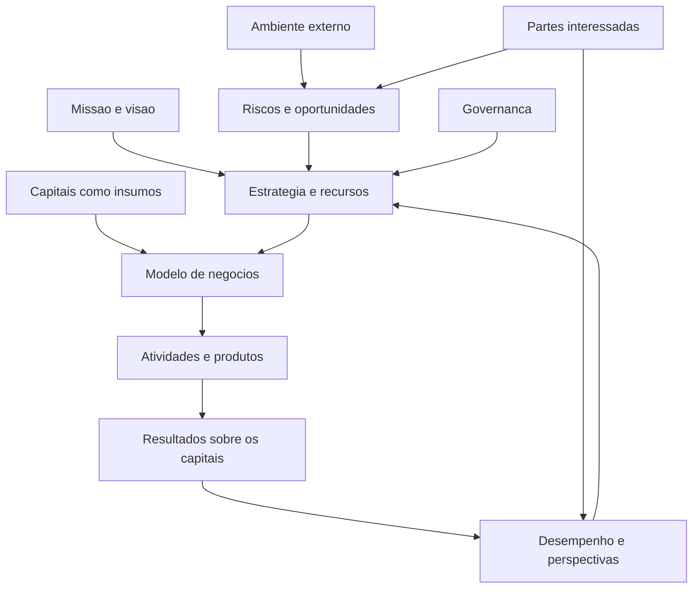

# CTG 09 — Correlação à Estrutura Conceitual Básica do Relato Integrado

> [!abstract] Resumo em 30 segundos
> O CTG 09 orienta a elaboração e a apresentação do Relato Integrado: uma comunicação concisa sobre como estratégia, governança, desempenho e perspectivas, no contexto do ambiente externo, se relacionam com a geração de valor no curto, médio e longo prazos. O relato conecta informações financeiras e não financeiras, considera os capitais utilizados ou afetados pela organização e explica temas relevantes, seus efeitos e as respostas adotadas. A orientação é baseada em princípios e exige julgamento profissional; não estabelece indicadores ou métodos de mensuração específicos.

## Ficha rápida

| Campo | Síntese |
|---|---|
| Norma | CTG 09 — Relato Integrado |
| Aprovada | NBC CTG 09, de 26 de novembro de 2020 |
| Finalidade | Orientar os princípios, o conteúdo e os conceitos fundamentais do Relato Integrado |
| Público principal | Provedores de capital financeiro; o relato também beneficia outras partes interessadas |
| Aplicação | Escrita principalmente para o setor privado e empresas com fins lucrativos, mas adaptável ao setor público e a entidades sem fins lucrativos |
| Vigência indicada no PDF | O comunicado informa efeitos a partir de 1º de janeiro de 2021 (p. 32) |

A norma foi elaborada com base na OCPC 09 do Comitê de Pronunciamentos Contábeis. O conteúdo técnico denomina-se **CTG 09 – Relato Integrado** (p. 1).

## Objetivo e alcance

O Relato Integrado deve explicar como a estratégia, a governança, o desempenho e as perspectivas da organização, considerados em seu ambiente externo, conduzem à geração de valor ao longo do tempo. O foco principal é informar provedores de capital financeiro, mas as informações também podem ser úteis a empregados, clientes, fornecedores, parceiros comerciais, comunidades, legisladores e reguladores (pp. 3–4).

A orientação busca melhorar a qualidade da informação disponível para decisões de alocação de capital, tornar o relato corporativo mais coeso e apoiar a prestação de contas sobre os capitais e suas interdependências. Não avalia a qualidade da estratégia nem estabelece padrões de desempenho para organizações (p. 3).

O documento é **baseado em princípios**. Não prescreve indicadores específicos, métodos de mensuração ou divulgações padronizadas para cada tema. Cabe aos responsáveis pela elaboração determinar, com julgamento profissional, o que é relevante e como comunicar a informação nas circunstâncias da organização (p. 4).

## Conceitos-chave

### Pensamento integrado e geração de valor

Pensamento integrado é considerar efetivamente as relações entre áreas operacionais e funcionais da organização e os capitais que ela usa ou afeta. Ele favorece decisões conectadas e ações que consideram a geração de valor no curto, médio e longo prazos (p. 33).

Valor não é criado somente dentro da organização. É influenciado pelo ambiente externo, pelas relações com as partes interessadas e pelos recursos disponíveis. Pode beneficiar a própria organização e terceiros; pode também ser preservado ou reduzido. Assim, “geração de valor” inclui aumentos, diminuições e transformações nos capitais (pp. 6–8).

### Capitais

Os capitais são estoques de valor que servem de insumos ao modelo de negócios e podem aumentar, diminuir ou se transformar pelas atividades e pelos produtos da organização. A orientação identifica seis categorias:

| Capital | Exemplos descritos na orientação |
|---|---|
| Financeiro | Recursos obtidos por dívida, participação societária, subvenções ou investimentos |
| Manufaturado | Prédios, equipamentos e infraestrutura |
| Intelectual | Propriedade intelectual, conhecimento tácito, sistemas e procedimentos |
| Humano | Competências, experiência, motivação, capacidade de colaboração e liderança |
| Social e de relacionamento | Relações, confiança, valores compartilhados, reputação e licença social para operar |
| Natural | Recursos ambientais e processos como água, terra, minerais, florestas e biodiversidade |

A organização não é obrigada a adotar essa classificação nem a estruturar o relatório por capitais. Deve, porém, usá-la como referência para não negligenciar capitais relevantes que utilize ou afete (pp. 7–10).

### Materialidade e limites do relato

Um tema é relevante quando pode afetar substancialmente a capacidade da organização de gerar valor no curto, médio ou longo prazos. A análise considera efeitos positivos e negativos, riscos, oportunidades, desempenho e perspectivas. Os limites do relato partem da entidade emissora de relatórios contábeis, mas também incluem riscos, oportunidades e resultados relacionados a outras entidades ou partes interessadas quando possam afetar substancialmente a geração de valor (pp. 14–16).

## Diagrama do processo de geração de valor

O processo é dinâmico: mudanças no ambiente, nos capitais e nos resultados podem levar à revisão da estratégia, do modelo de negócios e da alocação de recursos (pp. 10–11).

## Aplicação passo a passo / checklist

1. **Defina a comunicação.** Identifique e denomine claramente o Relato Integrado. Ele pode ser independente ou constituir uma parte distinta de outro relatório; não deve ser apenas um resumo de outras publicações (pp. 4–5).
2. **Entenda o contexto.** Descreva a organização, seu ambiente externo, sua missão e visão e as condições que afetam sua atuação.
3. **Conecte governança e modelo de negócios.** Explique como a governança apoia a geração de valor e como os capitais são convertidos em produtos e resultados.
4. **Identifique e priorize temas.** Avalie efeitos conhecidos ou potenciais, magnitude, probabilidade quando houver incerteza, duração e áreas afetadas. Não exclua um tema só porque é difícil ou indesejável tratá-lo.
5. **Considere partes interessadas e limites.** Explique relações relevantes e considere impactos além dos limites do relato financeiro quando afetarem substancialmente a capacidade de gerar valor.
6. **Relacione estratégia, recursos e desempenho.** Mostre como riscos e oportunidades influenciam objetivos, planos de alocação de recursos e resultados.
7. **Apresente perspectivas fundamentadas.** Discuta desafios e incertezas, a resposta da organização e possíveis implicações para o modelo de negócios e o desempenho futuro.
8. **Revise a qualidade.** Verifique concisão, equilíbrio, completude, comparabilidade e coerência com outras comunicações.
9. **Inclua a declaração de governança.** Os responsáveis devem reconhecer sua responsabilidade pela integridade do relatório e a aplicação do pensamento coletivo, além de manifestar opinião ou conclusão sobre sua conformidade. Se a declaração não for incluída, explique o papel da governança, as medidas para apresentá-la em relatórios futuros e o prazo previsto, limitado ao terceiro Relato Integrado que faça referência à orientação (pp. 5–6).

## Reconhecimento e mensuração

O CTG 09 não define reconhecimento contábil, bases de mensuração ou indicadores obrigatórios. Seu foco é a seleção e a comunicação de informações que expliquem a capacidade de gerar valor e os efeitos sobre os capitais.

- Combine informações quantitativas e qualitativas; uma não substitui necessariamente a outra.
- Use indicadores quantitativos quando forem viáveis e relevantes, com contexto, métodos e premissas explicados.
- Quando informações do Relato Integrado forem semelhantes às de outras publicações ou delas derivarem, use a mesma base ou torne-as facilmente conciliáveis.
- Se não for viável ou sensato quantificar movimentos relevantes nos capitais, apresente explicação qualitativa sobre mudanças em disponibilidade, qualidade ou acessibilidade.
- A orientação não exige quantificar ou descrever movimentos entre cada capital para cada tema (pp. 4, 12–13 e 30).

## Divulgação

O relato deve observar sete princípios: **foco estratégico e orientação para o futuro; conectividade de informações; relação com partes interessadas; materialidade; concisão; confiabilidade e completude; uniformidade e comparabilidade** (pp. 11–18).

Os elementos de conteúdo organizam a comunicação em torno destas perguntas:

| Elemento | Pergunta orientadora |
|---|---|
| Visão geral e ambiente externo | O que a organização faz e em quais circunstâncias atua? |
| Governança | Como a governança apoia a geração de valor? |
| Modelo de negócios | Como a organização transforma insumos em produtos e resultados? |
| Riscos e oportunidades | Quais temas afetam a geração de valor e como são tratados? |
| Estratégia e alocação de recursos | Para onde a organização pretende ir e como? |
| Desempenho | Até que ponto os objetivos foram alcançados e quais foram os efeitos sobre os capitais? |
| Perspectiva | Quais desafios e incertezas podem afetar a estratégia e o desempenho futuro? |
| Base de elaboração e apresentação | Como os temas foram selecionados e como são avaliados? |

Ao divulgar tema relevante, apresente, conforme apropriado, sua explicação e seus efeitos; conexões e interdependências; a visão da organização; ações de gestão e sua eficácia; alcance do controle; informações quantitativas e qualitativas, comparações e metas. Se houver incerteza, explique-a e informe, quando possível, resultados possíveis e premissas. O relatório também deve resumir o processo de materialidade, os limites adotados e as estruturas e métodos relevantes usados para avaliar ou quantificar temas (pp. 27–30).

## Exceções e erros comuns

> [!warning] Omissão de informação relevante
> A orientação admite situações específicas relacionadas à indisponibilidade de informação confiável, proibição legal ou risco de dano concorrencial significativo. Quando houver omissão por indisponibilidade de dados confiáveis ou proibição legal, indique o que foi omitido e por quê; se faltarem dados, informe as medidas para obtê-los e o prazo esperado (p. 5).

Quando detalhes específicos puderem causar perda significativa de vantagem competitiva, descreva a essência do tema em termos gerais, considerando a necessidade de informação dos usuários (pp. 18–19).

Evite também:

- reduzir o relato a um resumo de demonstrações contábeis, relatório de sustentabilidade ou outras comunicações;
- omitir temas negativos ou divulgar apenas resultados favoráveis;
- usar linguagem genérica, jargões ou conteúdo sem utilidade prática;
- confundir concisão com ausência de contexto;
- tratar a incerteza de informação futura, por si só, como motivo para excluí-la;
- agregar informações a ponto de esconder desempenhos relevantes ou desagregá-las sem necessidade;
- apresentar indicadores sem métodos, premissas ou contexto comparativo quando essas informações forem relevantes (pp. 17–19 e 28–31).

## Conexões com outras normas e relatórios

A orientação relaciona os limites do Relato Integrado à **entidade emissora de relatórios contábeis**, determinada segundo os padrões de relato financeiro aplicáveis, e usa as demonstrações contábeis como referência para conectar outras informações. Também prevê coerência ou conciliação com informações publicadas, como demonstrações contábeis e relatório de sustentabilidade. O texto não especifica, neste contexto, normas contábeis individuais (pp. 4, 16 e 28).

## Fonte

**CTG 09 — Relato Integrado**, texto fornecido do PDF *CTG 09.pdf*. Referências de página correspondem à paginação indicada no próprio material. A vigência é mencionada no comunicado ao final do PDF (p. 32).
