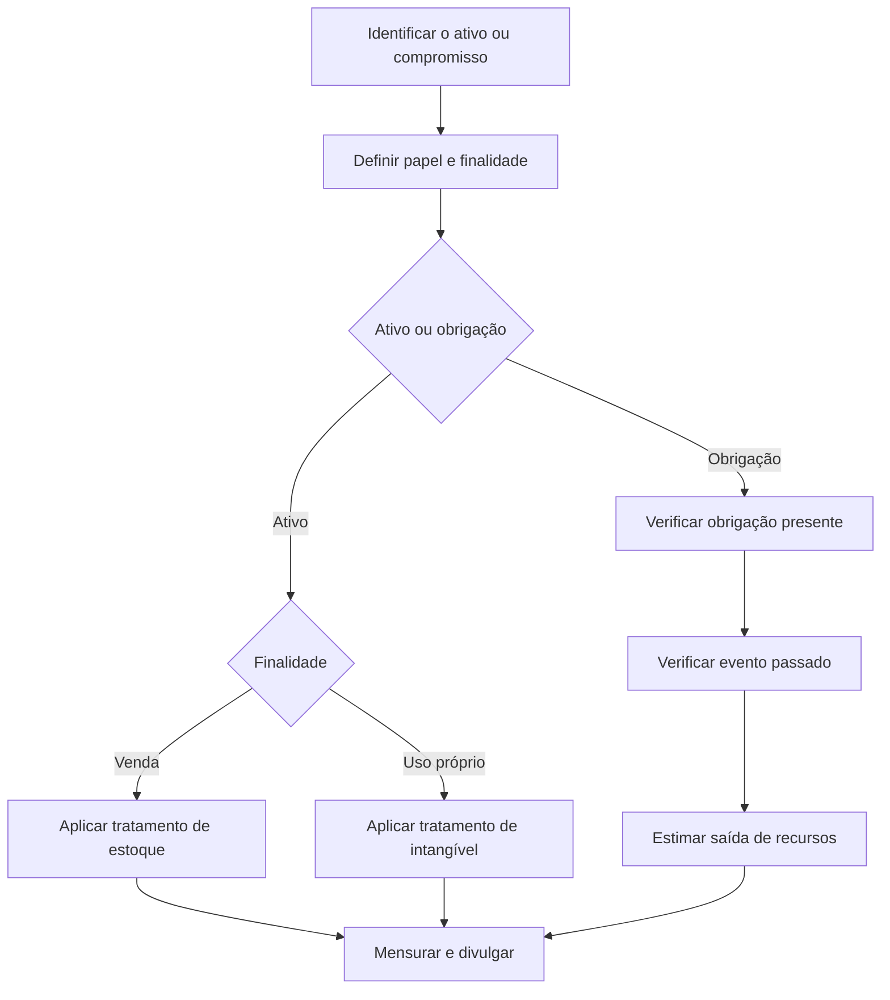

# CTG 10 — Créditos de Carbono (tCO2e), Permissões de emissão (allowances) e Crédito de Descarbonização (CBIO)

> [!abstract] Resumo em 30 segundos
> O CTG 10 orienta o reconhecimento, a mensuração, a apresentação e a divulgação de créditos de carbono (tCO₂e), permissões de emissão (*allowances*) e CBIOs, além de passivos por compromissos de compensação ou neutralização de emissões. O tratamento depende do papel econômico da entidade — originadora, intermediária ou usuária final — e da finalidade de manter os ativos. Compromissos ambientais podem gerar provisão quando houver obrigação presente decorrente de emissões já realizadas e for esperada saída de recursos.

## Ficha rápida

| Campo | Informação |
|---|---|
| Norma | CTG 10 — Créditos de Carbono (tCO₂e), Permissões de Emissão (*Allowances*) e Crédito de Descarbonização (CBIO) |
| Aprovação | 12 de dezembro de 2024 |
| Publicação indicada no título da nota | DOU de 16/12/2024 |
| Aplicação | Exercícios sociais iniciados em ou após 1º de janeiro de 2025 |
| Tema central | Reconhecimento, mensuração, apresentação e divulgação dos ativos tratados e dos passivos associados |
| Base técnica | Orientação Técnica OCPC 10 e normas contábeis existentes, conforme descrito no Comunicado |

## Objetivo e alcance

O Comunicado estabelece critérios contábeis para eventos ligados à originação, aquisição, negociação e aposentadoria de créditos de carbono, permissões de emissão e CBIOs. Também trata de passivos relacionados a obrigações legais ou não formalizadas de compensação ou neutralização de emissões de gases de efeito estufa (GEE), à luz da NBC TG 25.

O CTG 10 não trata de questões tributárias ou jurídicas. O texto prioriza a essência econômica do evento, em vez de se limitar à forma jurídica. Embora seja voltado aos instrumentos especificados, seus requerimentos podem servir de referência para outros créditos ambientais quando a substância econômica for similar.

## Conceitos-chave

| Termo | Síntese do conceito |
|---|---|
| **Crédito de carbono (tCO₂e)** | Direito originado de projeto certificado que reduza ou evite emissões de GEE, ou que sequestra ou remova esses gases. É um ativo não financeiro, incorpóreo e sem substância física. |
| **Allowance** | Permissão emitida pelo governo para emitir GEE dentro de um programa regulado. Não é, por si só, crédito de carbono. |
| **CBIO** | Crédito de Descarbonização do RenovaBio, associado à comercialização de biocombustíveis e utilizado no cumprimento das metas aplicáveis aos distribuidores de combustíveis. |
| **Originador** | Controla recursos econômicos que podem gerar os ativos tratados e, em geral, os origina para venda. |
| **Intermediário** | Compra e vende os ativos. Pode ser *broker-trader*, conforme os critérios da NBC TG 16. |
| **Usuário final** | Adquire os ativos para aposentadoria e cumprimento de metas ou compromissos ambientais. |
| **Aposentadoria** | Cancelamento ou retirada do ativo de circulação para comprovar o cumprimento de compromisso ambiental. A simples aquisição não extingue a obrigação. |

Os ativos não são classificados como instrumentos financeiros apenas por serem negociáveis. O Comunicado ressalva que determinados contratos de compra e venda para liquidação futura, com crédito de carbono como ativo subjacente, podem se enquadrar como instrumentos financeiros se atenderem aos critérios da NBC TG 39.

## Mercados e modelos de negócio

O Comunicado distingue mercados **compulsórios**, nos quais há interferência governamental, e **voluntários**, nos quais as transações decorrem de decisões espontâneas das partes. Uma entidade pode desempenhar mais de um papel econômico e manter ativos para finalidades diferentes. A classificação e o tratamento contábil devem refletir a finalidade efetiva: venda no curso normal dos negócios ou uso próprio para compensação.

No contexto dos programas *cap and trade*, o governo define um limite de emissões e os participantes devem entregar permissões correspondentes às emissões do período. Para esses programas, o CTG 10 adota o modelo **Government Grant**, com reconhecimento da subvenção pelo valor justo e apresentação integral dos ativos e passivos pertinentes, em vez de omitir permissões recebidas gratuitamente ou apresentar apenas a parcela líquida descoberta.

## Diagrama do processo contábil

## Aplicação passo a passo — checklist

1. **Identifique o instrumento:** crédito de carbono, allowance ou CBIO. Verifique se o direito está certificado, emitido ou em processo de emissão, conforme aplicável.
2. **Determine o papel da entidade:** originadora, intermediária ou usuária final. Considere que uma mesma entidade pode acumular papéis.
3. **Defina a finalidade de cada posição:** venda no curso normal dos negócios, negociação como *broker-trader* ou aposentadoria para compensar emissões próprias.
4. **Classifique o ativo:** em geral, estoque quando mantido para venda; ativo intangível em rubrica específica quando mantido para uso próprio.
5. **Avalie passivos ambientais:** examine obrigações legais e também declarações, políticas e práticas públicas que possam criar expectativa válida em terceiros.
6. **Identifique o fato gerador:** reconheça provisão somente quando houver obrigação presente decorrente de evento passado. Para compromissos de compensação, considere as emissões já realizadas.
7. **Mensure e apresente:** aplique o modelo pertinente ao instrumento e à finalidade; não compense ativos e passivos salvo quando permitido ou exigido.
8. **Divulgue políticas, julgamentos, estimativas e quantidades relevantes**, incluindo informações específicas de CBIOs e projetos, quando aplicável.

## Reconhecimento e mensuração

### Créditos de carbono (tCO₂e)

- **Originador que mantém créditos para comercialização:** reconhece estoque pelo custo; subsequentemente, pelo menor entre custo e valor realizável líquido. Gastos de originação que atendam aos critérios de capitalização da NBC TG 04 são reconhecidos inicialmente como intangível e apropriados ao estoque conforme os períodos a que se referem.
- **Intermediário:** reconhece estoque pelo custo e aplica, em regra, o menor entre custo e valor realizável líquido. Se atender à definição de *broker-trader*, pode adotar valor justo menos custos de venda. Caso use custo ou valor realizável líquido, deve divulgar o valor justo menos custos de venda.
- **Usuário final:** reconhece o crédito em rubrica específica de intangível, com mensuração inicial pelo custo de aquisição ou geração e mensuração subsequente conforme a NBC TG 04.

### Permissões de emissão (*allowances*)

O intermediário reconhece as permissões mantidas para venda como estoque: custo na mensuração inicial e, subsequentemente, menor entre custo e valor realizável líquido. Um *broker-trader* pode usar valor justo menos custos de venda. Se também utilizar permissões para cumprir obrigações próprias, aplica a contabilização de usuário final a essas permissões.

Para o usuário final de programas do tipo *cap and trade*, o CTG 10 adota o modelo **Government Grant**. As permissões recebidas gratuitamente são registradas inicialmente pelo valor justo, nos termos da NBC TG 07. A provisão pelas emissões deve refletir o valor contábil das permissões detidas que cobrem a obrigação; a parcela não coberta é mensurada pela melhor estimativa do desembolso necessário para liquidá-la. Apresentam-se integralmente os ativos e a provisão, sem compensação.

### CBIO

- **Originador:** os gastos diretamente relacionados à emissão são apropriados ao custo dos CBIOs até o fim do processo de emissão. O ativo é reconhecido como estoque, com contrapartida de subvenção governamental. Ao final da emissão, o CBIO é mensurado pelo valor justo, e a contrapartida dessa mensuração é reconhecida diretamente no resultado, pois as condições para obtenção já foram cumpridas. Subsequentemente, o valor justo é utilizado como custo atribuído, ajustado ao valor realizável líquido se este for menor.
- **Intermediário:** observa a NBC TG 16. O *broker-trader* pode mensurar o estoque pelo valor justo menos custos de venda, com variações reconhecidas no resultado. Se optar pelo custo histórico, divulga o valor justo menos custos de venda.
- **Usuário final — distribuidor de combustíveis:** reconhece mensalmente provisão à medida que comercializa combustíveis fósseis, pela melhor estimativa do desembolso para cumprir a obrigação. CBIOs adquiridos para esse fim são registrados em rubrica específica de intangível; a baixa do ativo ocorre contra o passivo quando da aposentadoria.

### Passivos por compromissos de descarbonização

Uma provisão requer, cumulativamente, obrigação presente, obrigação decorrente de eventos passados e expectativa de saída de recursos. Compromissos públicos voluntários precisam ser avaliados caso a caso: uma política ou declaração pode criar expectativa válida em terceiros, mas a existência dessa expectativa, por si só, não elimina a necessidade de avaliar os demais critérios.

Para compromissos de compensação ou neutralização, o passivo é reconhecido na medida em que ocorram as emissões a que o compromisso se refere. Não se provisionam emissões futuras nem gastos futuros de operação apenas por haver um compromisso. A mensuração corresponde à melhor estimativa da saída de recursos: para a parcela coberta por créditos já adquiridos ou gerados, considera-se o custo de aquisição ou geração do lastro; para a parcela descoberta, estima-se a saída necessária para adquirir ou gerar os créditos.

A contrapartida da provisão depende da origem das emissões: estoque, se ligadas ao processo produtivo; ativos em formação, se ligadas à formação de imobilizado ou intangível; ou resultado, se relacionadas a processos administrativos ou comerciais, ou se não puderem ser alocadas de modo confiável e não arbitrário.

## Divulgação

As notas explicativas devem permitir que o usuário compreenda o modelo de negócio, a política contábil e os julgamentos e estimativas relevantes. A materialidade deve ser considerada tanto quantitativa quanto qualitativamente.

Divulgações específicas destacadas no Comunicado:

- **Créditos de carbono:** modelo de negócio e processo de reconhecimento e mensuração.
- **CBIOs do originador:** quantidade em estoque e quantidade em processo de emissão.
- **CBIOs do distribuidor usuário final:** meta preliminar, enquanto não houver meta definitiva; quantidade e valor dos CBIOs adquiridos; e valor da provisão referente aos CBIOs ainda a adquirir.
- **Passivos ambientais:** natureza da obrigação, cronograma esperado de saídas de recursos e principais premissas e incertezas. Se o julgamento sobre a existência ou mensuração do passivo for significativamente incerto, divulgar os julgamentos relevantes.
- **Investimentos de longo prazo relacionados a compromissos de redução:** objetivos, etapa e prazo do projeto; incertezas de recuperação do investimento; comparação entre valores realizados e estimados; e alterações em relação ao projeto original.

## Exceções e erros comuns

> [!warning] Pontos de atenção
> - Não classifique créditos de carbono, allowances ou CBIOs automaticamente como ativos financeiros: o CTG 10 os trata como ativos não financeiros nos casos descritos.
> - Não use a mesma classificação para todos os ativos da entidade: finalidade de venda e finalidade de uso próprio podem levar a apresentações diferentes.
> - Não reconheça provisão apenas porque existe uma meta ambiental anunciada. Avalie se há obrigação presente, evento passado e expectativa de saída de recursos.
> - Não reconheça provisão por emissões futuras de GEE.
> - Não considere a simples aquisição de crédito de carbono suficiente para extinguir o passivo: a obrigação é extinta com a aposentadoria do crédito.
> - Não compense créditos e provisões de neutralização ou compensação; o Comunicado determina apresentação separada.
> - Para *broker-traders*, observe os requisitos de divulgação quando a entidade adotar mensuração pelo custo em vez de valor justo menos custos de venda.

> [!tip] Julgamento sobre compromissos voluntários
> Especificidade da declaração, aprovação e detalhamento dos planos, prazo das ações e evidências públicas de progresso ou de descumprimento são fatores que podem afetar a avaliação de expectativa válida em terceiros. O risco reputacional, isoladamente, não determina a existência de passivo, embora possa ser considerado no julgamento.

## Conexões com outras normas

O CTG 10 relaciona explicitamente os tratamentos, entre outras, às seguintes normas: NBC TG 04 (Ativo Intangível), NBC TG 07 (Subvenção e Assistência Governamentais), NBC TG 16 (Estoques), NBC TG 25 (Provisões, Passivos Contingentes e Ativos Contingentes), NBC TG 26 (Apresentação das Demonstrações Contábeis), NBC TG 39 (Instrumentos Financeiros: Apresentação), NBC TG 46 (Mensuração do Valor Justo), NBC TG 47 (Receita de Contrato com Cliente) e NBC TG 23 (Políticas Contábeis, Mudança de Estimativa e Retificação de Erro).

## Fonte

**CTG 10 — Créditos de Carbono (tCO₂e), Permissões de Emissão (*Allowances*) e Crédito de Descarbonização (CBIO)**, aprovado pelo CFC em 12 de dezembro de 2024. PDF fornecido: `CTG 10.pdf`. A data de aplicação indicada no texto é 1º de janeiro de 2025, para exercícios sociais iniciados nessa data ou após ela.
