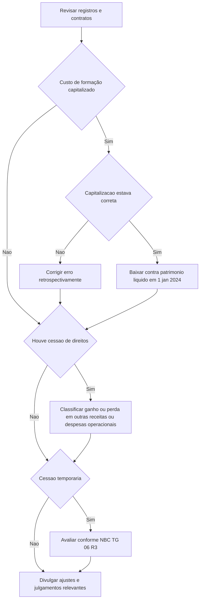

# OTG 2003 (R1) — OTG 2003 – Orientações sobre a aplicação da ITG 2003 (R1) - Entidade Desportiva

> [!abstract] Resumo em 30 segundos
> A OTG orienta a transição da ITG 2003 (R2) no exercício de 2024, para entidades desportivas profissionais e não profissionais. Desde 1º de janeiro de 2024, custos de formação de atletas não devem ser reconhecidos como ativo intangível: as despesas de formação são reconhecidas no resultado, e os saldos anteriores devem ser analisados e baixados. Ganhos e perdas na baixa de intangíveis ligados a direitos profissionais de atletas são apresentados em outras receitas e despesas operacionais, não como receita de venda. Cessões temporárias devem ser avaliadas conforme a NBC TG 06 (R3), com revisão dos contratos anteriores e divulgação dos efeitos.

## Ficha rápida

| Campo | Síntese |
|---|---|
| Norma | OTG 2003 (R1) — orientações sobre a aplicação da ITG 2003 (R2) |
| Grupo | 05 - OTG |
| Entidades abrangidas | Entidades desportivas profissionais e não profissionais |
| Foco da orientação | Transição em 2024: formação de atletas, ganhos ou perdas em cessões e cessões temporárias |
| Normas relacionadas citadas | NBC TG 23, NBC TG 26 (R5), NBC TG 06 (R3) e ITG 2003 (R2) |
| Vigência | O texto final declara que a Orientação entra em vigor na data de sua divulgação. |

## Objetivo e alcance

A OTG visa orientar a aplicação da ITG 2003 (R2), com destaque para as regras de transição a serem implementadas no exercício encerrado em 31 de dezembro de 2024. Aplica-se a entidades desportivas profissionais e não profissionais.

A orientação também afirma que, após a transição, a ITG 2003 e sua alteração (R1) perdem efeito, e que as entidades passam a seguir os princípios de contabilidade e as normas, interpretações e comunicados técnicos editados pelo CFC, observadas as particularidades de apresentação aplicáveis.

## Conceitos-chave

- **Custos de formação de atletas:** a partir de 1º de janeiro de 2024, não são mais reconhecidos como ativo intangível; as despesas de formação são reconhecidas integralmente no resultado.
- **Saldo anterior de intangível:** deve ser analisado para distinguir valores capitalizados incorretamente de valores reconhecidos adequadamente segundo as regras aplicáveis.
- **Erro contábil:** valores capitalizados em desacordo com a ITG 2003 (R2) são corrigidos retrospectivamente conforme a NBC TG 23.
- **Baixa de intangível:** os ganhos ou perdas decorrentes da baixa de ativo intangível relacionado à cessão de direitos profissionais sobre atletas são classificados em outras receitas e despesas operacionais.
- **Cessão temporária:** deve ser avaliada e contabilizada conforme a NBC TG 06 (R3), inclusive quanto à classificação como arrendamento financeiro ou operacional.
- **Transição:** o período indicado pela OTG vai de 1º de janeiro a 31 de dezembro de 2024.

## Diagrama de decisão

## Aplicação passo a passo — checklist

1. **Identifique os saldos e contratos afetados.** Levante os intangíveis relacionados à formação de atletas, as transações de cessão de direitos profissionais e os contratos de cessão temporária, inclusive os celebrados anteriormente.
2. **Analise os saldos de formação em 31 de dezembro de 2023.** Separe:
   - valores que não atendiam às regras de capitalização;
   - valores que foram corretamente reconhecidos como intangíveis segundo a ITG 2003 (R2).
3. **Corrija os valores indevidos.** Trate a capitalização incorreta como erro contábil e aplique a NBC TG 23, com correção retrospectiva e ajuste dos saldos de abertura dos períodos comparativos.
4. **Baixe os valores anteriormente reconhecidos de forma adequada.** O saldo de custos de formação reconhecido corretamente deve ser eliminado do intangível em 1º de janeiro de 2024, contra lucros ou prejuízos acumulados, superávits ou déficits acumulados, ou outro componente do patrimônio líquido, conforme apropriado.
5. **Passe a reconhecer os novos gastos de formação no resultado.** A partir de 1º de janeiro de 2024, não capitalize esses custos como ativo intangível.
6. **Reavalie a apresentação de ganhos e perdas.** Revise as transações de cessão de direitos profissionais e apresente os efeitos da baixa do intangível em outras receitas e despesas operacionais.
7. **Revise as cessões temporárias.** Avalie cada contrato conforme a NBC TG 06 (R3), classifique-o e determine os registros e divulgações aplicáveis.
8. **Reapresente informações comparativas quando houver erro.** Inclua os ajustes retrospectivos necessários para fins de comparabilidade.
9. **Prepare as notas explicativas.** Explique a natureza dos ajustes, seus valores, a classificação contábil adotada e os impactos nas demonstrações financeiras.

> [!warning] Não confunda os dois tratamentos dos saldos antigos
> A OTG distingue a correção de valores **capitalizados incorretamente**, tratada como erro e ajustada retrospectivamente, da baixa de valores **reconhecidos adequadamente** como intangível, que é feita contra o patrimônio líquido na abertura de 2024.

## Reconhecimento e mensuração

### Custos de formação de atletas

A partir de 1º de janeiro de 2024, as despesas de formação devem ser integralmente reconhecidas no resultado do exercício. A entidade deve eliminar do balanço qualquer saldo relacionado à formação de atletas.

Para os saldos existentes em 31 de dezembro de 2023, a sequência é:

| Situação do valor registrado | Tratamento indicado |
|---|---|
| Capitalização em desacordo com a ITG 2003 (R2) | Corrigir como erro, conforme NBC TG 23, retrospectivamente |
| Capitalização adequada segundo a ITG 2003 (R2) | Baixar integralmente em 1º de janeiro de 2024 contra componente apropriado do patrimônio líquido |

A OTG apresenta um exemplo de retificação de erro em que parte do saldo é atribuída a exercícios anteriores e parte ao exercício de 2023. O exemplo demonstra ajustes no intangível, no patrimônio líquido e na demonstração do resultado, além da reapresentação de demonstrações comparativas. É ilustrativo; os valores e percentuais do exemplo não são parâmetros gerais.

### Ganhos e perdas em cessões de direitos

Ganhos oriundos de alienações de intangível relacionadas à cessão de direitos profissionais sobre atletas não devem ser classificados como receita de venda. Ganhos ou perdas na baixa do intangível são apresentados em conta representativa de **outras receitas e despesas operacionais**, conforme a estrutura indicada pela NBC TG 26 (R5).

Se a classificação anterior estiver errada, a entidade deve aplicar a NBC TG 23 e reapresentar os dados retrospectivamente para comparabilidade. O material ilustrativo observa que a mudança pode afetar indicadores calculados a partir do resultado bruto; não use a receita bruta da cessão como se fosse o ganho líquido na baixa.

### Cessões temporárias e arrendamentos

A entidade deve avaliar os contratos de cessão temporária conforme a NBC TG 06 (R3), considerando seus termos e a transferência de riscos e benefícios econômicos relacionados aos direitos sobre o atleta. A OTG orienta revisar e reclassificar, durante 2024, as cessões temporárias realizadas anteriormente.

Quando a classificação levar ao tratamento de arrendamento financeiro, a orientação prevê reconhecimento de ativo e passivo pelo arrendatário, mensuração considerando o valor presente dos pagamentos futuros e amortização do ativo durante o contrato. O cálculo do valor presente utiliza a taxa implícita, se determinável; caso contrário, uma taxa de desconto apropriada às circunstâncias da entidade.

> Valor presente dos pagamentos futuros = soma dos pagamentos futuros descontados pela taxa aplicável.

Para arrendamento operacional, a OTG orienta que a entidade cedente reconheça a receita de cessão linearmente durante o prazo do contrato e reconheça despesas associadas conforme o regime de competência.

A orientação menciona a isenção de reconhecimento para arrendamentos de curto prazo e de baixo valor, nos termos do item 5 da NBC TG 06 (R3). Também informa que o arrendatário pode, mas não é obrigado a, aplicar a NBC TG 06 (R3) a arrendamentos de ativo intangível, conforme o item 4 dessa norma.

## Divulgação

As notas explicativas devem abordar, conforme o tema:

- **Baixa dos intangíveis de formação:** natureza e valor dos ativos eliminados; impacto no resultado acumulado ou em outro componente patrimonial; e razões para a mudança, incluindo a convergência mencionada pela OTG.
- **Ganhos e perdas em cessões de direitos:** natureza e valor dos ganhos ou perdas; classificação em outras receitas e despesas operacionais; e ajustes retrospectivos realizados por erro.
- **Cessões temporárias:** natureza, termos, prazo, valores e clubes participantes; critérios de classificação; impactos financeiros; tratamento das isenções; e posicionamento do arrendatário quanto à faculdade de aplicação para ativos intangíveis.

A divulgação dos arrendamentos deve observar os aspectos indicados pela NBC TG 06 (R3), itens 51 a 60A, conforme citados pela OTG.

## Exceções e erros comuns

> [!danger] Erros que podem distorcer a transição
> - Manter no ativo custos de formação de atletas após a mudança indicada para 1º de janeiro de 2024.
> - Tratar como simples baixa no patrimônio líquido valores que foram capitalizados incorretamente; esses valores exigem correção retrospectiva como erro.
> - Classificar o ganho ou a perda na baixa do intangível como receita de venda.
> - Deixar de revisar contratos de cessão temporária celebrados antes de 2024.
> - Omitir das notas explicativas a natureza e os efeitos dos ajustes.

A dispensa de reconhecimento mencionada para arrendamentos de curto prazo e de baixo valor e a faculdade relativa a arrendamentos de ativo intangível são pontos específicos da NBC TG 06 (R3), conforme descritos pela OTG. A entidade deve avaliar sua aplicação e explicá-la nas notas.

## Conexões com outras normas

- **NBC TG 23 — Políticas Contábeis, Mudança de Estimativa e Retificação de Erro:** base indicada para correção retrospectiva de erros e reapresentação para comparabilidade.
- **NBC TG 26 (R5) — Apresentação das Demonstrações Contábeis:** referência para classificar ganhos e perdas em outras receitas e despesas operacionais.
- **NBC TG 06 (R3) — Arrendamentos:** referência para avaliar, classificar, reconhecer e divulgar cessões temporárias.
- **ITG 2003 (R2) — Entidade Desportiva:** norma cuja aplicação e transição são objeto da orientação.

## Fonte

CFC, **Norma Brasileira de Contabilidade, OTG 2003 (R1)**, texto técnico e exemplos ilustrativos, páginas 1–12 do PDF *OTG 2003 (R1).pdf*.
